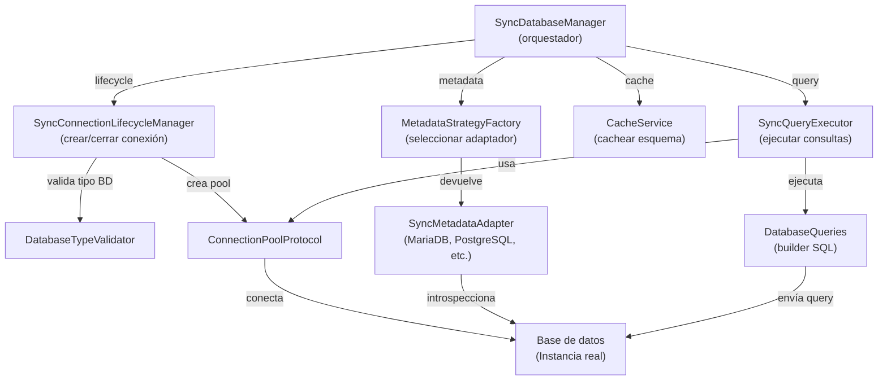

# SyncDatabaseManager - Referencia técnica

## Responsabilidad

Orquestar el ciclo de vida completo de conexiones sincrónicas a múltiples tipos de bases de datos, delegando tareas especializadas a componentes dedicados (Lifecycle, Metadata, Query, Cache).

## Diagrama de componentes y flujo



## Métodos públicos

| Método | Parámetros | Retorna | Descripción |
|--------|-----------|---------|------------|
| `__init__` | `db_type`, credenciales, `pool_config` | - | Constructor; valida tipo BD e inicializa pool |
| `introspect()` | - | `DatabaseSchema` | Obtiene esquema: tablas, columnas, constraints, índices |
| `execute(query)` | `query: str` | `Rows` (list) | Ejecuta SELECT; devuelve filas |
| `close()` | - | - | Cierra todas las conexiones y libera recursos |
| `__enter__` / `__exit__` | - | - | Context manager (with statement) |

## Contrato de entrada

| Parámetro | Tipo | Ejemplo | Restricción |
|-----------|------|---------|------------|
| `db_type` | `str` | `"postgresql"` | Debe estar en lista de drivers soportados |
| `host` | `str` | `"localhost"` | Hostname o IP válida |
| `port` | `int` | `5432` | 1-65535 |
| `user` | `str` | `"analyst"` | No vacío |
| `password` | `str` | `"secret"` | Puede ser vacío (BD local) |
| `database` | `str` | `"mydb"` | Nombre de base de datos |
| `pool_config` | `dict` (opt) | `{"min_size": 2, "max_size": 10}` | Opcional |

## Contrato de salida

### `introspect()` → `DatabaseSchema`

```python
{
    "tables": [
        {
            "name": "users",
            "columns": [
                {
                    "name": "id",
                    "type": "INT",
                    "nullable": False,
                    "primary_key": True
                },
                {
                    "name": "email",
                    "type": "VARCHAR(255)",
                    "nullable": False,
                    "unique": True
                }
            ],
            "constraints": [
                {
                    "name": "fk_users_org",
                    "type": "FOREIGN KEY",
                    "columns": ["org_id"],
                    "references_table": "organizations"
                }
            ],
            "indexes": [...]
        }
    ]
}
```

### `execute(query)` → `Rows` (list of dicts)

```python
[
    {"id": 1, "name": "Alice", "created": "2026-01-15"},
    {"id": 2, "name": "Bob", "created": "2026-02-01"}
]
```

## Errores y excepciones

| Excepción | Causa probable | Acción recomendada |
|-----------|---|---|
| `ConnectionError` | Credenciales inválidas o BD no accesible | Verificar host, puerto, usuario, contraseña |
| `DatabaseConfigurationError` | Pool mal configurado | Revisar `pool_config` (min_size < max_size) |
| `DatabaseOperationError` | Query con error de sintaxis o permiso insuficiente | Revisar query SQL y permisos de usuario |
| `DriverError` | Driver para tipo de BD no instalado | Instalar dependencia (e.g., `pip install psycopg2-binary`) |
| `ValidationError` | Parámetro de entrada inválido | Revisar tipos y rangos en tabla "Contrato de entrada" |

## Patrones de uso

### Patrón 1: Context Manager (recomendado)

```python
with SyncDatabaseManager(db_type="postgresql", ...) as mgr:
    schema = mgr.introspect()
    result = mgr.execute("SELECT * FROM users")
# Cierre automático
```

### Patrón 2: Manual (legacy)

```python
mgr = SyncDatabaseManager(db_type="mysql", ...)
try:
    result = mgr.execute("SELECT COUNT(*) FROM orders")
finally:
    mgr.close()  # Crítico: debe ejecutarse
```

### Patrón 3: Pipeline de datos

```python
with SyncDatabaseManager(db_type="snowflake", ...) as mgr:
    for table in mgr.introspect().tables:
        rows = mgr.execute(f"SELECT * FROM {table.name}")
        save_to_csv(rows, f"output/{table.name}.csv")
```

## Limitaciones conocidas

- **Redshift**: Constraints son solo `advisory` (no son enforced por la BD)
- **Snowflake**: No hay soporte para constraints ni índices (no están disponibles en Snowflake)
- **SQLite**: No soporta transacciones distribuidas ni foreign keys enforced por defecto
- **All**: Una sola operación a la vez por manager (no multithread)

---

*Generado por Documentation Generator - Fase 3: Documentación técnica*
