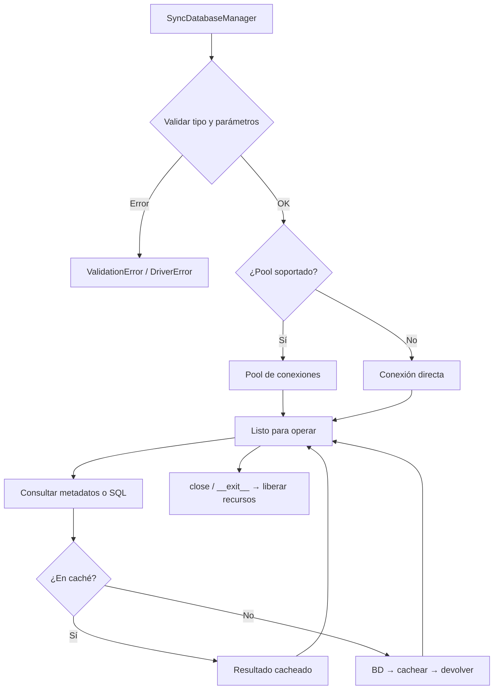

# Manager Síncrono (SyncDatabaseManager)

Gestor síncrono del ciclo de vida completo de una conexión de base de datos multi-motor: abre la conexión (pool o directa), expone introspección de metadatos y ejecución de consultas, y libera los recursos al cerrar.

## 1. Arquitectura y Diseño

## 2. Modelo de Datos / Contratos

### API pública

| Función/Clase | Firma simplificada | Descripción | Retorna |
|---|---|---|---|
| `SyncDatabaseManager` | `(db_type, conn_params, queries_file?, use_pool?)` | Crea el gestor y abre la conexión | `SyncDatabaseManager` |
| `get_tables` | `()` | Lista de tablas | `Rows` |
| `get_views` | `()` | Lista de vistas | `Rows` |
| `get_routines` | `()` | Lista de rutinas | `Rows` |
| `get_columns` | `(tabla)` | Columnas de una tabla | `Rows` |
| `get_tables_normalized` | `()` | Tablas en formato normalizado homogéneo | `list[NormalizedTableRow]` |
| `get_columns_normalized` | `(tabla)` | Columnas en formato normalizado | `list[NormalizedColumnRow]` |
| `get_ddl` | `(tabla)` | DDL de una tabla | `str` |
| `get_view_ddl` | `(vista)` | DDL de una vista | `str` |
| `get_indices` | `(tabla)` | Índices de una tabla | `Rows` |
| `get_primary_keys` | `(tabla)` | Claves primarias | `Rows` |
| `get_foreign_keys` | `(tabla)` | Claves foráneas | `Rows` |
| `get_routine_ddl` | `(rutina, tipo_rutina)` | DDL de una rutina | `str` |
| `get_database_version` | `()` | Versión del motor | `str` |
| `get_storage_inventory` | `(tablespace?)` | Inventario de almacenamiento | `dict[str, Any]` |
| `execute_query_many` | `(query_name, timeout?, **kwargs)` | Query registrada → varias filas | `Rows` |
| `execute_custom_many` | `(sql, params?, timeout?)` | SQL libre → varias filas | `Rows` |
| `execute_custom_one` | `(sql, params?, timeout?)` | SQL libre → una fila | `RowOrNone` |
| `get_sqlalchemy_engine` | `()` | Engine SQLAlchemy configurado | `Engine` |
| `close` | `(timeout_seconds?, force?)` | Cierra el gestor y libera recursos | `None` |
| `get_supported_db_types` | `()` *(estático)* | Tipos de BD soportados | `list[str]` |

### Contrato de entrada

| Parámetro | Tipo | Descripción | Restricciones |
|---|---|---|---|
| `db_type` | `str` | Tipo de motor | Uno de: `mariadb`, `oracle`, `postgresql`, `sqlite`, `hsqldb`, `sqlserver` |
| `conn_params` | `dict[str, Any]` | Parámetros de conexión | Debe incluir `database`; motor-específicos adicionales |
| `use_pool` | `bool` | Activar pool | Default `True`; cae a conexión directa si no soportado |
| `timeout` | `float \| None` | Timeout en segundos | `None` = sin límite |
| `tablespace` | `str \| None` | Tablespace para inventario | Requerido en Oracle y PostgreSQL |

### Contrato de salida

- **`Rows`** — `list[tuple[Any, ...]]`; orden y tipos dependientes del motor.
- **`NormalizedTableRow`** / **`NormalizedColumnRow`** — dataclasses tipados con campos homogéneos entre motores.
- **`RowOrNone`** — una sola tupla si hay resultado, `None` si no hay filas.
- **`Engine`** — instancia SQLAlchemy lista para `BulkCrud` u otras operaciones.
- Todos los métodos de metadatos devuelven resultados cacheados en la segunda llamada.

### Errores y casos especiales

| Error | Cuándo ocurre |
|---|---|
| `ValidationError` | `db_type` no reconocido o `conn_params` falta `database` |
| `DriverError` | El driver Python del motor no está instalado |
| `ConnectionError` | No se puede establecer conexión con el servidor |
| `QueryError` | Error en ejecución de `execute_custom_*` o `execute_query_*` |

## 3. Componentes y Clases

*No aplica para este módulo.* `SyncDatabaseManager` es la única clase pública de este módulo; su descomposición interna (lifecycle, metadata, query, cache) está documentada en los módulos `managers-lifecycle`, `metadata-manager` y `query-system`.

## 4. Dependencias y Requisitos

| Dependencia | Propósito | Requerida | Comportamiento sin ella |
|---|---|---|---|
| `SyncConnectionLifecycleManager` (interno) | Gestión del ciclo de vida de la conexión | Sí | Módulo no funciona |
| `MetadataStrategyFactory` (interno) | Selección de estrategia de metadatos por motor | Sí | Módulo no funciona |
| `SyncQueryExecutor` (interno) | Ejecución de consultas | Sí | Módulo no funciona |
| Driver Python del motor | Conexión nativa con la BD | Sí (motor-específico) | `DriverError` al inicializar |

## 5. Ejemplos Relacionados

- [Ejemplo: Conectar e Introspeccionar Base de Datos](../examples/example-connect-introspect.md) — Conexión básica, listado de tablas y columnas con `SyncDatabaseManager`
