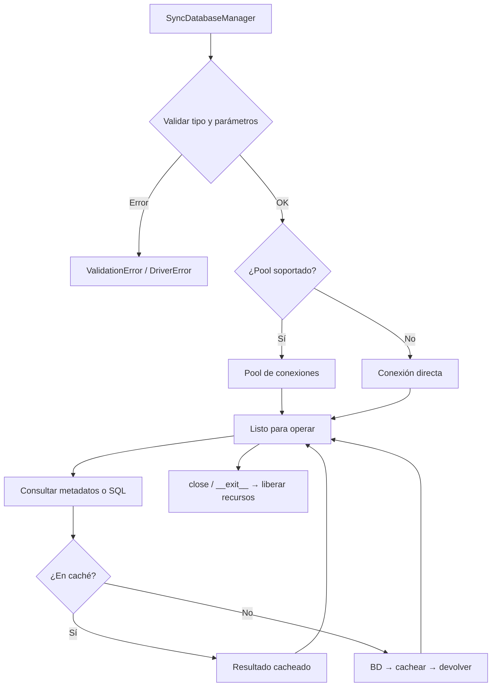

## Responsabilidad del módulo

Gestor síncrono del ciclo de vida completo de una conexión de base de datos multi-motor: abre la conexión (pool o directa), expone la API de introspección de metadatos y ejecución de consultas, y libera los recursos al cerrar.

## Diagrama

## API pública

| Función/Clase | Firma simplificada | Descripción | Retorna |
|---|---|---|---|
| `SyncDatabaseManager` | `(db_type, conn_params, queries_file?, use_pool?)` | Crea el gestor y abre la conexión | `SyncDatabaseManager` |
| `get_tables` | `()` | Lista de tablas de la base de datos | `Rows` |
| `get_views` | `()` | Lista de vistas | `Rows` |
| `get_routines` | `()` | Lista de rutinas (procedures y funciones) | `Rows` |
| `get_columns` | `(tabla)` | Columnas de una tabla | `Rows` |
| `get_tables_normalized` | `()` | Tablas en formato normalizado homogéneo | `list[NormalizedTableRow]` |
| `get_columns_normalized` | `(tabla)` | Columnas en formato normalizado homogéneo | `list[NormalizedColumnRow]` |
| `get_ddl` | `(tabla)` | DDL de una tabla | `str` |
| `get_view_ddl` | `(vista)` | DDL de una vista | `str` |
| `get_indices` | `(tabla)` | Índices de una tabla | `Rows` |
| `get_primary_keys` | `(tabla)` | Claves primarias de una tabla | `Rows` |
| `get_foreign_keys` | `(tabla)` | Claves foráneas de una tabla | `Rows` |
| `get_unique_constraints` | `(tabla)` | Restricciones únicas de una tabla | `Rows` |
| `get_routine_parameters` | `(rutina, tipo_rutina)` | Parámetros de una rutina | `Rows` |
| `get_routine_ddl` | `(rutina, tipo_rutina)` | DDL de una rutina | `str` |
| `get_database_version` | `()` | Versión del motor de base de datos | `str` |
| `get_database_charset_collation` | `()` | Charset y collation de la base de datos | `dict[str, Any]` |
| `get_columns_charset_collation` | `(tabla)` | Charset/collation por columna | `list[tuple[str, str\|None, str\|None]]` |
| `get_storage_inventory` | `(tablespace?)` | Inventario de almacenamiento | `dict[str, Any]` |
| `execute_query_many` | `(query_name, timeout?, **kwargs)` | Ejecuta query registrada, retorna varias filas | `Rows` |
| `execute_query_one` | `(query_name, timeout?, **kwargs)` | Ejecuta query registrada, retorna una fila | `RowOrNone` |
| `execute_custom_many` | `(sql, params?, timeout?)` | Ejecuta SQL libre, retorna varias filas | `Rows` |
| `execute_custom_one` | `(sql, params?, timeout?)` | Ejecuta SQL libre, retorna una fila | `RowOrNone` |
| `resolve_query` | `(query_name, **params)` | Resuelve SQL final de una query registrada | `Any` |
| `get_available_queries` | `()` | Nombres de queries disponibles | `list[str]` |
| `get_sqlalchemy_engine` | `()` | Engine SQLAlchemy configurado con el motor actual | `Engine` |
| `get_database_info` | `()` | Información de la conexión y el motor activo | `dict[str, Any]` |
| `get_connection` | `()` | Obtiene conexión del pool o directa | `Any` |
| `close_connection` | `(connection?)` | Devuelve conexión al pool o la cierra | `None` |
| `close` | `(timeout_seconds?, force?)` | Cierra el gestor y libera todos los recursos | `None` |
| `get_supported_db_types` | `()` *(estático)* | Tipos de BD soportados | `list[str]` |
| `is_db_type_supported` | `(db_type)` *(estático)* | Verifica si un tipo de BD está soportado | `bool` |

## Contrato de entrada

| Parámetro | Tipo | Descripción | Restricciones |
|---|---|---|---|
| `db_type` | `str` | Tipo de motor de base de datos | Uno de: `mariadb`, `oracle`, `postgresql`, `sqlite`, `hsqldb`, `sqlserver` |
| `conn_params` | `dict[str, Any]` | Parámetros de conexión | Debe incluir `database`; cada motor requiere parámetros adicionales (`host`, `port`, `user`, `password`) |
| `queries_file` | `Path \| None` | Ruta a JSON con queries personalizadas | Opcional; si se omite, usa las queries predefinidas del motor |
| `use_pool` | `bool` | Activar pool de conexiones | Default `True`; se ignora y cae a conexión directa si el motor no soporta pool |
| `tabla` / `vista` / `rutina` | `str` | Nombre del objeto de base de datos | Sensible a mayúsculas según el motor (Oracle normaliza a mayúsculas) |
| `tipo_rutina` | `str` | Tipo de rutina | `PROCEDURE` o `FUNCTION` |
| `timeout` | `float \| None` | Timeout en segundos para la ejecución | Opcional; sin límite si es `None` |
| `tablespace` | `str \| None` | Nombre del tablespace | Requerido en Oracle y PostgreSQL para inventario de almacenamiento |

## Contrato de salida

- **`Rows`** — `list[tuple[Any, ...]]`. Cada tupla representa una fila; el orden y tipo de campos depende del motor y la consulta.
- **`NormalizedTableRow`** / **`NormalizedColumnRow`** — dataclasses tipados con campos homogéneos entre motores (nombre, tipo, nullable, etc.).
- **`RowOrNone`** — una sola tupla si hay resultado, `None` si no hay filas.
- **`str`** (DDL/versión) — texto plano; el formato varía por motor (`CREATE TABLE` en PostgreSQL, Oracle, etc.).
- **`dict[str, Any]`** (charset, storage, database_info) — diccionario con claves documentadas por motor.
- **`Engine`** (SQLAlchemy) — instancia de `sqlalchemy.engine.base.Engine` lista para usar con `bulk_crud` u otras librerías que requieren SQLAlchemy.

Todos los métodos de metadatos devuelven resultados cacheados en la segunda llamada; el caché vive hasta que se llame a `close()`.

## Errores y casos especiales

| Error | Cuándo ocurre |
|---|---|
| `ValidationError` | `db_type` no reconocido o `conn_params` falta `database` |
| `DriverError` | El driver Python del motor no está instalado |
| `ConnectionError` | No se puede establecer conexión con el servidor |
| `DatabaseConfigurationError` | Error inesperado durante la inicialización |
| `DatabaseOperationError` | Fallo en operación de metadatos o cierre de recursos |
| `QueryError` | Error en ejecución de `execute_custom_*` o `execute_query_*` |

**Casos especiales:**
- SQLite no expone charset/collation: `get_columns_charset_collation()` devuelve lista vacía.
- Oracle: charset/collation por columna solo disponible en versiones ≥ 12.2 con privilegios suficientes; en caso contrario devuelve lista vacía.
- Si `use_pool=True` pero el motor no soporta pool, el gestor cae automáticamente a conexión directa sin error (registra advertencia en log).
- El destructor (`__del__`) intenta cerrar la conexión con `force=True`, pero no garantiza cierre limpio del pool; es preferible usar el context manager o `close()` explícito.
