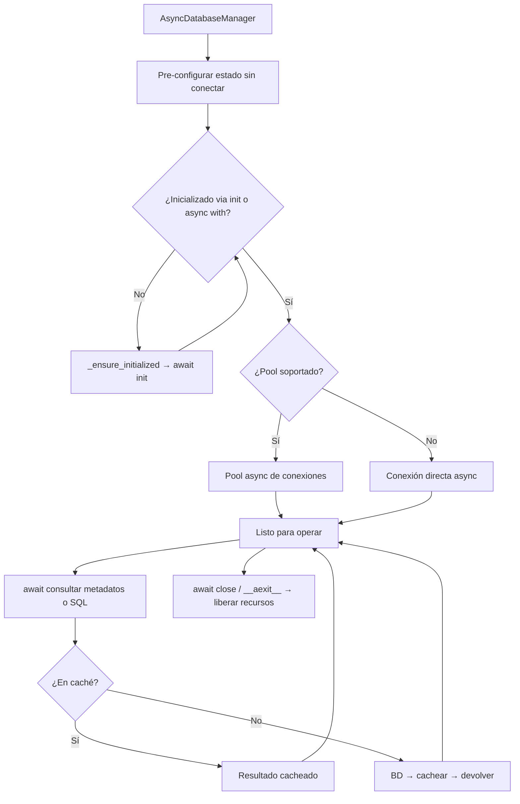

# Manager Asíncrono (AsyncDatabaseManager)

Gestor asíncrono del ciclo de vida de conexiones de base de datos multi-motor: el constructor pre-configura el estado sin conectar; la conexión real se establece en `await init()` o al entrar en un bloque `async with`.

## 1. Arquitectura y Diseño

## 2. Modelo de Datos / Contratos

### API pública

| Función/Clase | Firma simplificada | Descripción | Retorna |
|---|---|---|---|
| `AsyncDatabaseManager` | `(db_type, conn_params, use_pool?)` | Pre-configura sin conectar | `AsyncDatabaseManager` |
| `init` | `async ()` | Abre la conexión; idempotente; retorna `self` | `AsyncDatabaseManager` |
| `__aenter__` / `__aexit__` | `async` | Context manager async | `AsyncDatabaseManager` / `None` |
| `get_tables` | `async ()` | Lista de tablas | `Rows` |
| `get_columns` | `async (tabla)` | Columnas de una tabla | `Rows` |
| `get_tables_normalized` | `async ()` | Tablas en formato normalizado | `list[NormalizedTableRow]` |
| `get_ddl` | `async (tabla)` | DDL de una tabla | `str` |
| `get_indices` | `async (tabla)` | Índices de una tabla | `Rows` |
| `get_primary_keys` | `async (tabla)` | Claves primarias | `Rows` |
| `get_foreign_keys` | `async (tabla)` | Claves foráneas | `Rows` |
| `get_database_version` | `async ()` | Versión del motor | `str` |
| `execute_query_many` | `async (query_name, **params)` | Query registrada → varias filas | `Rows` |
| `execute_custom_many` | `async (sql, params?)` | SQL libre → varias filas | `Rows` |
| `execute_custom_one` | `async (sql, params?)` | SQL libre → una fila | `RowOrNone` |
| `get_sqlalchemy_engine` | `async ()` | AsyncEngine SQLAlchemy | `AsyncEngine` |
| `close` | `async (mode?)` | Cierra el gestor y libera recursos | `None` |
| `get_supported_db_types` | `()` *(estático)* | Tipos de BD soportados | `list[str]` |

### Contrato de entrada

| Parámetro | Tipo | Descripción | Restricciones |
|---|---|---|---|
| `db_type` | `str` | Tipo de motor | Uno de los motores soportados |
| `conn_params` | `dict[str, Any]` | Parámetros de conexión | Debe incluir `database` |
| `use_pool` | `bool` | Activar pool async | Default `True`; cae a conexión directa si no soportado |
| `mode` en `close` | `str \| AsyncCloseMode` | Política de cierre | `"immediate"` (default), `"graceful"` o `"drain"` |

### Contrato de salida

- **`Rows`** — `list[tuple[Any, ...]]`; orden y tipos dependientes del motor.
- **`NormalizedTableRow`** / **`NormalizedColumnRow`** — dataclasses tipados con campos homogéneos.
- **`AsyncEngine`** — instancia async de SQLAlchemy lista para operaciones bulk async.
- **`init()`** — devuelve `self` para encadenamiento: `manager = await AsyncDatabaseManager(...).init()`.
- Todos los métodos de metadatos usan caché en memoria por sesión.

### Errores y casos especiales

| Error | Cuándo ocurre |
|---|---|
| `ValidationError` | `db_type` no reconocido al construir |
| `ConnectionError` | No se puede establecer conexión en `init()` |
| `DatabaseOperationError` | Operación de metadatos fallida o executor no inicializado |
| `QueryNotFoundError` | `query_name` no existe para el motor activo |

**Diferencia crítica respecto a `SyncDatabaseManager`:** el constructor NO conecta. Olvidar el `await init()` no genera error inmediato, pero sí en la primera operación (inicialización perezosa automática).

## 3. Componentes y Clases

*No aplica para este módulo.* `AsyncDatabaseManager` es la única clase pública de este módulo; su descomposición interna está documentada en `managers_lifecycle`.

## 4. Dependencias y Requisitos

| Dependencia | Propósito | Requerida | Comportamiento sin ella |
|---|---|---|---|
| Driver async del motor | Conexión nativa async con la BD | Sí (motor-específico) | `ConnectionError` al inicializar |
| `asyncio` (stdlib) | Event loop para operaciones async | Sí | Python < 3.10 no soportado |
| `sqlalchemy[asyncio]` | Pool async y engine async | Sí | Módulo no funciona |

## 5. Ejemplos Relacionados

- [Ejemplo: Queries Concurrentes (Async)](../examples/async_concurrent_queries.md) — Uso de `AsyncDatabaseManager` con `asyncio.gather()`
