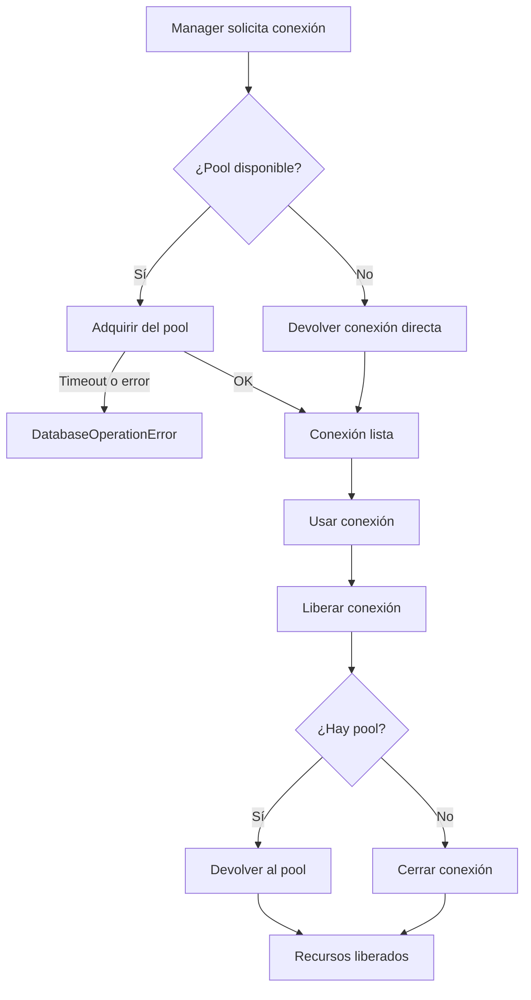

# Ciclo de Vida de Conexiones (managers_lifecycle)

Centraliza la lógica de apertura, adquisición, liberación y cierre de recursos de conexión (pool y directa) para los managers sync y async, con manejo uniforme de errores y logging consistente. Es interno (`managers/_manager_lifecycle.py`): no forma parte de la API pública; los managers lo usan a través de `get_connection()`, `release_connection()` y `close()`.

## 1. Arquitectura y Diseño

## 2. Modelo de Datos / Contratos

### API pública

#### Clase `SyncConnectionLifecycleManager`

| Función/Clase | Firma simplificada | Descripción | Retorna |
|---|---|---|---|
| `SyncConnectionLifecycleManager` | `(db_type, logger)` | Gestiona ciclo de vida de conexiones sincrónicas | `SyncConnectionLifecycleManager` |
| `get_connection` | `(*, pool_connection, connection)` | Obtiene conexión del pool o devuelve la directa | `Any` |
| `release_connection` | `(*, pool_connection, connection)` | Devuelve la conexión al pool o la cierra | `None` |
| `close_resources` | `(*, pool_connection, cursor, connection, timeout_seconds, force)` | Cierra pool, cursor y conexión acumulando errores | `None` |

#### Funciones async de módulo

| Función | Firma simplificada | Descripción | Retorna |
|---|---|---|---|
| `init_async_resources` | `async (*, use_pool, create_pool, create_connection)` | Inicializa recursos async con fallback a conexión directa | `tuple[bool, Any, Any]` |
| `get_async_connection` | `async (*, initialized, ensure_initialized, pool_connection, connection)` | Obtiene conexión async | `Any` |
| `release_async_connection` | `async (*, pool_connection, connection)` | Libera conexión async al pool | `None` |
| `close_async_resources` | `async (*, pool_connection, connection, close_mode, db_type="unknown", logger=None)` | Cierra pool y conexión directa async, acumulando errores | `None` |

### Contrato de entrada

| Parámetro | Tipo | Descripción | Restricciones |
|---|---|---|---|
| `db_type` | `str` | Tipo de motor de base de datos | Solo para mensajes de error y logging |
| `logger` | `logging.Logger` | Logger del manager propietario | No puede ser `None` |
| `pool_connection` | `Any \| None` | Pool de conexiones activo | `None` si se usa conexión directa |
| `connection` | `Any \| None` | Conexión directa activa | `None` si se usa pool |
| `force` | `bool` | Forzar cierre sin esperar | `True` en destructor; `False` en cierre normal |
| `close_mode` | `AsyncCloseMode` | Política de cierre async | `"immediate"` o `"graceful"` (`ValueError` con otro valor) |
| `use_pool` | `bool` | Intentar crear pool async | `True` + falla con `NotImplementedError` → cae a conexión directa |

### Contrato de salida

- `get_connection` / `get_async_connection` — conexión adquirida; tipo opaco dependiente del driver.
- `init_async_resources` — `tuple(use_pool_resuelto: bool, pool_connection, connection)`. Exactamente uno de los dos últimos será distinto de `None`.
- `close_resources` / `close_async_resources` — `None`; intentan cerrar todo, acumulan los errores y lanzan un único `DatabaseOperationError` con todos los detalles (el primero en `__cause__`).
- `release_connection` — `None`; devuelve la conexión al pool o cierra la directa. `release_async_connection` solo la devuelve al pool (sin pool no hace nada: la conexión directa se cierra en `close`). Un error del driver se propaga.

### Errores y casos especiales

| Error | Cuándo ocurre |
|---|---|
| `DatabaseOperationError` | Timeout al obtener del pool, pool devuelve `None`, o no hay conexión disponible |
| `DatabaseOperationError` (acumulado) | `close_resources` / `close_async_resources` fallan en pool, cursor y/o conexión |

## 3. Componentes y Clases

| Clase | Responsabilidad |
|---|---|
| `SyncConnectionLifecycleManager` | Gestión sync de adquisición, liberación y cierre de recursos de conexión |
| Funciones async de módulo | Equivalentes async para `init`, `get`, `release` y `close` de conexiones |

## 4. Dependencias y Requisitos

| Dependencia | Propósito | Requerida | Comportamiento sin ella |
|---|---|---|---|
| `logging` (stdlib) | Registro de operaciones y errores | Sí | Módulo no funciona sin logger |
| `sqlalchemy` (indirecto) | Tipo `Engine` usado por los managers que delegan aquí | Indirecta | *No aplica para este módulo.* |

## 5. Ejemplos Relacionados

- [Ejemplo: Conectar e Introspeccionar Base de Datos](../examples/example_connect_introspect.md) — Ciclo de vida de conexión con context manager

