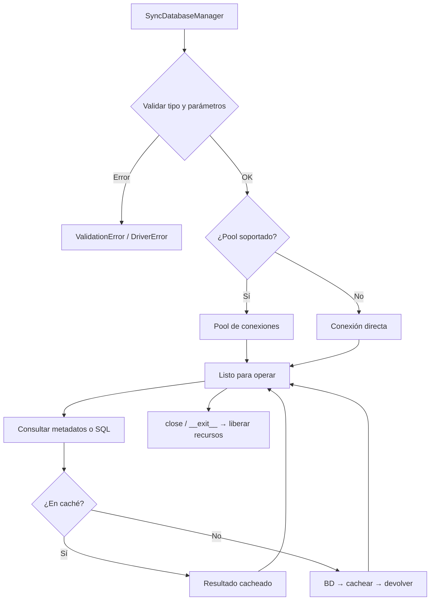

# Manager Síncrono (SyncDatabaseManager)

Gestor síncrono del ciclo de vida completo de una conexión de base de datos multi-motor: abre la conexión (pool o directa), expone introspección de metadatos y ejecución de consultas, y libera los recursos al cerrar.

## 1. Arquitectura y Diseño

## 2. Modelo de Datos / Contratos

### API pública

| Función/Clase | Firma simplificada | Descripción | Retorna |
|---|---|---|---|
| `SyncDatabaseManager` | `(db_type, conn_params, queries_file=None, use_pool=True)` | Crea el gestor y abre la conexión (también como context manager: `with SyncDatabaseManager(...) as m:`) | `SyncDatabaseManager` |
| `init` | `()` | No hace I/O (el manager sync conecta en `__init__`); existe por simetría con `AsyncDatabaseManager.init()` | `Self` |
| `get_schema_metadata` | `(schema=None, *, kinds=ALL_KINDS, tables=None)` | Metadatos del schema con una consulta por tipo de objeto (tablas, columnas, claves, índices, routines…) ([lectura de metadatos](metadata_manager.md)) | `SchemaSnapshot` |
| `ping` | `()` | Comprueba que la conexión responde con una consulta trivial del catálogo (también HSQLDB) y devuelve el tiempo de ida y vuelta en segundos; si no responde, lanza la excepción del driver (desde 4.6.0) | `float` |
| `get_server_version` | `()` | Versión del servidor tal como la informa (`16.4`, `11.4.2-MariaDB`, `19.0.0.0.0`; en SQLite, la de la biblioteca) (desde 4.6.0) | `str \| None` |
| `get_schema_names` | `()` | Schemas visibles, ordenados, con el nombre del catálogo (Oracle `BENCH`, no `bench`; PostgreSQL sin `pg_*`) (desde 4.6.0) | `list[str]` |
| `get_tables` / `get_views` / `get_routines` | `()` | Objetos del schema, del snapshot | `list[TableMeta]` / `list[ViewMeta]` / `list[RoutineMeta]` |
| `get_columns` | `(tabla)` | Columnas de una tabla o vista | `list[ColumnMeta]` |
| `get_primary_keys` | `(tabla)` | Clave primaria | `PrimaryKeyMeta \| None` |
| `get_foreign_keys` / `get_unique_constraints` / `get_indices` | `(tabla)` | Claves foráneas, UNIQUE e índices | `list[ForeignKeyMeta]` / `list[UniqueMeta]` / `list[IndexMeta]` |
| `get_ddl` | `(tabla)` | `CREATE TABLE` de una tabla: en MySQL/MariaDB desde el snapshot; en el resto, el del motor (una consulta por tabla, cacheada) | `str` |
| `get_columns_charset_collation` | `(tabla)` | Columnas con collation propia: `(columna, charset, collation)` (charset solo en MySQL/MariaDB) | `list[tuple]` |
| `get_view_ddl` | `(vista)` | `CREATE VIEW … AS` + definición | `str` |
| `get_routine_ddl` | `(rutina, tipo_rutina)` | Definición de una rutina | `str` |
| `get_routine_parameters` | `(rutina, tipo_rutina)` | Parámetros de una rutina | `list[RoutineParameterMeta]` |
| `get_database_version` | `()` | Versión del motor (`"Unknown"` si no se puede leer) | `str` |
| `get_storage_inventory` | `(tablespace=None)` | Inventario de almacenamiento (`primary`, `temp_tablespaces`, `sqlite_file_summary`); `ValueError` sin `tablespace` en Oracle y PostgreSQL | `dict[str, Any]` |
| `get_storage_rows` | `(query_name, **params)` | Filas de una consulta de `metadata.storage` (`QueryNotFoundError` si el motor no la tiene) | `list[tuple]` |
| `execute_query_many` / `execute_query_one` | `(query_name, timeout=None, **kwargs)` | Query registrada → varias filas / una fila | `Rows` / `RowOrNone` |
| `execute_custom_many` / `execute_custom_one` | `(sql, params=None, timeout=None)` | SQL libre → varias filas / una fila | `Rows` / `RowOrNone` |
| `get_connection` / `release_connection` | `()` / `(connection=None)` | Conexión nativa del pool (o la única) y su devolución | `Any` / `None` |
| `clear_cache` | `(context_database=None, table=None, routine=None, routine_type=None)` | Invalida la caché de metadatos (toda o por schema, tabla o rutina) | `None` |
| `get_sqlalchemy_engine` | `()` | Engine SQLAlchemy configurado | `Engine` |
| `get_engine_readiness` | `()` | Verificación de condiciones del motor (`EngineReadinessAdvisor.assess`): estáticos con `conn_params`, dinámicos con una conexión de `get_sqlalchemy_engine()`; sin conexión, solo estáticos y el motivo en `error` | `EngineReadinessReport` |
| `close` | `(timeout_seconds=None, force=False)` | Cierra el Engine de `get_sqlalchemy_engine()`, el pool y la conexión; sin `timeout_seconds` usa `conn_params["close_timeout"]` (10 s) | `None` |
| `get_supported_db_types` | `()` *(estático)* | Tipos de BD soportados | `list[str]` |

### Contrato de entrada

| Parámetro | Tipo | Descripción | Restricciones |
|---|---|---|---|
| `db_type` | `str` | Tipo de motor (sin distinguir mayúsculas) | Uno de `get_supported_db_types()`: `mariadb`, `mysql`, `oracle`, `postgresql`, `hsqldb`, `sqlserver`, `sqlite` |
| `conn_params` | `dict[str, Any]` | Parámetros de conexión ([por motor](../guides/connection_guide.md)) | Obligatorios: `host`, `user`, `password`, `database` (MariaDB, MySQL, PostgreSQL, SQL Server); `user`, `password` (Oracle); `user`, `jdbc_url`, `jdbc_jar` (HSQLDB); `database` (SQLite) |
| `queries_file` | `Path \| None` | JSON de consultas propias | `None` usa las empaquetadas (`data/sql_queries.json`) |
| `use_pool` | `bool` | Activar pool | Default `True`; HSQLDB no tiene pool y usa conexión única |
| `timeout` | `float \| None` | Timeout en segundos | `None` = sin límite |
| `tablespace` | `str \| None` | Tablespace para inventario | Requerido en Oracle y PostgreSQL |

### Contrato de salida

- **Modelos de metadatos** (`TableMeta`, `ColumnMeta`, `ForeignKeyMeta`…) — dataclasses inmutables de `util_bbdd.metadata.model`, iguales en todos los motores.
- **`Rows`** — `list[tuple[Any, ...]]` de `execute_*`; orden y tipos dependientes de la consulta.
- **`RowOrNone`** — una sola tupla si hay resultado, `None` si no hay filas.
- **`Engine`** — instancia SQLAlchemy lista para `BulkCrud` u otras operaciones.
- Los métodos de metadatos leen cada tipo de objeto una vez para todo el schema y lo sirven de caché hasta `clear_cache()`.

### Errores y casos especiales

| Error | Cuándo ocurre |
|---|---|
| `InvalidDatabaseType` (subclase de `ValidationError`) | `db_type` no soportado |
| `ValidationError` | Faltan parámetros obligatorios del motor en `conn_params` |
| `DriverError` | El driver Python del motor no está instalado |
| `ConnectionError` | Falla la conexión única (sin pool o HSQLDB) |
| `DatabaseConfigurationError` | Cualquier otro fallo al construir el manager, incluido el de crear el pool (p. ej. servidor inalcanzable con `use_pool=True`) |
| `QueryNotFoundError` | `execute_query_*` con un nombre que el motor no tiene registrado |
| `DatabaseOperationError` | Error al ejecutar `execute_custom_*` o `execute_query_*` (SQL inválido, conexión caída…), con el error del driver en `__cause__` |
| `QueryTimeoutError` | Se supera `timeout` |

Todas heredan de `DatabaseException` y se importan desde `util_bbdd.exceptions`.

## 3. Componentes y Clases

`SyncDatabaseManager` es la única clase pública; delega en componentes internos (no forman parte de la API pública):

| Componente | Módulo | Responsabilidad |
|---|---|---|
| `SyncLifecycleManager` | `managers/_manager_lifecycle_sync.py` | Valida `db_type` y parámetros obligatorios; decide si hay pool |
| `SyncSessionManager` | `managers/_manager_session.py` | Entrega y devuelve conexiones (pool o única) vía `SyncConnectionLifecycleManager` ([ciclo de vida](managers_lifecycle.md)); construye el ejecutor |
| `SyncQueryExecutor` | `executors/sync_query_executor.py` | Ejecuta las consultas sobre una conexión obtenida y liberada en cada operación ([ejecución de consultas](query_execution.md)) |
| `DatabaseQueries` | `query/queries.py` | Registro y resolución de las consultas con nombre ([registry](query_system.md)) |
| `SyncCatalogFacade` | `managers/_catalog_facade.py` | `get_*` de metadatos sobre el snapshot (modelos neutros) |
| `CatalogSource` (`metadata_source`) + `ManagerCatalogExecutor` | `metadata/source.py`, `managers/_catalog_executor.py` | Lectura del catálogo por lotes sobre las conexiones del manager ([lectura de metadatos](metadata_manager.md)) |
| `SnapshotCache` | `metadata/snapshot_cache.py` | Caché LRU de snapshots por schema, con carga única por clave; `clear_cache()` la vacía |

## 4. Dependencias y Requisitos

| Dependencia | Propósito | Requerida | Comportamiento sin ella |
|---|---|---|---|
| `SyncConnectionLifecycleManager` (interno) | Gestión del ciclo de vida de la conexión | Sí | Módulo no funciona |
| `metadata/` (`CatalogSource`, `CatalogDialect`) | Lectura de metadatos por lotes (ADR-003) | Sí | Sin metadatos |
| `SyncQueryExecutor` (interno) | Ejecución de consultas | Sí | Módulo no funciona |
| Driver Python del motor | Conexión nativa con la BD | Sí (motor-específico) | `DriverError` al inicializar |

## 5. Ejemplos Relacionados

- [Ejemplo: Conectar e Introspeccionar Base de Datos](../examples/example_connect_introspect.md) — Conexión básica, listado de tablas y columnas con `SyncDatabaseManager`
