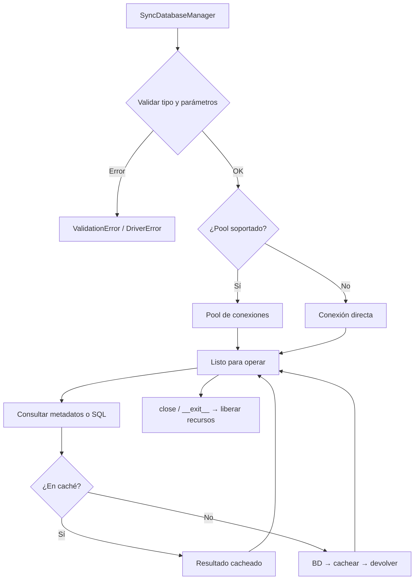

# Manager Síncrono (SyncDatabaseManager)

Gestor síncrono del ciclo de vida completo de una conexión de base de datos multi-motor: abre la conexión (pool o directa), expone introspección de metadatos y ejecución de consultas, y libera los recursos al cerrar.

## 1. Arquitectura y Diseño

## 2. Modelo de Datos / Contratos

### API pública

| Función/Clase | Firma simplificada | Descripción | Retorna |
|---|---|---|---|
| `SyncDatabaseManager` | `(db_type, conn_params, queries_file?, use_pool?)` | Crea el gestor y abre la conexión | `SyncDatabaseManager` |
| `get_schema_metadata` | `(schema=None, *, kinds=ALL_KINDS, tables=None)` | Metadatos del schema con una consulta por tipo de objeto (tablas, columnas, claves, índices, routines…) ([lectura de metadatos](metadata_manager.md)) | `SchemaSnapshot` |
| `get_tables` / `get_views` / `get_routines` | `()` | Objetos del schema, del snapshot | `list[TableMeta]` / `list[ViewMeta]` / `list[RoutineMeta]` |
| `get_columns` | `(tabla)` | Columnas de una tabla o vista | `list[ColumnMeta]` |
| `get_primary_keys` | `(tabla)` | Clave primaria | `PrimaryKeyMeta \| None` |
| `get_foreign_keys` / `get_unique_constraints` / `get_indices` | `(tabla)` | Claves foráneas, UNIQUE e índices | `list[ForeignKeyMeta]` / `list[UniqueMeta]` / `list[IndexMeta]` |
| `get_ddl` | `(tabla)` | `CREATE TABLE` de una tabla: en MySQL/MariaDB desde el snapshot; en el resto, el del motor (una consulta por tabla, cacheada) | `str` |
| `get_columns_charset_collation` | `(tabla)` | Columnas con collation propia: `(columna, charset, collation)` (charset solo en MySQL/MariaDB) | `list[tuple]` |
| `get_view_ddl` | `(vista)` | `CREATE VIEW … AS` + definición | `str` |
| `get_routine_ddl` | `(rutina, tipo_rutina)` | Definición de una rutina | `str` |
| `get_routine_parameters` | `(rutina, tipo_rutina)` | Parámetros de una rutina | `list[RoutineParameterMeta]` |
| `get_database_version` | `()` | Versión del motor (`"Unknown"` si no se puede leer) | `str` |
| `get_storage_inventory` | `(tablespace?)` | Inventario de almacenamiento (`primary`, `temp_tablespaces`, `sqlite_file_summary`) | `dict[str, Any]` |
| `get_storage_rows` | `(query_name, **params)` | Filas de una consulta de `metadata.storage` (`QueryNotFoundError` si el motor no la tiene) | `list[tuple]` |
| `execute_query_many` | `(query_name, timeout?, **kwargs)` | Query registrada → varias filas | `Rows` |
| `execute_custom_many` | `(sql, params?, timeout?)` | SQL libre → varias filas | `Rows` |
| `execute_custom_one` | `(sql, params?, timeout?)` | SQL libre → una fila | `RowOrNone` |
| `get_sqlalchemy_engine` | `()` | Engine SQLAlchemy configurado | `Engine` |
| `close` | `(timeout_seconds?, force?)` | Cierra el gestor y libera recursos | `None` |
| `get_supported_db_types` | `()` *(estático)* | Tipos de BD soportados | `list[str]` |

### Contrato de entrada

| Parámetro | Tipo | Descripción | Restricciones |
|---|---|---|---|
| `db_type` | `str` | Tipo de motor | Uno de: `mariadb`, `oracle`, `postgresql`, `sqlite`, `hsqldb`, `sqlserver` |
| `conn_params` | `dict[str, Any]` | Parámetros de conexión | Debe incluir `database`; motor-específicos adicionales |
| `use_pool` | `bool` | Activar pool | Default `True`; cae a conexión directa si no soportado |
| `timeout` | `float \| None` | Timeout en segundos | `None` = sin límite |
| `tablespace` | `str \| None` | Tablespace para inventario | Requerido en Oracle y PostgreSQL |

### Contrato de salida

- **Modelos de metadatos** (`TableMeta`, `ColumnMeta`, `ForeignKeyMeta`…) — dataclasses inmutables de `util_bbdd.metadata.model`, iguales en todos los motores.
- **`Rows`** — `list[tuple[Any, ...]]` de `execute_*`; orden y tipos dependientes de la consulta.
- **`RowOrNone`** — una sola tupla si hay resultado, `None` si no hay filas.
- **`Engine`** — instancia SQLAlchemy lista para `BulkCrud` u otras operaciones.
- Los métodos de metadatos leen cada tipo de objeto una vez para todo el schema y lo sirven de caché hasta `clear_cache()`.

### Errores y casos especiales

| Error | Cuándo ocurre |
|---|---|
| `ValidationError` | `db_type` no reconocido o `conn_params` falta `database` |
| `DriverError` | El driver Python del motor no está instalado |
| `ConnectionError` | No se puede establecer conexión con el servidor |
| `QueryError` | Error en ejecución de `execute_custom_*` o `execute_query_*` |

## 3. Componentes y Clases

*No aplica para este módulo.* `SyncDatabaseManager` es la única clase pública de este módulo; su descomposición interna (lifecycle, metadata, query, cache) está documentada en los módulos `managers_lifecycle`, `metadata_manager` y `query_system`.

## 4. Dependencias y Requisitos

| Dependencia | Propósito | Requerida | Comportamiento sin ella |
|---|---|---|---|
| `SyncConnectionLifecycleManager` (interno) | Gestión del ciclo de vida de la conexión | Sí | Módulo no funciona |
| `MetadataStrategyFactory` (interno) | Selección de estrategia de metadatos por motor | Sí | Módulo no funciona |
| `SyncQueryExecutor` (interno) | Ejecución de consultas | Sí | Módulo no funciona |
| Driver Python del motor | Conexión nativa con la BD | Sí (motor-específico) | `DriverError` al inicializar |

## 5. Ejemplos Relacionados

- [Ejemplo: Conectar e Introspeccionar Base de Datos](../examples/example_connect_introspect.md) — Conexión básica, listado de tablas y columnas con `SyncDatabaseManager`
