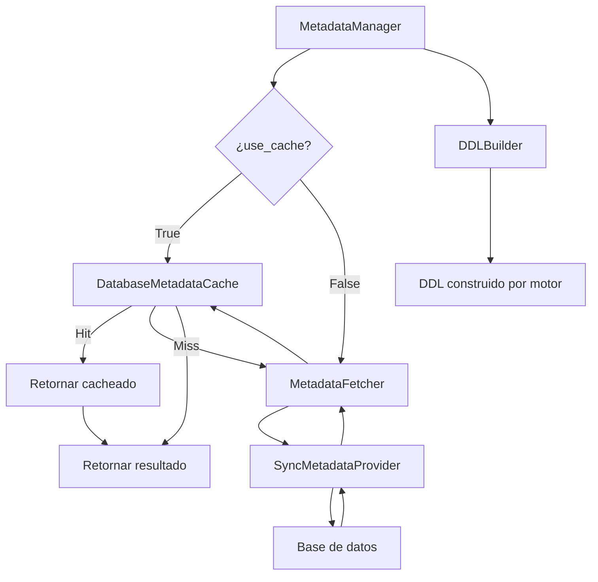

# Gestor de Metadatos (MetadataManager)

`MetadataManager` orquesta el acceso a metadatos de base de datos coordinando fetcher, caché, DDL builder y normalizadores, evitando que los managers gestionen directamente la caché y la normalización.

## 1. Arquitectura y Diseño

## 2. Modelo de Datos / Contratos

### API pública

#### Clase `MetadataManager`

| Método | Firma simplificada | Descripción | Retorna |
|---|---|---|---|
| `MetadataManager` | `(metadata_provider, db_cache?, relationship_cache?, db_type?)` | Inicializa con proveedor de metadatos | `MetadataManager` |
| `get_tables` | `(use_cache?)` | Lista de tablas con caché opcional | `Rows` |
| `get_columns` | `(table_name, use_cache?)` | Columnas de una tabla | `Rows` |
| `get_primary_keys` | `(table_name, use_cache?)` | Claves primarias | `Rows` |
| `get_foreign_keys` | `(table_name, use_cache?)` | Claves foráneas | `Rows` |
| `get_indices` | `(table_name, use_cache?)` | Índices | `Rows` |
| `get_tables_normalized` | `(use_cache?)` | Tablas en formato normalizado | `list[NormalizedTableRow]` |
| `get_columns_normalized` | `(table_name, use_cache?)` | Columnas en formato normalizado | `list[NormalizedColumnRow]` |
| `get_ddl` | `(table_name)` | DDL de una tabla | `str` |
| `get_view_ddl` | `(view_name)` | DDL de una vista | `str` |

#### Clase `DatabaseMetadataCache`

| Método | Firma simplificada | Descripción | Retorna |
|---|---|---|---|
| `get_columns` | `(table_key)` | Columnas cacheadas | `list \| None` |
| `set_columns` | `(table_key, columns)` | Guarda columnas en caché | `None` |
| `get_primary_keys` | `(table_key)` | PKs cacheadas | `list \| None` |
| `set_primary_keys` | `(table_key, pks)` | Guarda PKs | `None` |
| `get_foreign_keys` | `(table_key)` | FKs cacheadas | `list \| None` |
| `set_foreign_keys` | `(table_key, fks)` | Guarda FKs | `None` |

### Contrato de entrada

| Parámetro | Tipo | Descripción | Restricciones |
|---|---|---|---|
| `metadata_provider` | `SyncMetadataProvider` | Objeto que implementa `get_tables()`, `get_columns()`, etc. | Normalmente una instancia de `SyncDatabaseManager` |
| `db_cache` | `DatabaseMetadataCache \| None` | Caché a reutilizar entre managers | `None` crea caché vacía nueva |
| `db_type` | `str` | Tipo de motor | Default `"mariadb"`; afecta la construcción DDL |
| `table_key` | `tuple[str, str]` | Clave de tabla para la caché | `(context, nombre_tabla)` |
| `use_cache` | `bool` | Usar caché en la consulta | Default `True` |

### Contrato de salida

- **`Rows`** — `list[tuple[Any, ...]]`; estructura dependiente del motor.
- **`NormalizedTableRow`** / **`NormalizedColumnRow`** — dataclasses con campos homogéneos entre motores.
- Métodos `get_*` de `DatabaseMetadataCache` retornan `None` en cache miss (no lanzan excepción).

### Errores y casos especiales

| Error | Cuándo ocurre |
|---|---|
| Propagado desde `metadata_provider` | Si el proveedor lanza error en BD (conexión caída, permisos) |

Si `db_cache` se comparte entre varios `MetadataManager`, los resultados de uno son visibles al otro en el mismo proceso.

## 3. Componentes y Clases

| Clase | Responsabilidad |
|---|---|
| `MetadataManager` | Coordinación entre fetcher, caché, DDL builder y normalizadores |
| `DatabaseMetadataCache` | 12 cachés independientes para metadatos puros |
| `RelationshipMetadataCache` | 4 cachés adicionales para análisis derivados de relaciones |

## 4. Dependencias y Requisitos

| Dependencia | Propósito | Requerida | Comportamiento sin ella |
|---|---|---|---|
| `SyncMetadataProvider` (protocolo interno) | Proveedor de metadatos desde BD | Sí | Sin proveedor no hay datos que cachear |
| `DDLBuilder` (interno) | Construcción del DDL por motor | Sí | `get_ddl()` no funciona |

## 5. Ejemplos Relacionados

- [Ejemplo: Caché de Metadatos](../examples/metadata_cache_usage.md) — Uso de `DatabaseMetadataCache` y patrón get-or-cache
