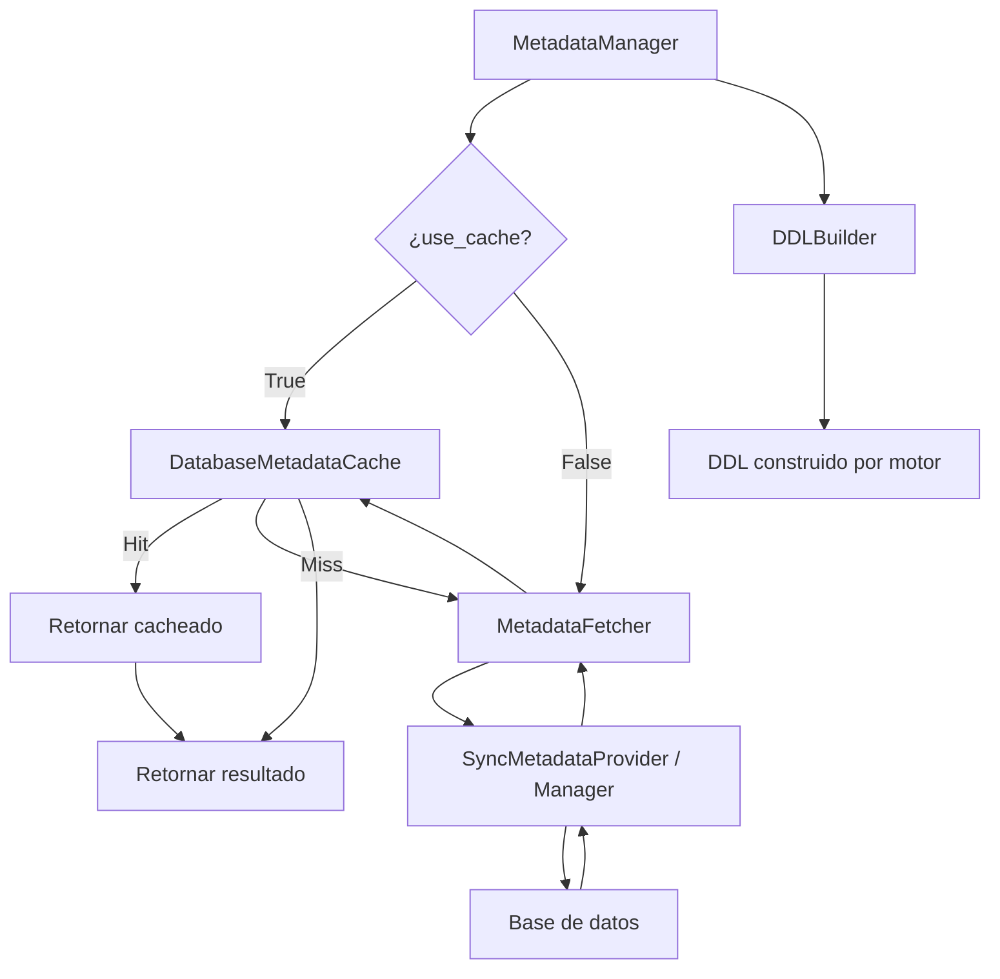

## Responsabilidad del módulo

`MetadataManager` orquesta el acceso a metadatos de base de datos coordinando cuatro componentes: `MetadataFetcher` (obtiene datos de BD), `DatabaseMetadataCache` (cachea resultados en memoria), `DDLBuilder` (construye DDL) y los normalizadores de filas. Es la capa de coordinación que evita que los managers tengan que gestionar la caché y la normalización directamente.

`DatabaseMetadataCache` es la única fuente de verdad para metadatos puros (12 cachés independientes), y `RelationshipMetadataCache` extiende esa base con análisis derivados de relaciones (4 cachés adicionales).

## Diagrama

## API pública

### Clase `MetadataManager`

| Método | Firma simplificada | Descripción | Retorna |
|---|---|---|---|
| `MetadataManager` | `(metadata_provider, db_cache?, relationship_cache?, db_type?)` | Inicializa con proveedor de metadatos | `MetadataManager` |
| `get_tables` | `(use_cache?)` | Lista de tablas con cache opcional | `Rows` |
| `get_columns` | `(table_name, use_cache?)` | Columnas de una tabla | `Rows` |
| `get_primary_keys` | `(table_name, use_cache?)` | Claves primarias de una tabla | `Rows` |
| `get_foreign_keys` | `(table_name, use_cache?)` | Claves foráneas de una tabla | `Rows` |
| `get_indices` | `(table_name, use_cache?)` | Índices de una tabla | `Rows` |
| `get_unique_constraints` | `(table_name, use_cache?)` | Restricciones únicas | `Rows` |
| `get_tables_normalized` | `(use_cache?)` | Tablas en formato normalizado | `list[NormalizedTableRow]` |
| `get_columns_normalized` | `(table_name, use_cache?)` | Columnas en formato normalizado | `list[NormalizedColumnRow]` |
| `get_ddl` | `(table_name)` | DDL de una tabla | `str` |
| `get_view_ddl` | `(view_name)` | DDL de una vista | `str` |

### Clase `DatabaseMetadataCache`

| Método | Firma simplificada | Descripción | Retorna |
|---|---|---|---|
| `get_columns` | `(table_key)` | Columnas cacheadas para `(context, tabla)` | `list \| None` |
| `set_columns` | `(table_key, columns)` | Guarda columnas en caché | `None` |
| `get_primary_keys` | `(table_key)` | PKs cacheadas | `list \| None` |
| `set_primary_keys` | `(table_key, pks)` | Guarda PKs | `None` |
| `get_indices` | `(table_key)` | Índices cacheados | `list \| None` |
| `set_indices` | `(table_key, indices)` | Guarda índices | `None` |
| `get_foreign_keys` | `(table_key)` | FKs cacheadas | `list \| None` |
| `set_foreign_keys` | `(table_key, fks)` | Guarda FKs | `None` |
| `get_unique_constraints` | `(table_key)` | UCs cacheadas | `list \| None` |
| `set_unique_constraints` | `(table_key, ucs)` | Guarda UCs | `None` |

## Contrato de entrada

| Parámetro | Tipo | Descripción | Restricciones |
|---|---|---|---|
| `metadata_provider` | `SyncMetadataProvider` | Objeto que implementa `get_tables()`, `get_columns()`, etc. | Normalmente una instancia de `SyncDatabaseManager` |
| `db_cache` | `DatabaseMetadataCache \| None` | Instancia de caché a reutilizar entre managers | Si `None`, se crea una nueva caché vacía |
| `relationship_cache` | `RelationshipMetadataCache \| None` | Caché de análisis de relaciones | Si `None`, se crea ligada a `db_cache` |
| `db_type` | `str` | Tipo de motor | Default `"mariadb"`; afecta la construcción DDL |
| `table_key` | `tuple[str, str]` | Clave de tabla para la caché | `(context, nombre_tabla)`; el context identifica la base de datos |
| `use_cache` | `bool` | Usar caché en la consulta | Default `True`; `False` fuerza consulta directa a BD |

## Contrato de salida

- **`Rows`** — `list[tuple[Any, ...]]`; estructura y tipos dependen del motor y la consulta.
- **`NormalizedTableRow`** / **`NormalizedColumnRow`** — dataclasses con campos homogéneos entre motores; permiten comparar estructuras de distintos motores sin adaptadores.
- **`str`** (DDL) — texto plano del DDL; formato varía por motor.
- Métodos `get_*` de `DatabaseMetadataCache` retornan `None` en caso de cache miss (no levantan excepción).

## Errores y casos especiales

| Error | Cuándo ocurre |
|---|---|
| Propagado desde `metadata_provider` | Si el proveedor lanza error en la consulta a BD (conexión caída, permisos, etc.) |

**Casos especiales:**
- Si `db_cache` se comparte entre varios `MetadataManager`, los resultados de uno son visibles al otro desde el mismo proceso. Comportamiento intencional para cachés compartidas en pipelines multi-tabla.
- `RelationshipMetadataCache` mantiene referencia al `DatabaseMetadataCache` pasado; no crea una copia — modificar la caché base afecta también al análisis de relaciones.
- Los métodos `set_*` de `DatabaseMetadataCache` siempre guardan una copia de la lista (`list(pks)`) para evitar referencias a objetos externos que puedan mutar.
