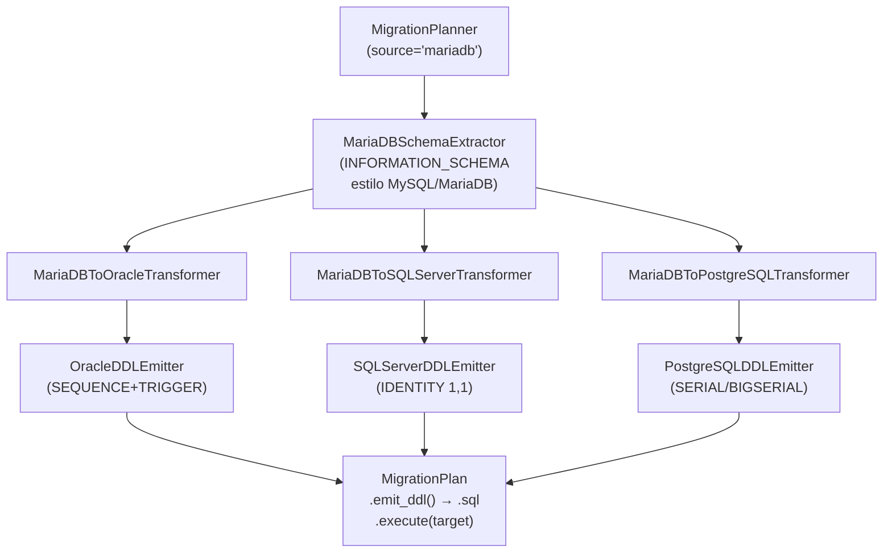

# API — Migración MariaDB como origen

## Responsabilidad del módulo

Orquesta la migración DDL desde un schema MariaDB hacia Oracle, SQL Server o PostgreSQL en tres
capas desacopladas: extracción de metadatos MariaDB vía `INFORMATION_SCHEMA`, transformación al
modelo canónico IR con mapeo de tipos, y emisión del script DDL con ordenación topológica por
dependencias FK.

## Diagrama



## API pública

| Clase / Función | Firma simplificada | Descripción | Retorna |
|---|---|---|---|
| `MigrationPlanner` | `(source_engine, target_engine, ...)` | Orquestador principal; valida configuración en `__init__` | instancia |
| `MigrationPlanner.plan` | `(connection, schema: str)` | Extrae, transforma y consolida en un plan ejecutable | `MigrationPlan` |
| `MigrationPlan.emit_ddl` | `()` | Script DDL completo listo para guardar en fichero `.sql` | `str` |
| `MigrationPlan.emit_statements` | `()` | Sentencias individuales sin `;`, para ejecución controlada | `list[str]` |
| `MigrationPlan.execute` | `(target_connection)` | Ejecuta cada sentencia DDL contra el motor destino | `None` |
| `MigrationPlan.error_count` | propiedad | Número de warnings con severidad `ERROR` | `int` |
| `MigrationPlan.warning_count` | propiedad | Número de warnings con severidad `WARNING` | `int` |
| `MigrationPlan.info_count` | propiedad | Número de warnings con severidad `INFO` | `int` |
| `format_plan_text` | `(plan: MigrationPlan)` | Reporte de texto plano con avisos agrupados por severidad | `str` |
| `format_plan_markdown` | `(plan: MigrationPlan)` | Reporte Markdown con tabla de avisos y listado de tablas | `str` |
| `MariaDBSchemaExtractor` | `(manager)` | Capa de extracción MariaDB (uso avanzado) | instancia |
| `MariaDBToOracleTransformer` | `()` | Transformación a dialectos Oracle (uso avanzado) | instancia |
| `MariaDBToSQLServerTransformer` | `()` | Transformación a dialectos SQL Server (uso avanzado) | instancia |
| `MariaDBToPostgreSQLTransformer` | `()` | Transformación a dialectos PostgreSQL (uso avanzado) | instancia |
| `OracleDDLEmitter` | `()` | Generación DDL Oracle (uso avanzado) | instancia |
| `SQLServerDDLEmitter` | `(sql_server_collation)` | Generación DDL SQL Server (uso avanzado) | instancia |
| `PostgreSQLDDLEmitter` | `(pg_schema)` | Generación DDL PostgreSQL (uso avanzado) | instancia |

## Contrato de entrada

### `MigrationPlanner.__init__`

| Parámetro | Tipo | Descripción | Restricciones |
|---|---|---|---|
| `source_engine` | `str` | Motor origen | `"mariadb"` para este flujo; `ValueError` si no soportado |
| `target_engine` | `str` | Motor destino | `"oracle"` \| `"sqlserver"` \| `"postgresql"`; `ValueError` si igual al origen |
| `sql_server_collation` | `str \| None` | COLLATE columna SQL Server | Solo si `target_engine="sqlserver"`; `None` usa collation de BD destino |
| `pg_schema` | `str \| None` | Schema PostgreSQL | Solo si `target_engine="postgresql"`; emite `SET search_path = schema;` |

!!! note "charset/collation en MariaDB como fuente"
    Los parámetros `charset` y `collation` solo aplican cuando MariaDB es el **destino**.
    En este flujo (MariaDB como origen) se ignoran.

### `MigrationPlanner.plan`

| Parámetro | Tipo | Descripción | Restricciones |
|---|---|---|---|
| `connection` | `SyncDatabaseManager` | Manager con conexión MariaDB activa | Duck-typed: requiere `execute_custom_many(sql, params) → list` |
| `schema` | `str` | Nombre del schema MariaDB a migrar | Equivale a `TABLE_SCHEMA` en `INFORMATION_SCHEMA` |

## Contrato de salida

### `MigrationPlanner.plan` → `MigrationPlan`

| Campo | Tipo | Descripción |
|---|---|---|
| `.tables` | `list[CanonicalTable]` | Tablas transformadas, ordenadas topológicamente por FKs |
| `.warnings` | `list[MigrationWarning]` | Todos los avisos consolidados de tablas y columnas |
| `.source_schema` | `str` | Nombre del schema MariaDB origen |
| `.source_engine` | `str` | Motor origen normalizado en minúsculas |
| `.target_engine` | `str` | Motor destino normalizado en minúsculas |

### `MigrationWarning`

| Campo | Tipo | Descripción |
|---|---|---|
| `.table` | `str` | Nombre de la tabla afectada |
| `.column` | `str \| None` | Nombre de la columna afectada (`None` para avisos de tabla) |
| `.oracle_type` | `str` | Tipo MariaDB original (campo histórico) o `"IDENTIFIER"` / `"FOREIGN KEY"` |
| `.target_type` | `str` | Tipo destino resultante o `"(omitido)"` |
| `.message` | `str` | Descripción legible de la decisión tomada |
| `.severity` | `"INFO" \| "WARNING" \| "ERROR"` | Nivel de severidad |
| `.proposals` | `tuple[str, ...]` | Alternativas al mapeo elegido (vacío si no hay) |

## Errores y casos especiales

| Situación | Comportamiento |
|---|---|
| `source_engine` / `target_engine` no soportados | `ValueError` en `__init__` |
| `source_engine == target_engine` | `ValueError` en `__init__` |
| Tipo MariaDB desconocido | Se mapea al tipo de texto más amplio del motor destino; aviso `WARNING` |
| Identificador > límite del motor | Truncado a `límite - 5` chars + sufijo `_XXXX` (hash del nombre original); aviso `WARNING` |
| `AUTO_INCREMENT` | Oracle: SEQUENCE+TRIGGER; SQL Server: `IDENTITY(1,1)`; PostgreSQL: `SERIAL/BIGSERIAL`; aviso `INFO` |
| FK a tabla fuera del schema | Emitida como `ALTER TABLE ADD CONSTRAINT` al final con comentario; aviso `WARNING` |
| FKs circulares | `CREATE TABLE` sin esas FKs + `ALTER TABLE ADD CONSTRAINT` al final del script |
| Vista MariaDB | Incluida sin reescritura SQL; aviso `WARNING` indicando revisión manual recomendada |

## Ejemplo técnico mínimo

=== "MariaDB → Oracle"

    ```python
    from util_bbdd import MigrationPlanner

    planner = MigrationPlanner(
        source_engine="mariadb",
        target_engine="oracle",
    )
    plan = planner.plan(connection=mariadb_manager, schema="ventas")
    print(f"Errores: {plan.error_count}  Warnings: {plan.warning_count}")
    ddl = plan.emit_ddl()
    ```

=== "MariaDB → SQL Server"

    ```python
    from util_bbdd import MigrationPlanner

    planner = MigrationPlanner(
        source_engine="mariadb",
        target_engine="sqlserver",
        sql_server_collation="SQL_Latin1_General_CP1_CI_AS",
    )
    plan = planner.plan(connection=mariadb_manager, schema="ventas")
    ddl = plan.emit_ddl()
    ```

=== "MariaDB → PostgreSQL"

    ```python
    from util_bbdd import MigrationPlanner

    planner = MigrationPlanner(
        source_engine="mariadb",
        target_engine="postgresql",
        pg_schema="ventas",
    )
    plan = planner.plan(connection=mariadb_manager, schema="ventas")
    ddl = plan.emit_ddl()
    ```
