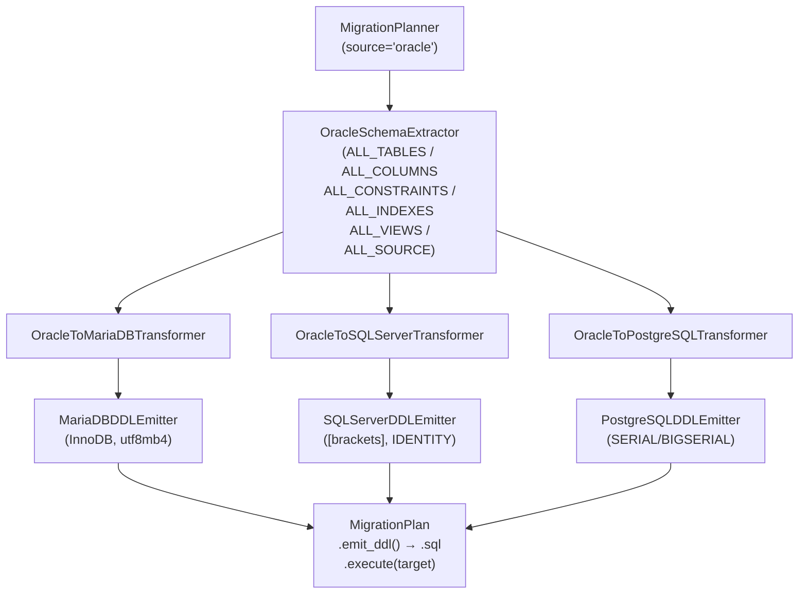

# API — Migración Oracle como origen

## Responsabilidad del módulo

Orquesta la migración DDL desde un schema Oracle hacia MariaDB, SQL Server o PostgreSQL en tres capas
desacopladas: extracción de metadatos Oracle, transformación al modelo canónico IR con mapeo de tipos,
y emisión del script DDL con ordenación topológica por dependencias FK.

## Diagrama



## API pública

| Clase / Función | Firma simplificada | Descripción | Retorna |
|---|---|---|---|
| `MigrationPlanner` | `(source_engine, target_engine, ...)` | Orquestador principal; valida configuración en `__init__` | instancia |
| `MigrationPlanner.plan` | `(connection, schema: str)` | Extrae, transforma y consolida en un plan ejecutable | `MigrationPlan` |
| `MigrationPlan.emit_ddl` | `()` | Script DDL completo listo para guardar en fichero `.sql` | `str` |
| `MigrationPlan.emit_statements` | `()` | Sentencias individuales sin `;`, para ejecución controlada | `list[str]` |
| `MigrationPlan.execute` | `(target_connection)` | Ejecuta cada sentencia DDL contra el motor destino | `None` |
| `MigrationPlan.error_count` | propiedad | Número de warnings con severidad `ERROR` | `int` |
| `MigrationPlan.warning_count` | propiedad | Número de warnings con severidad `WARNING` | `int` |
| `MigrationPlan.info_count` | propiedad | Número de warnings con severidad `INFO` | `int` |
| `format_plan_text` | `(plan: MigrationPlan)` | Reporte de texto plano con avisos agrupados por severidad | `str` |
| `format_plan_markdown` | `(plan: MigrationPlan)` | Reporte Markdown con tabla de avisos y listado de tablas | `str` |
| `OracleSchemaExtractor` | `(manager)` | Capa de extracción (uso avanzado) | instancia |
| `OracleToMariaDBTransformer` | `(number_fallback, charset)` | Transformación a dialectos MariaDB (uso avanzado) | instancia |
| `OracleToSQLServerTransformer` | `(number_fallback)` | Transformación a dialectos SQL Server (uso avanzado) | instancia |
| `OracleToPostgreSQLTransformer` | `(number_fallback)` | Transformación a dialectos PostgreSQL (uso avanzado) | instancia |
| `OracleDDLEmitter` | `(oracle_identity_mode)` | Generación DDL Oracle (uso avanzado); modos `sequence_trigger` \| `identity_by_default_on_null` | instancia |
| `MariaDBDDLEmitter` | `(charset, collation, engine)` | Generación DDL MariaDB (uso avanzado) | instancia |
| `SQLServerDDLEmitter` | `(sql_server_collation)` | Generación DDL SQL Server (uso avanzado) | instancia |
| `PostgreSQLDDLEmitter` | `(pg_schema)` | Generación DDL PostgreSQL (uso avanzado) | instancia |
| `validate_charset` | `(charset: str)` | Valida y normaliza un charset MariaDB | `str` |
| `validate_collation` | `(collation: str)` | Valida y normaliza una collation MariaDB | `str` |

## Contrato de entrada

### `MigrationPlanner.__init__`

| Parámetro | Tipo | Descripción | Restricciones |
|---|---|---|---|
| `source_engine` | `str` | Motor origen | `"oracle"` para este flujo; `ValueError` si no soportado |
| `target_engine` | `str` | Motor destino | `"mariadb"` \| `"sqlserver"` \| `"postgresql"`; `ValueError` si igual al origen |
| `charset` | `str` | CHARACTER SET MariaDB | Solo si `target_engine="mariadb"`; `ValueError` si inválido |
| `collation` | `str` | COLLATE MariaDB | Solo si `target_engine="mariadb"`; incluye `utf8mb4_spanish2_ci` |
| `number_fallback` | `Literal["DOUBLE","DECIMAL(38,10)","DECIMAL(18,4)"]` | Tipo para `NUMBER` sin precisión | Mapeado automáticamente al equivalente del motor destino |
| `engine` | `str` | Motor de almacenamiento MariaDB | `"InnoDB"` por defecto; solo si `target_engine="mariadb"` |
| `int_display_width` | `int` | Display width para `INT` MariaDB | `11` por defecto; `0` desactiva; solo si `target_engine="mariadb"` |
| `sql_server_collation` | `str \| None` | COLLATE columna SQL Server | Solo si `target_engine="sqlserver"`; `None` usa collation de BD destino |
| `pg_schema` | `str \| None` | Schema PostgreSQL | Solo si `target_engine="postgresql"`; emite `SET search_path = schema;` |
| `oracle_identity_mode` | `Literal["sequence_trigger","identity_by_default_on_null"]` | Modo de columnas AUTO_INCREMENT en Oracle destino | Solo si `target_engine="oracle"`; ver tabla de modos abajo |

!!! note "oracle_identity_mode: `sequence_trigger` vs `identity_by_default_on_null`"
    | Modo | Comportamiento | Requiere |
    |---|---|---|
    | `"sequence_trigger"` (por defecto) | Emite `CREATE SEQUENCE` + `CREATE OR REPLACE TRIGGER` por cada columna AUTO_INCREMENT; compatible con Oracle 11g y anteriores | Oracle 11g+ |
    | `"identity_by_default_on_null"` | Emite `GENERATED BY DEFAULT ON NULL AS IDENTITY` inline en la columna; NO genera SEQUENCE ni TRIGGER | Oracle 12c+ |

    Usa `"sequence_trigger"` cuando el entorno Oracle destino puede ser 11g o cuando
    se requiere compatibilidad máxima. Usa `"identity_by_default_on_null"` en entornos
    Oracle 12c+ para un DDL más limpio.

### `MigrationPlanner.plan`

| Parámetro | Tipo | Descripción | Restricciones |
|---|---|---|---|
| `connection` | `SyncDatabaseManager` | Manager con conexión Oracle activa | Duck-typed: requiere `execute_custom_many(sql, params) → list` |
| `schema` | `str` | Schema/owner Oracle a migrar | Sensible a mayúsculas en Oracle |

## Contrato de salida

### `MigrationPlanner.plan` → `MigrationPlan`

| Campo | Tipo | Descripción |
|---|---|---|
| `.tables` | `list[CanonicalTable]` | Tablas transformadas, ordenadas topológicamente por FKs |
| `.views` | `list[CanonicalView]` | Vistas transformadas (pass-through v1) |
| `.routines` | `list[CanonicalRoutine]` | Stored procedures y funciones (pass-through v1) |
| `.warnings` | `list[MigrationWarning]` | Todos los avisos consolidados de tablas, vistas y rutinas |
| `.source_schema` | `str` | Nombre del schema Oracle origen |
| `.source_engine` | `str` | Motor origen normalizado en minúsculas |
| `.target_engine` | `str` | Motor destino normalizado en minúsculas |

### `MigrationWarning`

| Campo | Tipo | Descripción |
|---|---|---|
| `.table` | `str` | Nombre de la tabla afectada |
| `.column` | `str \| None` | Nombre de la columna afectada (`None` para avisos de tabla) |
| `.oracle_type` | `str` | Tipo Oracle original o `"IDENTIFIER"` / `"FOREIGN KEY"` |
| `.target_type` | `str` | Tipo destino resultante o `"(omitido)"` |
| `.message` | `str` | Descripción legible de la decisión tomada |
| `.severity` | `"INFO" \| "WARNING" \| "ERROR"` | Nivel de severidad |
| `.proposals` | `tuple[str, ...]` | Alternativas al mapeo elegido (vacío si no hay) |

## Errores y casos especiales

| Situación | Comportamiento |
|---|---|
| `source_engine` / `target_engine` no soportados | `ValueError` en `__init__` |
| `source_engine == target_engine` | `ValueError` en `__init__` |
| `charset` o `collation` inválidos (MariaDB) | `ValueError` en `__init__` con lista de opciones válidas |
| Tipo Oracle desconocido | Se mapea al tipo de texto más amplio del motor destino; aviso `WARNING` |
| `ROWID` / `UROWID` | Columna omitida del DDL; aviso `ERROR`; comentario SQL en su lugar |
| Identificador > límite del motor | Truncado a `límite - 5` chars + sufijo `_XXXX` (hash del nombre original); aviso `WARNING` |
| `NUMBER` sin precisión | Tipo `number_fallback` configurado (con remapeo automático por motor); aviso `WARNING` |
| `NEXTVAL` en columna no PK | Se añade como PK automáticamente; aviso `WARNING` |
| FK a tabla fuera del schema | Emitida como `ALTER TABLE ADD CONSTRAINT` al final con comentario; aviso `WARNING` |
| FKs circulares | `CREATE TABLE` sin esas FKs + `ALTER TABLE ADD CONSTRAINT` al final del script |
| Tabla con todas las columnas omitidas | `CREATE TABLE` con comentario `-- ERROR: tabla sin columnas activas` |

## Ejemplo técnico mínimo

=== "Oracle → MariaDB"

    ```python
    from util_bbdd import MigrationPlanner

    planner = MigrationPlanner(
        source_engine="oracle",
        target_engine="mariadb",
        charset="utf8mb4",
        collation="utf8mb4_spanish2_ci",
        number_fallback="DECIMAL(18,4)",
    )
    plan = planner.plan(connection=oracle_manager, schema="VENTAS")
    print(f"Errores: {plan.error_count}  Warnings: {plan.warning_count}")
    print(f"Rutinas: {len(plan.routines)}")
    ddl = plan.emit_ddl()
    ```

=== "Oracle → Oracle (identity_by_default_on_null)"

    ```python
    # Para entornos Oracle 12c+ como destino: columnas IDENTITY nativas
    from util_bbdd import MigrationPlanner

    planner = MigrationPlanner(
        source_engine="oracle",
        target_engine="mariadb",          # ajustar al motor deseado
        oracle_identity_mode="identity_by_default_on_null",  # requiere Oracle 12c+
    )
    plan = planner.plan(connection=oracle_manager, schema="VENTAS")
    ddl = plan.emit_ddl()
    # Las columnas AUTO_INCREMENT emiten GENERATED BY DEFAULT ON NULL AS IDENTITY
    # en lugar de CREATE SEQUENCE + TRIGGER
    ```

=== "Oracle → SQL Server"

    ```python
    from util_bbdd import MigrationPlanner

    planner = MigrationPlanner(
        source_engine="oracle",
        target_engine="sqlserver",
        sql_server_collation="SQL_Latin1_General_CP1_CI_AS",
    )
    plan = planner.plan(connection=oracle_manager, schema="VENTAS")
    ddl = plan.emit_ddl()
    ```

=== "Oracle → PostgreSQL"

    ```python
    from util_bbdd import MigrationPlanner

    planner = MigrationPlanner(
        source_engine="oracle",
        target_engine="postgresql",
        pg_schema="ventas",
    )
    plan = planner.plan(connection=oracle_manager, schema="VENTAS")
    ddl = plan.emit_ddl()
    ```
