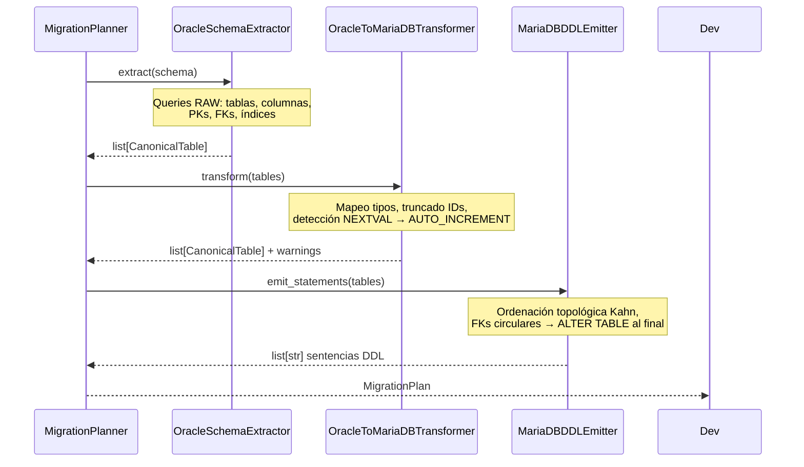

## Responsabilidad del módulo

Orquesta la migración DDL Oracle → MariaDB en tres capas desacopladas: extracción de metadatos Oracle en crudo, transformación al modelo canónico IR con mapeo de tipos, y emisión del script DDL con ordenación topológica por dependencias FK.

## Diagrama



## API pública

| Clase / Función | Firma simplificada | Descripción | Retorna |
|---|---|---|---|
| `MigrationPlanner` | `(source_engine, target_engine, charset, collation, number_fallback, engine, int_display_width)` | Orquestador principal; valida configuración en `__init__` | instancia |
| `MigrationPlanner.plan` | `(connection, schema: str)` | Extrae, transforma y consolida en un plan ejecutable | `MigrationPlan` |
| `MigrationPlan.emit_ddl` | `()` | Script DDL completo listo para guardar en fichero `.sql` | `str` |
| `MigrationPlan.emit_statements` | `()` | Sentencias individuales sin `;`, para ejecución controlada | `list[str]` |
| `MigrationPlan.execute` | `(target_connection)` | Ejecuta cada sentencia DDL contra el motor destino | `None` |
| `MigrationPlan.error_count` | propiedad | Número de warnings con severidad `ERROR` | `int` |
| `MigrationPlan.warning_count` | propiedad | Número de warnings con severidad `WARNING` | `int` |
| `MigrationPlan.info_count` | propiedad | Número de warnings con severidad `INFO` | `int` |
| `format_plan_text` | `(plan: MigrationPlan)` | Reporte de texto plano con avisos agrupados por severidad | `str` |
| `format_plan_markdown` | `(plan: MigrationPlan)` | Reporte Markdown con tabla de avisos y listado de tablas | `str` |
| `OracleSchemaExtractor` | `(manager)` | Capa de extracción (uso avanzado) | instancia |
| `OracleToMariaDBTransformer` | `(number_fallback, charset)` | Capa de transformación (uso avanzado) | instancia |
| `MariaDBDDLEmitter` | `(charset, collation, engine)` | Capa de emisión DDL (uso avanzado) | instancia |
| `validate_charset` | `(charset: str)` | Valida y normaliza un charset MariaDB | `str` |
| `validate_collation` | `(collation: str)` | Valida y normaliza una collation MariaDB | `str` |

## Contrato de entrada

### `MigrationPlanner.__init__`

| Parámetro | Tipo | Descripción | Restricciones |
|---|---|---|---|
| `source_engine` | `str` | Motor origen | Solo `"oracle"` actualmente; `ValueError` si no soportado |
| `target_engine` | `str` | Motor destino | Solo `"mariadb"` actualmente; `ValueError` si no soportado |
| `charset` | `str` | Character set MariaDB | Debe pertenecer a `VALID_CHARSETS`; `ValueError` si inválido |
| `collation` | `str` | Collation MariaDB | Debe pertenecer a `VALID_COLLATIONS`; incluye `utf8mb4_spanish2_ci`, `utf8mb4_spanish_ci`, `latin1_spanish_ci` |
| `number_fallback` | `Literal["DOUBLE", "DECIMAL(38,10)", "DECIMAL(18,4)"]` | Tipo para `NUMBER` Oracle sin precisión | Solo esos tres literales |
| `engine` | `str` | Motor de almacenamiento MariaDB | `"InnoDB"` por defecto |
| `int_display_width` | `int` | Display width para tipo `INT` (convenio MariaDB) | `11` por defecto; `0` desactiva el parámetro (emite solo `INT`) |

### `MigrationPlanner.plan`

| Parámetro | Tipo | Descripción | Restricciones |
|---|---|---|---|
| `connection` | `SyncDatabaseManager` | Manager con conexión Oracle activa | Duck-typed: requiere `execute_custom_many(sql, params) → list` |
| `schema` | `str` | Schema/owner Oracle a migrar | Sensible a mayúsculas en Oracle |

### `MigrationPlan.execute`

| Parámetro | Tipo | Descripción | Restricciones |
|---|---|---|---|
| `target_connection` | `SyncDatabaseManager` | Manager con conexión MariaDB activa | Duck-typed: requiere `execute_custom_one(sql, params)` |

## Contrato de salida

### `MigrationPlanner.plan` → `MigrationPlan`

| Campo | Tipo | Descripción |
|---|---|---|
| `.tables` | `list[CanonicalTable]` | Tablas transformadas, ordenadas topológicamente por FKs |
| `.warnings` | `list[MigrationWarning]` | Todos los avisos consolidados de tablas y columnas |
| `.source_schema` | `str` | Nombre del schema Oracle origen |
| `.source_engine` | `str` | Motor origen normalizado en minúsculas |
| `.target_engine` | `str` | Motor destino normalizado en minúsculas |

### `MigrationWarning`

| Campo | Tipo | Descripción |
|---|---|---|
| `.table` | `str` | Nombre de la tabla afectada |
| `.column` | `str \| None` | Nombre de la columna afectada (`None` para avisos de tabla) |
| `.oracle_type` | `str` | Tipo Oracle original o `"IDENTIFIER"` / `"FOREIGN KEY"` |
| `.target_type` | `str` | Tipo MariaDB resultante o `"(omitido)"` |
| `.message` | `str` | Descripción legible de la decisión tomada |
| `.severity` | `"INFO" \| "WARNING" \| "ERROR"` | Nivel de severidad |
| `.proposals` | `tuple[str, ...]` | Alternativas al mapeo elegido (vacío si no hay) |

## Errores y casos especiales

| Situación | Comportamiento |
|---|---|
| `source_engine` no soportado | `ValueError` en `__init__` |
| `charset` o `collation` inválidos | `ValueError` en `__init__` con lista de opciones válidas |
| Tipo Oracle desconocido | Se mapea a `TEXT`; aviso `WARNING` en la columna |
| `ROWID` / `UROWID` | Columna omitida del DDL; aviso `ERROR`; comentario SQL en su lugar |
| Identificador > 64 chars | Truncado a 59 chars + sufijo `_XXXX` (MD5 del nombre original); aviso `WARNING` |
| `NUMBER` sin precisión | Tipo `number_fallback` configurado; aviso `WARNING` con DDL comment |
| `NEXTVAL` en columna no PK | Se añade como PK automáticamente; aviso `WARNING` |
| FK a tabla fuera del schema | Emitida como `ALTER TABLE ADD CONSTRAINT` al final del script con comentario; aviso `WARNING` |
| FKs circulares | `CREATE TABLE` sin esas FKs + `ALTER TABLE ADD CONSTRAINT` al final del script |
| Tabla con todas las columnas omitidas | `CREATE TABLE` con comentario `-- ERROR: tabla sin columnas activas` |
| Índice sobre columna omitida | Índice excluido del script sin aviso adicional |

## Ejemplo técnico mínimo

```python
from util_bbdd import MigrationPlanner, MigrationPlan
from util_bbdd.migrate import (
    OracleSchemaExtractor,
    OracleToMariaDBTransformer,
    MariaDBDDLEmitter,
)

# Uso estándar: una línea de configuración, una de ejecución
planner = MigrationPlanner(
    charset="utf8mb4",
    collation="utf8mb4_spanish2_ci",
    number_fallback="DECIMAL(18,4)",
)
plan: MigrationPlan = planner.plan(connection=oracle_manager, schema="VENTAS")

# Inspecionar antes de aplicar
print(f"Tablas: {len(plan.tables)}")
print(f"Errores: {plan.error_count}  Warnings: {plan.warning_count}  Info: {plan.info_count}")
for w in plan.warnings:
    if w.severity in ("ERROR", "WARNING"):
        loc = f"{w.table}.{w.column}" if w.column else w.table
        print(f"  [{w.severity}] {loc}: {w.message}")

# Obtener el script completo
ddl: str = plan.emit_ddl()

# Uso avanzado: capas individuales
extractor = OracleSchemaExtractor(oracle_manager)
tables = extractor.extract("VENTAS")

transformer = OracleToMariaDBTransformer(number_fallback="DOUBLE", charset="utf8mb4")
transformed = transformer.transform(tables)

emitter = MariaDBDDLEmitter(charset="utf8mb4", collation="utf8mb4_unicode_ci")
script: str = emitter.emit(transformed)
statements: list[str] = emitter.emit_statements(transformed)
```
