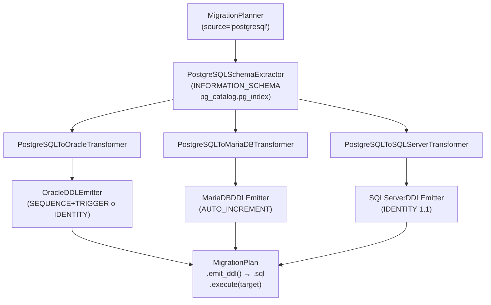

# API — Migración PostgreSQL como origen

## Responsabilidad del módulo

Orquesta la migración DDL desde un schema PostgreSQL hacia Oracle, MariaDB o SQL Server en tres
capas desacopladas: extracción de metadatos PostgreSQL vía `INFORMATION_SCHEMA` y `pg_catalog`,
transformación al modelo canónico IR con mapeo de tipos, y emisión del script DDL con ordenación
topológica por dependencias FK.

## Diagrama



## API pública

| Clase / Función | Firma simplificada | Descripción | Retorna |
|---|---|---|---|
| `MigrationPlanner` | `(source_engine, target_engine, ...)` | Orquestador principal; valida configuración en `__init__` | instancia |
| `MigrationPlanner.plan` | `(connection, schema: str)` | Extrae, transforma y consolida en un plan ejecutable | `MigrationPlan` |
| `MigrationPlan.emit_ddl` | `()` | Script DDL completo listo para guardar en fichero `.sql` | `str` |
| `MigrationPlan.emit_statements` | `()` | Sentencias individuales sin `;`, para ejecución controlada | `list[str]` |
| `MigrationPlan.execute` | `(target_connection)` | Ejecuta cada sentencia DDL contra el motor destino | `None` |
| `MigrationPlan.error_count` | propiedad | Número de warnings con severidad `ERROR` | `int` |
| `MigrationPlan.warning_count` | propiedad | Número de warnings con severidad `WARNING` | `int` |
| `MigrationPlan.info_count` | propiedad | Número de warnings con severidad `INFO` | `int` |
| `format_plan_text` | `(plan: MigrationPlan)` | Reporte de texto plano con avisos agrupados por severidad | `str` |
| `format_plan_markdown` | `(plan: MigrationPlan)` | Reporte Markdown con tabla de avisos y listado de tablas | `str` |
| `PostgreSQLSchemaExtractor` | `(manager)` | Capa de extracción PostgreSQL (uso avanzado) | instancia |
| `PostgreSQLToOracleTransformer` | `()` | Transformación a dialectos Oracle (uso avanzado) | instancia |
| `PostgreSQLToMariaDBTransformer` | `()` | Transformación a dialectos MariaDB (uso avanzado) | instancia |
| `PostgreSQLToSQLServerTransformer` | `()` | Transformación a dialectos SQL Server (uso avanzado) | instancia |
| `OracleDDLEmitter` | `(oracle_identity_mode)` | Generación DDL Oracle; `"sequence_trigger"` \| `"identity_by_default_on_null"` | instancia |
| `MariaDBDDLEmitter` | `(charset, collation, engine)` | Generación DDL MariaDB (uso avanzado) | instancia |
| `SQLServerDDLEmitter` | `(sql_server_collation)` | Generación DDL SQL Server (uso avanzado) | instancia |

## Contrato de entrada

### `MigrationPlanner.__init__`

| Parámetro | Tipo | Descripción | Restricciones |
|---|---|---|---|
| `source_engine` | `str` | Motor origen | `"postgresql"` para este flujo; `ValueError` si no soportado |
| `target_engine` | `str` | Motor destino | `"oracle"` \| `"mariadb"` \| `"sqlserver"`; `ValueError` si igual al origen |
| `charset` | `str` | CHARACTER SET MariaDB | Solo si `target_engine="mariadb"` |
| `collation` | `str` | COLLATE MariaDB | Solo si `target_engine="mariadb"` |
| `sql_server_collation` | `str \| None` | COLLATE columna SQL Server | Solo si `target_engine="sqlserver"`; `None` usa collation de BD destino |
| `oracle_identity_mode` | `Literal["sequence_trigger","identity_by_default_on_null"]` | Modo AUTO_INCREMENT en Oracle destino | Solo si `target_engine="oracle"`; ver tabla en [API Oracle](migrate-oracle-mariadb.md) |

### `MigrationPlanner.plan`

| Parámetro | Tipo | Descripción | Restricciones |
|---|---|---|---|
| `connection` | `SyncDatabaseManager` | Manager con conexión PostgreSQL activa | Duck-typed: requiere `execute_custom_many(sql, params) → list`; param style `%(name)s` |
| `schema` | `str` | `TABLE_SCHEMA` PostgreSQL a migrar | Habitualmente `'public'`; sensible a mayúsculas |

## Contrato de salida

### `MigrationPlanner.plan` → `MigrationPlan`

| Campo | Tipo | Descripción |
|---|---|---|
| `.tables` | `list[CanonicalTable]` | Tablas transformadas, ordenadas topológicamente por FKs |
| `.views` | `list[CanonicalView]` | Vistas transformadas (pass-through v1) |
| `.routines` | `list[CanonicalRoutine]` | Stored procedures y funciones (pass-through v1) |
| `.warnings` | `list[MigrationWarning]` | Todos los avisos consolidados |
| `.source_schema` | `str` | Schema PostgreSQL origen |
| `.source_engine` | `str` | `"postgresql"` |
| `.target_engine` | `str` | Motor destino normalizado en minúsculas |

### `MigrationWarning`

| Campo | Tipo | Descripción |
|---|---|---|
| `.table` | `str` | Nombre de la tabla / rutina afectada |
| `.column` | `str \| None` | Nombre de la columna (`None` para avisos de tabla o rutina) |
| `.oracle_type` | `str` | Tipo PostgreSQL original (campo histórico) o `"IDENTIFIER"` |
| `.target_type` | `str` | Tipo destino resultante |
| `.message` | `str` | Descripción legible de la decisión |
| `.severity` | `"INFO" \| "WARNING" \| "ERROR"` | Nivel de severidad |

## Contratos IR: fuente PostgreSQL

| Campo IR | Fuente PostgreSQL |
|---|---|
| `CanonicalColumn.oracle_type` | `DATA_TYPE` de `INFORMATION_SCHEMA.COLUMNS` (uppercase) |
| `CanonicalColumn.char_length` | `CHARACTER_MAXIMUM_LENGTH` (`None` para tipos sin límite) |
| `CanonicalColumn.auto_increment` | `COLUMN_DEFAULT` comienza con `nextval(` (SERIAL/BIGSERIAL/SMALLSERIAL) |
| `CanonicalIndex` | `pg_catalog.pg_index` + `generate_subscripts` (PG 8.4+) |
| `CanonicalFK.is_external` | `REF_SCHEMA != schema` |

## Errores y casos especiales

| Situación | Comportamiento |
|---|---|
| `source_engine` / `target_engine` no soportados | `ValueError` en `__init__` |
| `source_engine == target_engine` | `ValueError` en `__init__` |
| `CHARACTER VARYING` sin límite (`char_length=None`) | → `CLOB` / `LONGTEXT` / `NVARCHAR(MAX)`; aviso `INFO` |
| `BOOLEAN` → Oracle | → `NUMBER(1,0)`; aviso `WARNING` |
| `JSON`/`JSONB` | → `CLOB`/`LONGTEXT`/`NVARCHAR(MAX)`; aviso `WARNING` |
| `TSVECTOR`/`TSQUERY` | → equivalente CLOB; aviso `ERROR` |
| `ARRAY` | → equivalente CLOB; aviso `ERROR` |
| `USER-DEFINED` (enums) | → equivalente CLOB; aviso `ERROR` |
| Tipos espaciales (`POINT`, etc.) | → VARCHAR/CLOB/LONGTEXT; aviso `ERROR` |
| Identificador > límite del motor | Truncado + sufijo hash `_XXXX`; aviso `WARNING` |
| FK a tabla fuera del schema | `ALTER TABLE ADD CONSTRAINT` al final con comentario; aviso `WARNING` |
| FKs circulares | `CREATE TABLE` sin esas FKs + `ALTER TABLE ADD CONSTRAINT` al final |
| Stored procedure / function | Emitida verbatim con `-- PROCEDURE\|FUNCTION: name` + `-- NOTE: requires manual review` |

## Ejemplo técnico mínimo

=== "PostgreSQL → Oracle"

    ```python
    from util_bbdd import MigrationPlanner

    planner = MigrationPlanner(
        source_engine="postgresql",
        target_engine="oracle",
    )
    plan = planner.plan(connection=pg_manager, schema="public")
    print(f"Errores: {plan.error_count}  Warnings: {plan.warning_count}")
    print(f"Rutinas: {len(plan.routines)}")
    ddl = plan.emit_ddl()
    ```

=== "PostgreSQL → MariaDB"

    ```python
    from util_bbdd import MigrationPlanner

    planner = MigrationPlanner(
        source_engine="postgresql",
        target_engine="mariadb",
        charset="utf8mb4",
        collation="utf8mb4_unicode_ci",
    )
    plan = planner.plan(connection=pg_manager, schema="public")
    ddl = plan.emit_ddl()
    ```

=== "PostgreSQL → SQL Server"

    ```python
    from util_bbdd import MigrationPlanner

    planner = MigrationPlanner(
        source_engine="postgresql",
        target_engine="sqlserver",
        sql_server_collation="SQL_Latin1_General_CP1_CI_AS",
    )
    plan = planner.plan(connection=pg_manager, schema="public")
    ddl = plan.emit_ddl()
    ```
