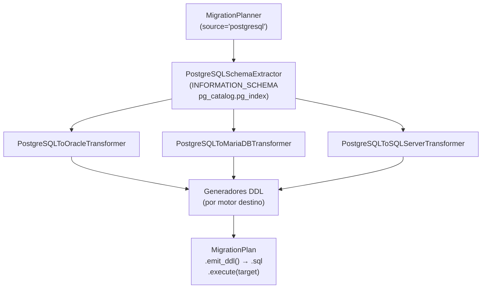

# API — Migración PostgreSQL como Origen

Orquesta la migración DDL desde PostgreSQL hacia Oracle, MariaDB o SQL Server en tres capas desacopladas: extracción vía `INFORMATION_SCHEMA` y `pg_catalog`, transformación al modelo canónico IR y emisión del script DDL.

## 1. Arquitectura y Diseño

## 2. Modelo de Datos / Contratos

### API pública

| Clase / Función | Firma simplificada | Descripción | Retorna |
|---|---|---|---|
| `MigrationPlanner` | `(source_engine, target_engine, ...)` | Orquestador principal | instancia |
| `MigrationPlanner.plan` | `(connection, schema: str)` | Extrae, transforma y consolida en plan ejecutable | `MigrationPlan` |
| `MigrationPlan.emit_ddl` | `()` | Script DDL completo listo para guardar en `.sql` | `str` |
| `MigrationPlan.execute` | `(target_connection)` | Ejecuta cada sentencia DDL contra el motor destino | `None` |
| `MigrationPlan.error_count` | propiedad | Número de warnings con severidad `ERROR` | `int` |
| `format_plan_text` | `(plan: MigrationPlan)` | Reporte de texto plano con avisos | `str` |
| `format_plan_markdown` | `(plan: MigrationPlan)` | Reporte Markdown con tabla de avisos | `str` |

### Contrato de entrada

| Parámetro | Tipo | Descripción | Restricciones |
|---|---|---|---|
| `source_engine` | `str` | Motor origen | `"postgresql"` para este flujo |
| `target_engine` | `str` | Motor destino | `"oracle"`, `"mariadb"` o `"sqlserver"` |
| `charset` | `str` | CHARACTER SET MariaDB | Solo si `target_engine="mariadb"` |
| `sql_server_collation` | `str \| None` | COLLATE para SQL Server | Solo si `target_engine="sqlserver"` |
| `oracle_identity_mode` | `Literal["sequence_trigger","identity_by_default_on_null"]` | Modo columnas SERIAL en Oracle destino | Solo si `target_engine="oracle"` |
| `connection` | `SyncDatabaseManager` | Manager PostgreSQL activo | Param style `%(name)s`; `psycopg2` o `psycopg3` |
| `schema` | `str` | Nombre del schema (`TABLE_SCHEMA`) | Habitualmente `'public'` |

### Contrato de salida

- **`MigrationPlan.emit_ddl()`** — `str` con el script DDL completo.
- **`MigrationPlan.warnings`** — `list[MigrationWarning]` con severidad `INFO`/`WARNING`/`ERROR`.

### Errores y casos especiales

| Error | Cuándo ocurre |
|---|---|
| `ValueError` | Motor origen/destino no soportado |
| `SQLAlchemyError` | Error al consultar `INFORMATION_SCHEMA` o `pg_catalog` |

Tipos sin equivalente directo (`ARRAY`, `TSVECTOR`, `USER-DEFINED`) se mapean a tipos LOB con severidad `ERROR` en los warnings; el script DDL sigue generándose.

## 3. Componentes y Clases

| Clase | Responsabilidad |
|---|---|
| `MigrationPlanner` | Orquestación del flujo completo |
| `PostgreSQLSchemaExtractor` | Extracción desde `INFORMATION_SCHEMA` y `pg_catalog.pg_index` |
| `PostgreSQLToOracleTransformer` / `PostgreSQLToMariaDBTransformer` / `PostgreSQLToSQLServerTransformer` | Mapeo de tipos al dialecto destino |

## 4. Dependencias y Requisitos

| Dependencia | Propósito | Requerida | Comportamiento sin ella |
|---|---|---|---|
| `SyncDatabaseManager` con engine PostgreSQL | Acceso a `INFORMATION_SCHEMA` y `pg_catalog` | Sí | Extracción imposible |
| `psycopg2` o `psycopg3` | Driver Python de PostgreSQL | Sí | `DriverError` al conectar |

## 5. Ejemplos Relacionados

- [Ejemplo: Migración DDL PostgreSQL → Oracle / MariaDB / SQL Server](../examples/migrate-postgresql-source.md) — Script completo de migración con `MigrationPlanner`
