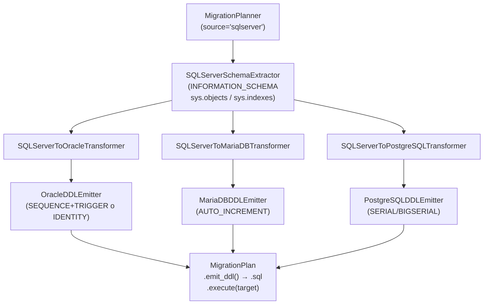

# API — Migración SQL Server como origen

## Responsabilidad del módulo

Orquesta la migración DDL desde un schema SQL Server hacia Oracle, MariaDB o PostgreSQL en tres
capas desacopladas: extracción de metadatos SQL Server vía `INFORMATION_SCHEMA` y `sys.*`,
transformación al modelo canónico IR con mapeo de tipos, y emisión del script DDL con ordenación
topológica por dependencias FK.

## Diagrama



## API pública

| Clase / Función | Firma simplificada | Descripción | Retorna |
|---|---|---|---|
| `MigrationPlanner` | `(source_engine, target_engine, ...)` | Orquestador principal; valida configuración en `__init__` | instancia |
| `MigrationPlanner.plan` | `(connection, schema: str)` | Extrae, transforma y consolida en un plan ejecutable | `MigrationPlan` |
| `MigrationPlan.emit_ddl` | `()` | Script DDL completo listo para guardar en fichero `.sql` | `str` |
| `MigrationPlan.emit_statements` | `()` | Sentencias individuales sin `;`, para ejecución controlada | `list[str]` |
| `MigrationPlan.execute` | `(target_connection)` | Ejecuta cada sentencia DDL contra el motor destino | `None` |
| `MigrationPlan.error_count` | propiedad | Número de warnings con severidad `ERROR` | `int` |
| `MigrationPlan.warning_count` | propiedad | Número de warnings con severidad `WARNING` | `int` |
| `MigrationPlan.info_count` | propiedad | Número de warnings con severidad `INFO` | `int` |
| `format_plan_text` | `(plan: MigrationPlan)` | Reporte de texto plano con avisos agrupados por severidad | `str` |
| `format_plan_markdown` | `(plan: MigrationPlan)` | Reporte Markdown con tabla de avisos y listado de tablas | `str` |
| `SQLServerSchemaExtractor` | `(manager)` | Capa de extracción SQL Server (uso avanzado) | instancia |
| `SQLServerToOracleTransformer` | `()` | Transformación a dialectos Oracle (uso avanzado) | instancia |
| `SQLServerToMariaDBTransformer` | `()` | Transformación a dialectos MariaDB (uso avanzado) | instancia |
| `SQLServerToPostgreSQLTransformer` | `()` | Transformación a dialectos PostgreSQL (uso avanzado) | instancia |
| `OracleDDLEmitter` | `(oracle_identity_mode)` | Generación DDL Oracle; `"sequence_trigger"` \| `"identity_by_default_on_null"` | instancia |
| `MariaDBDDLEmitter` | `(charset, collation, engine)` | Generación DDL MariaDB (uso avanzado) | instancia |
| `PostgreSQLDDLEmitter` | `(pg_schema)` | Generación DDL PostgreSQL (uso avanzado) | instancia |

## Contrato de entrada

### `MigrationPlanner.__init__`

| Parámetro | Tipo | Descripción | Restricciones |
|---|---|---|---|
| `source_engine` | `str` | Motor origen | `"sqlserver"` para este flujo; `ValueError` si no soportado |
| `target_engine` | `str` | Motor destino | `"oracle"` \| `"mariadb"` \| `"postgresql"`; `ValueError` si igual al origen |
| `charset` | `str` | CHARACTER SET MariaDB | Solo si `target_engine="mariadb"` |
| `collation` | `str` | COLLATE MariaDB | Solo si `target_engine="mariadb"` |
| `sql_server_collation` | `str \| None` | COLLATE columna SQL Server | No aplica en SQL Server como origen |
| `pg_schema` | `str \| None` | Schema PostgreSQL | Solo si `target_engine="postgresql"`; emite `SET search_path = schema;` |
| `oracle_identity_mode` | `Literal["sequence_trigger","identity_by_default_on_null"]` | Modo AUTO_INCREMENT en Oracle destino | Solo si `target_engine="oracle"`; ver tabla en [API Oracle](migrate-oracle-mariadb.md) |

### `MigrationPlanner.plan`

| Parámetro | Tipo | Descripción | Restricciones |
|---|---|---|---|
| `connection` | `SyncDatabaseManager` | Manager con conexión SQL Server activa | Duck-typed: requiere `execute_custom_many(sql, params) → list`; param style `%(name)s` (pymssql) |
| `schema` | `str` | `TABLE_SCHEMA` de SQL Server a migrar | Habitualmente `'dbo'`; case-sensitive en SQL Server |

## Contrato de salida

### `MigrationPlanner.plan` → `MigrationPlan`

| Campo | Tipo | Descripción |
|---|---|---|
| `.tables` | `list[CanonicalTable]` | Tablas transformadas, ordenadas topológicamente por FKs |
| `.views` | `list[CanonicalView]` | Vistas transformadas (pass-through v1) |
| `.routines` | `list[CanonicalRoutine]` | Stored procedures y funciones (pass-through v1) |
| `.warnings` | `list[MigrationWarning]` | Todos los avisos consolidados |
| `.source_schema` | `str` | `TABLE_SCHEMA` SQL Server origen |
| `.source_engine` | `str` | `"sqlserver"` |
| `.target_engine` | `str` | Motor destino normalizado en minúsculas |

### `MigrationWarning`

| Campo | Tipo | Descripción |
|---|---|---|
| `.table` | `str` | Nombre de la tabla / rutina afectada |
| `.column` | `str \| None` | Nombre de la columna (`None` para avisos de tabla o rutina) |
| `.oracle_type` | `str` | Tipo SQL Server original (campo histórico) o `"IDENTIFIER"` |
| `.target_type` | `str` | Tipo destino resultante |
| `.message` | `str` | Descripción legible de la decisión |
| `.severity` | `"INFO" \| "WARNING" \| "ERROR"` | Nivel de severidad |

## Contratos IR: fuente SQL Server

| Campo IR | Fuente SQL Server |
|---|---|
| `CanonicalColumn.oracle_type` | `DATA_TYPE` de `INFORMATION_SCHEMA.COLUMNS` |
| `CanonicalColumn.char_length` | `CHARACTER_MAXIMUM_LENGTH` (`-1` para `MAX`) |
| `CanonicalColumn.auto_increment` | `COLUMNPROPERTY(OBJECT_ID(...), col, 'IsIdentity')` |
| `CanonicalRoutine.routine_type` | `sys.objects.type`: `P`→`PROCEDURE`, `FN`/`IF`/`TF`→`FUNCTION` |
| `CanonicalFK.is_external` | `REF_SCHEMA != schema` |
| `CanonicalIndex.unique` | `sys.indexes.is_unique` |

## Errores y casos especiales

| Situación | Comportamiento |
|---|---|
| `source_engine` / `target_engine` no soportados | `ValueError` en `__init__` |
| `source_engine == target_engine` | `ValueError` en `__init__` |
| `VARCHAR(MAX)` / `NVARCHAR(MAX)` | → `CLOB` (Oracle) / `LONGTEXT` (MariaDB) / `TEXT` (PostgreSQL); aviso `INFO` |
| `GEOGRAPHY` / `GEOMETRY` | → `CLOB`/`LONGTEXT`/`NVARCHAR(MAX)`; aviso `ERROR` |
| `DATETIMEOFFSET` → MariaDB | → `VARCHAR(35)`; aviso `WARNING` (sin TZ nativo en MariaDB) |
| `TINYINT` → Oracle | → `NUMBER(3,0)`; rango SS unsigned 0–255 vs Oracle -999..999 |
| Identificador > límite del motor | Truncado a `límite - 5` chars + sufijo `_XXXX`; aviso `WARNING` |
| FK a tabla fuera del schema | `ALTER TABLE ADD CONSTRAINT` al final con comentario; aviso `WARNING` |
| FKs circulares | `CREATE TABLE` sin esas FKs + `ALTER TABLE ADD CONSTRAINT` al final |
| Stored procedure / function | Emitida verbatim con `-- PROCEDURE\|FUNCTION: [name]` + `-- NOTE: requires manual review` |
| `VIEW_DEFINITION` truncada | SS < 2019 puede truncar a 4000 chars; aviso `WARNING` |

## Ejemplo técnico mínimo

=== "SQL Server → Oracle"

    ```python
    from util_bbdd import MigrationPlanner

    planner = MigrationPlanner(
        source_engine="sqlserver",
        target_engine="oracle",
    )
    plan = planner.plan(connection=sqlserver_manager, schema="dbo")
    print(f"Errores: {plan.error_count}  Warnings: {plan.warning_count}")
    print(f"Rutinas: {len(plan.routines)}")
    ddl = plan.emit_ddl()
    ```

=== "SQL Server → MariaDB"

    ```python
    from util_bbdd import MigrationPlanner

    planner = MigrationPlanner(
        source_engine="sqlserver",
        target_engine="mariadb",
        charset="utf8mb4",
        collation="utf8mb4_unicode_ci",
    )
    plan = planner.plan(connection=sqlserver_manager, schema="dbo")
    ddl = plan.emit_ddl()
    ```

=== "SQL Server → PostgreSQL"

    ```python
    from util_bbdd import MigrationPlanner

    planner = MigrationPlanner(
        source_engine="sqlserver",
        target_engine="postgresql",
        pg_schema="mi_schema",
    )
    plan = planner.plan(connection=sqlserver_manager, schema="dbo")
    ddl = plan.emit_ddl()
    ```
