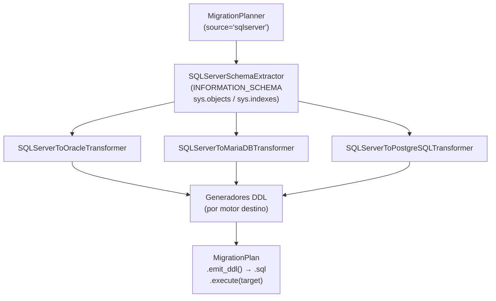

# API — Migración SQL Server como Origen

Orquesta la migración DDL desde SQL Server hacia Oracle, MariaDB o PostgreSQL en tres capas desacopladas: extracción vía `INFORMATION_SCHEMA` y `sys.*`, transformación al modelo canónico IR y emisión del script DDL.

## 1. Arquitectura y Diseño

## 2. Modelo de Datos / Contratos

### API pública

| Clase / Función | Firma simplificada | Descripción | Retorna |
|---|---|---|---|
| `MigrationPlanner` | `(source_engine, target_engine, ...)` | Orquestador principal | instancia |
| `MigrationPlanner.plan` | `(connection, schema: str)` | Extrae, transforma y consolida en plan ejecutable | `MigrationPlan` |
| `MigrationPlan.emit_ddl` | `()` | Script DDL completo listo para guardar en `.sql` | `str` |
| `MigrationPlan.execute` | `(target_connection)` | Ejecuta cada sentencia DDL contra el motor destino | `None` |
| `MigrationPlan.error_count` | propiedad | Número de warnings con severidad `ERROR` | `int` |
| `format_plan_text` | `(plan: MigrationPlan)` | Reporte de texto plano con avisos | `str` |
| `format_plan_markdown` | `(plan: MigrationPlan)` | Reporte Markdown con tabla de avisos | `str` |

### Contrato de entrada

| Parámetro | Tipo | Descripción | Restricciones |
|---|---|---|---|
| `source_engine` | `str` | Motor origen | `"sqlserver"` para este flujo |
| `target_engine` | `str` | Motor destino | `"oracle"`, `"mariadb"` o `"postgresql"` |
| `charset` | `str` | CHARACTER SET MariaDB | Solo si `target_engine="mariadb"` |
| `sql_server_collation` | `str \| None` | COLLATE SQL Server | N/A como origen; aplica solo a destino SQL Server |
| `oracle_identity_mode` | `Literal["sequence_trigger","identity_by_default_on_null"]` | Modo columnas IDENTITY en Oracle destino | Solo si `target_engine="oracle"` |
| `connection` | `SyncDatabaseManager` | Manager SQL Server activo | Param style `%(name)s` (pymssql) |
| `schema` | `str` | Nombre del schema (`TABLE_SCHEMA`) | Habitualmente `'dbo'` |

### Contrato de salida

- **`MigrationPlan.emit_ddl()`** — `str` con el script DDL completo.
- **`MigrationPlan.warnings`** — `list[MigrationWarning]` con severidad `INFO`/`WARNING`/`ERROR`.

### Errores y casos especiales

| Error | Cuándo ocurre |
|---|---|
| `ValueError` | Motor origen/destino no soportado |
| `SQLAlchemyError` | Error al consultar `INFORMATION_SCHEMA` o `sys.*` |

`VIEW_DEFINITION` en `INFORMATION_SCHEMA.VIEWS` puede truncarse a 4000 chars en SQL Server < 2019; vistas largas tendrán DDL incompleto.

## 3. Componentes y Clases

| Clase | Responsabilidad |
|---|---|
| `MigrationPlanner` | Orquestación del flujo completo |
| `SQLServerSchemaExtractor` | Extracción desde `INFORMATION_SCHEMA` y `sys.sql_modules` |
| `SQLServerToOracleTransformer` / `SQLServerToMariaDBTransformer` / `SQLServerToPostgreSQLTransformer` | Mapeo de tipos al dialecto destino |

## 4. Dependencias y Requisitos

| Dependencia | Propósito | Requerida | Comportamiento sin ella |
|---|---|---|---|
| `SyncDatabaseManager` con engine SQL Server | Acceso a catálogos | Sí | Extracción imposible |
| `pymssql` o pyodbc con wrapper | Driver Python de SQL Server | Sí | `DriverError` al conectar |

## 5. Ejemplos Relacionados

- [Ejemplo: Migración DDL SQL Server → Oracle / MariaDB / PostgreSQL](../examples/migrate-sqlserver-source.md) — Script completo de migración con `MigrationPlanner`
