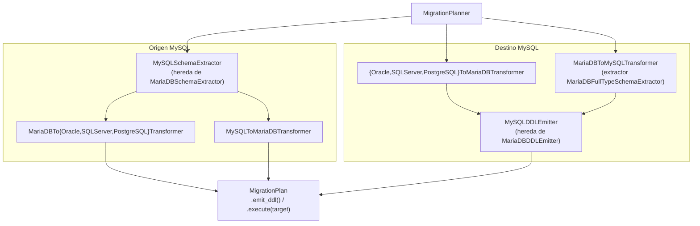

# API — Migración con MySQL (origen y destino)

Añade MySQL a `MigrationPlanner` como origen y como destino. Reutiliza las capas de MariaDB (mismo
`INFORMATION_SCHEMA` y misma sintaxis de tipos) y solo especializa lo que difiere: la lectura de columnas, el
emisor DDL y los dos pares dentro de la familia (MySQL ↔ MariaDB).

## 1. Arquitectura y Diseño

## 2. Modelo de Datos / Contratos

### API pública

| Clase / Función | Firma simplificada | Descripción | Retorna |
|---|---|---|---|
| `MigrationPlanner` | `(source_engine, target_engine, charset, collation, engine, ...)` | Admite `"mysql"` como origen y destino (20 pares) | instancia |
| `MigrationPlanner.plan` | `(connection, schema: str)` | Extrae, transforma y consolida el plan | `MigrationPlan` |
| `MySQLSchemaExtractor` | `(source, *, full_column_types=False)` | Extractor de MySQL; `full_column_types=True` guarda `COLUMN_TYPE` | instancia |
| `MariaDBFullTypeSchemaExtractor` | `(source)` | Extractor de MariaDB con `COLUMN_TYPE` (par MariaDB → MySQL) | instancia |
| `MySQLDDLEmitter` | `(charset, collation, engine="InnoDB")` | DDL MySQL; enteros sin ancho salvo `TINYINT(1)` | instancia |
| `MariaDBToMySQLTransformer` / `MySQLToMariaDBTransformer` | `()` | Pares de la familia: tipo completo del origen | instancia |
| `validate_mysql_collation` | `(collation: str)` | Valida la collation para MySQL | `str` |
| `DEFAULT_COLLATION_MYSQL` | constante | `utf8mb4_0900_ai_ci` | `str` |

### Contrato de entrada

| Parámetro | Tipo | Descripción | Restricciones |
|---|---|---|---|
| `source_engine` | `str` | Motor origen | `"oracle"`, `"mariadb"`, `"mysql"`, `"sqlserver"` o `"postgresql"` |
| `target_engine` | `str` | Motor destino | Los mismos; distinto del origen |
| `collation` | `str` | COLLATE de las tablas (destinos MariaDB y MySQL) | Con destino `"mysql"`, el valor por defecto se sustituye por `DEFAULT_COLLATION_MYSQL`; `utf8mb4_uca1400_ai_ci` explícita lanza `ValueError` |
| `connection` | `SyncDatabaseManager` o `MetadataSource` | Manager del origen (`db_type="mysql"` si el origen es MySQL) | Lee el catálogo con `metadata_source` (snapshot de `metadata/`, una consulta por tipo de objeto; ADR-003) |
| `schema` | `str` | Schema origen; en MySQL, el nombre de la base de datos | — |

### Contrato de salida

- **`MigrationPlan.emit_ddl()`** — `str` con el script DDL, ordenado por dependencias FK. Con destino MySQL:
  `ENGINE=InnoDB DEFAULT CHARSET=... COLLATE=utf8mb4_0900_ai_ci` (o la collation indicada).
- **`MigrationPlan.warnings`** — incluye un aviso por cada tipo exclusivo de MariaDB sustituido (`UUID`, `INET4`,
  `INET6`).

### Errores y casos especiales

| Error | Cuándo ocurre |
|---|---|
| `ValueError` | Motor no soportado, origen igual a destino, o collation no válida en MySQL |
| Aviso `DEFAULT ... tiene forma de llamada a función` | Default con una función del origen sin equivalente conocido (p. ej. `newid()`): revisar el DDL |

## 3. Componentes y Clases

| Clase | Responsabilidad |
|---|---|
| `MySQLSchemaExtractor` | Snapshot de `metadata/` → IR; los defaults literales llegan entrecomillados desde `MySQLCatalog` (convenio de MariaDB; `metadata.mariadb.catalog.quote_literal_default`) |
| `MariaDBFullTypeSchemaExtractor` | Igual, con `COLUMN_TYPE` completo y los defaults de MariaDB |
| `MySQLDDLEmitter` | Emisor de MariaDB con enteros sin ancho de visualización |
| `MySQLFamilyTransformer` | Base de los pares MySQL ↔ MariaDB: tipo completo del origen salvo `_TYPE_OVERRIDES` |
| `MariaDBToMySQLTransformer` | `UUID` → `CHAR(36)`, `INET4` → `VARCHAR(15)`, `INET6` → `VARCHAR(39)` |
| `MySQLToMariaDBTransformer` | Tipo completo sin sustituciones |

El SQL de lectura de columnas con `COLUMN_TYPE` vive en `metadata/mysql/tables.py` (`fetch_columns_with_type_sql`),
el único punto autorizado para SQL de introspección.

## 4. Dependencias y Requisitos

| Dependencia | Propósito | Requerida | Comportamiento sin ella |
|---|---|---|---|
| `SyncDatabaseManager` con `db_type="mysql"` | Acceso a `INFORMATION_SCHEMA` (origen MySQL) | Sí, si el origen es MySQL | Extracción imposible |
| `pymysql` (extra `util_bbdd[mysql]`) | Driver de MySQL | Sí, para conectar con MySQL | `DriverError` al crear el manager |
| MySQL 8.0+ | Destino | Sí | `utf8mb4_0900_ai_ci` no existe en versiones anteriores |

## 5. Ejemplos Relacionados

- [Ejemplo: Migración MySQL → PostgreSQL](../examples/migrate_mysql.md) — plan, avisos y DDL de un schema MySQL; collation con MySQL como destino
- [Migración MariaDB como origen](migrate_mariadb_source.md) — capas que MySQL reutiliza como origen
