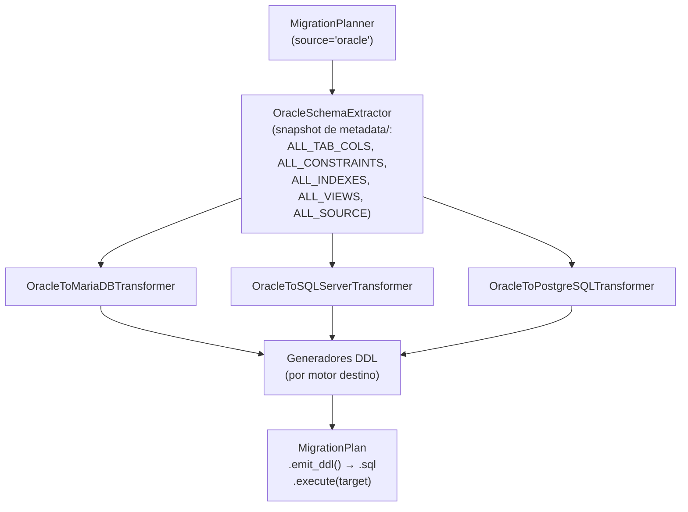

# API — Migración Oracle como Origen

Orquesta la migración DDL desde Oracle hacia MariaDB, MySQL, SQL Server o PostgreSQL en tres capas desacopladas: extracción de metadatos Oracle, transformación al modelo canónico IR y emisión del script DDL con ordenación topológica por dependencias FK.

## 1. Arquitectura y Diseño

## 2. Modelo de Datos / Contratos

### API pública

| Clase / Función | Firma simplificada | Descripción | Retorna |
|---|---|---|---|
| `MigrationPlanner` | `(source_engine, target_engine, ...)` | Orquestador principal; valida configuración en `__init__` | instancia |
| `MigrationPlanner.supported_sources` / `supported_targets` | `()` (estáticos) | Motores que admiten `source_engine` y `target_engine`, en orden alfabético (4.3.0) | `tuple[str, ...]` |
| `MigrationPlanner.plan` | `(connection, schema: str)` | Extrae, transforma y consolida en plan ejecutable | `MigrationPlan` |
| `MigrationPlan.emit_ddl` | `()` | Script DDL completo listo para guardar en `.sql` | `str` |
| `MigrationPlan.execute` | `(target_connection, *, audit_sink=None, dry_run=False, stop_on_error=True)` | Ejecuta cada sentencia DDL contra el motor destino; con `audit_sink`, un evento por sentencia ([auditoría](audit.md)); `dry_run` y `stop_on_error` desde 4.3.0 | `ExecutionResult` (4.3.0; antes `None`) |
| `MigrationPlan.check_target` | `(target_connection, *, schema=None, validate_views=False)` | Tablas y vistas del plan que ya existen en el destino (y, si se pide, vistas que el destino rechaza), sin cambiar nada (4.3.0) | `TargetCheck` |
| `MigrationPlan.to_dict` | `()` | Plan serializable a JSON (`format="util_bbdd.migration_plan"`, `format_version=1`, `statements_sha256`) para revisarlo y ejecutarlo después sin replanificar (4.3.0) | `dict` |
| `MigrationPlan.from_dict` | `(data)` (de clase) | Reconstruye el plan; vuelve a emitir y exige el mismo `statements_sha256` (4.3.0) | `MigrationPlan` |
| `MigrationPlan.statements_sha256` | `()` | SHA-256 de `emit_statements()` (sentencias separadas por NUL) (4.3.0) | `str` |
| `MigrationPlan.error_count` | propiedad | Número de warnings con severidad `ERROR` | `int` |
| `format_plan_text` | `(plan: MigrationPlan)` | Reporte de texto plano con avisos agrupados por severidad | `str` |
| `format_plan_markdown` | `(plan: MigrationPlan)` | Reporte Markdown con tabla de avisos | `str` |

### Contrato de entrada

| Parámetro | Tipo | Descripción | Restricciones |
|---|---|---|---|
| `source_engine` | `str` | Motor origen | `"oracle"` para este flujo |
| `target_engine` | `str` | Motor destino | `"mariadb"`, `"mysql"`, `"sqlserver"` o `"postgresql"` |
| `charset` | `str` | CHARACTER SET MariaDB | Solo si `target_engine="mariadb"` |
| `collation` | `str` | COLLATE MariaDB | Solo si `target_engine="mariadb"` |
| `number_fallback` | `Literal["DOUBLE","DECIMAL(38,10)","DECIMAL(18,4)"]` | Tipo para `NUMBER` Oracle sin precisión | Mapeado al equivalente del motor destino |
| `sql_server_collation` | `str \| None` | COLLATE para SQL Server | Solo si `target_engine="sqlserver"` |
| `pg_schema` | `str \| None` | Schema PostgreSQL | Solo si `target_engine="postgresql"`; emite `SET search_path` |
| `connection` | `SyncDatabaseManager` o `MetadataSource` | Manager Oracle activo | Lee el catálogo con `metadata_source` (snapshot de `metadata/`, una consulta por tipo de objeto; ADR-003) |
| `schema` | `str` | Schema/owner Oracle | Sensible a mayúsculas en Oracle |

### Contrato de salida

- **`MigrationPlan.emit_ddl()`** — `str` con el script DDL completo, ordenado por dependencias FK.
- **`MigrationPlan.warnings`** — `list[MigrationWarning]` con `table`, `column`, `severity` (`INFO`/`WARNING`/`ERROR`), `message` y `proposals`.
- **`MigrationPlan.error_count`** — `int`; verificar antes de `execute()`.
- **`MigrationPlan.to_dict()` / `from_dict()`** (4.3.0) — `MigrationPlan.from_dict(json.loads(json.dumps(plan.to_dict())))`
  emite las mismas sentencias y se ejecuta igual. `from_dict` lanza `MigrationPlanValidationError` (también
  `ValueError`) con un `format` o `format_version` desconocidos, un campo ausente o de otro tipo (con su ruta) o si el
  plan reconstruido no emite las sentencias de `statements_sha256` (p. ej., guardado con otra versión de util_bbdd que
  emite otro DDL: hay que volver a planificar). El hash viaja con los datos y no protege de una manipulación: si el
  fichero no es de confianza, guarda el hash aparte y compáralo con `statements_sha256()` antes de `execute()`.

- **`MigrationPlan.check_target(target)`** (4.3.0) — `TargetCheck` con `conflicts` (`TargetConflict`: `name`, `kind`,
  `existing_name`, `existing_kind`), `views`/`invalid_views` (con `validate_views=True`) y `ok`. Lee el catálogo del
  destino con su `MetadataSource` (manager, `MetadataSource` o `Engine`), sin caché, en `schema` o, por defecto, el
  `pg_schema` del plan (PostgreSQL) o el schema de la conexión. Compara sin distinguir mayúsculas.
- **`MigrationPlan.execute(...)`** (4.3.0) — devuelve `ExecutionResult` (`statements`, `applied`, `failures`,
  `dry_run`, `total`, `ok`). `dry_run=True` comprueba el plan y emite las sentencias sin conectar con el destino.
  `stop_on_error=False` sigue tras una sentencia que falla y la deja en `failures` (`StatementFailure`: `position`,
  `statement`, `error_type`, `message`).
- **Atomicidad**: `execute()` **no es atómico**. MySQL, MariaDB y Oracle confirman cada sentencia DDL por sí mismas y no
  se pueden deshacer; PostgreSQL y SQL Server confirman tras cada una para comportarse igual. Si una sentencia falla,
  las anteriores quedan aplicadas: comprueba antes con `check_target()` y `dry_run=True`.

### Errores y casos especiales

| Error | Cuándo ocurre |
|---|---|
| `ValueError` | Motor origen/destino no soportado, charset/collation inválidos |
| `MigrationStatementError` | Una sentencia de `execute()` falla (`stop_on_error=True`): `position`, `total`, `statement` y `result`; subclase de `DatabaseOperationError` (4.3.0) |
| `MetadataError` | Error al leer el catálogo del origen (envuelve el error del driver) |
| `TypeError` | `connection` no es un manager de `util_bbdd` ni una `MetadataSource` |

## 3. Componentes y Clases

| Clase | Responsabilidad |
|---|---|
| `MigrationPlanner` | Orquestación del flujo extracción → transformación → emisión |
| `OracleSchemaExtractor` | Snapshot de `metadata/` (catálogos `ALL_*`) → IR |
| `OracleToMariaDBTransformer` / `OracleToSQLServerTransformer` / `OracleToPostgreSQLTransformer` | Mapeo de tipos Oracle al dialecto destino |
| `MariaDBDDLEmitter` / `SQLServerDDLEmitter` / `PostgreSQLDDLEmitter` | Generación del DDL final por motor |

## 4. Dependencias y Requisitos

| Dependencia | Propósito | Requerida | Comportamiento sin ella |
|---|---|---|---|
| `SyncDatabaseManager` con engine Oracle | Acceso a catálogos `ALL_*` | Sí | Extracción imposible |
| `oracledb` (extra `util_bbdd[oracle]`) | Driver del manager sync de Oracle | Sí | `DriverError` al crear el manager |

## 5. Ejemplos Relacionados

- [Ejemplo: Migración DDL Oracle → MariaDB / SQL Server / PostgreSQL](../examples/migrate_oracle_mariadb.md) — Script completo de migración con `MigrationPlanner`
