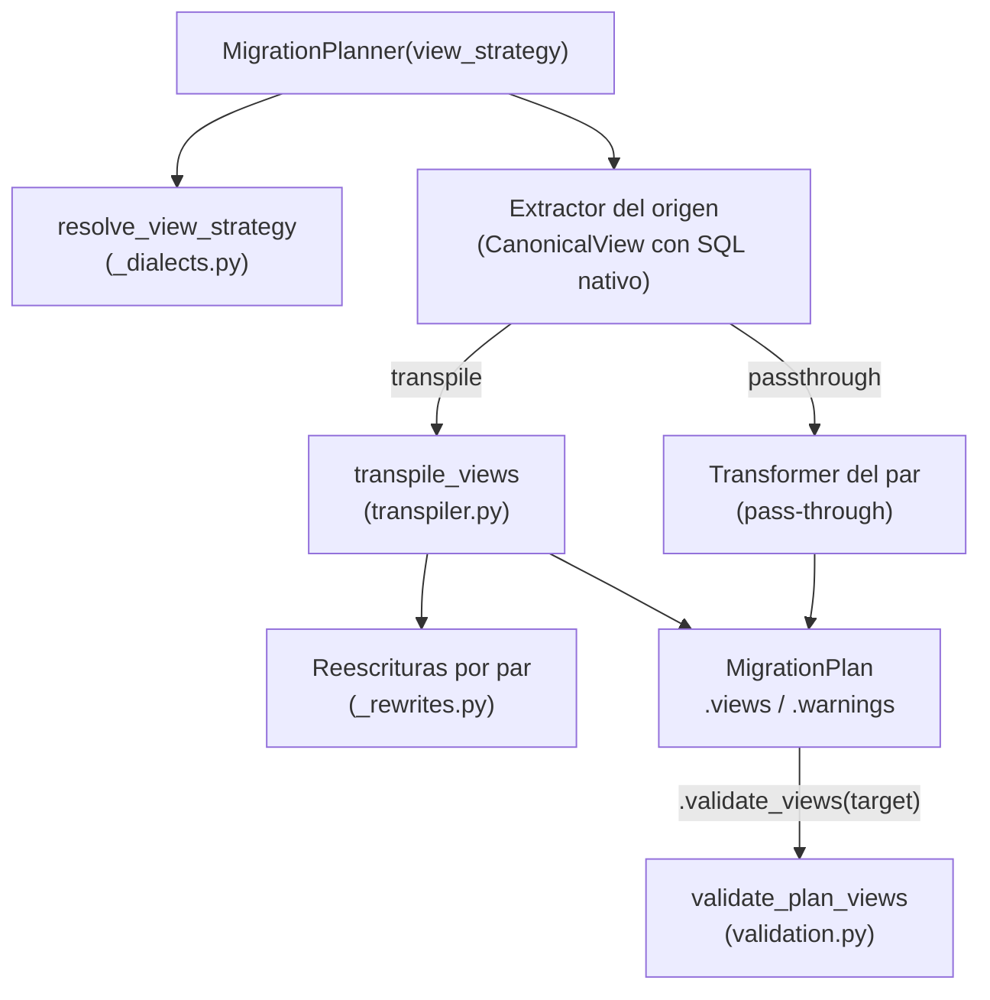

# API — Migración de vistas entre motores

Reescritura del SQL de las vistas al dialecto destino con sqlglot (`view_strategy` de `MigrationPlanner`) y
validación de las vistas de un plan contra el destino (`MigrationPlan.validate_views`). Código en
`src/util_bbdd/migrate/views/`.

## 1. Arquitectura y Diseño

`transpile_view` analiza el SQL con el dialecto sqlglot del origen, cualifica columnas con el esquema de tipos del
plan, aplica las reescrituras del par (`_rewrites.py`), sustituye los nombres por los del plan y genera el SQL con el
dialecto destino. Si algún paso falla o detecta una construcción sin traducción fiable, devuelve la vista sin
reescribir con un aviso.

## 2. Modelo de Datos / Contratos

### API pública

| Clase / Función | Firma simplificada | Descripción | Retorna |
|---|---|---|---|
| `MigrationPlanner` | `(source_engine, target_engine, ..., view_strategy="auto")` | Estrategia de vistas del plan | instancia |
| `MigrationPlan.validate_views` | `(target_connection=None, *, include_tables=True, audit_sink=None)` | Valida las vistas del plan en el destino sin dejar cambios | `list[ViewValidationResult]` |
| `ViewValidationResult` | dataclass `(view, valid, method, error)` | Resultado por vista | — |
| `ViewStrategy` | `Literal["auto", "transpile", "passthrough"]` | Tipo de `view_strategy` | — |
| `migrate.views.resolve_view_strategy` | `(strategy: str)` | Normaliza la estrategia; `"auto"` → `"transpile"` o `"passthrough"` | `str` |
| `migrate.views.sqlglot_available` | `()` | Indica si sqlglot se puede importar | `bool` |
| `migrate.views.transpiler.transpile_views` | `(views, ctx: ViewTranspileContext)` | Reescribe una lista de vistas | `list[CanonicalView]` |

`ViewStrategy` y `ViewValidationResult` se exportan desde `util_bbdd.migrate`.

### Contrato de entrada

| Parámetro | Tipo | Descripción | Restricciones |
|---|---|---|---|
| `view_strategy` | `str` | `"auto"`, `"transpile"` o `"passthrough"` (sin distinguir mayúsculas) | `"transpile"` exige sqlglot |
| `target_connection` | `SyncDatabaseManager`, `Engine` o `Connection` | Destino de la validación | Obligatorio con destino PostgreSQL o SQL Server; se ignora en el resto. Un `Engine` no debe estar en `AUTOCOMMIT` |
| `include_tables` | `bool` | Crear también las tablas del plan en la transacción de validación | Con `False`, las tablas deben existir ya en el destino |

### Contrato de salida

- **`CanonicalView.query`** — SQL del `SELECT` en el dialecto destino (sin `CREATE VIEW`); lo envuelve el emisor DDL.
- **`CanonicalView.warnings`** — avisos por vista (`category="VIEW"`); para filtrarlos, usa `code` (estable desde
  0.22.0), no el texto de `target_type`:

| `code` | `target_type` | Severidad | Significado |
|---|---|---|---|
| `VIEW_REWRITTEN` | `VIEW (reescrita)` | `INFO` | Vista reescrita al dialecto destino; revisar |
| `VIEW_ORACLE_SEMANTICS` | `VIEW (semántica Oracle)` | `WARNING` | Origen o destino Oracle: cadena vacía = `NULL`, `\|\|` ignora `NULL` |
| `VIEW_EXTERNAL_REFERENCE` | `VIEW (referencia externa)` | `WARNING` | Usa objetos fuera del schema migrado |
| `VIEW_HIERARCHY` | `VIEW (jerarquía)` | `WARNING` | `CONNECT BY` convertido en CTE recursiva: límite de recursión del destino, ciclos (o `NOCYCLE` con el camino de antepasados: array en PostgreSQL, texto en el resto), orden |
| `VIEW_NOT_REWRITTEN` | `VIEW (sin reescribir)` | `WARNING` | Copiada sin reescribir (construcción sin traducción, error de sqlglot o sin sqlglot); con `CONNECT BY`, el motivo entre paréntesis |

- **`ViewValidationResult`** — `view` (nombre en el destino), `valid` (`True`/`False`, o `None` si no se validó),
  `method` (`"transaction"`, `"syntax"` o `"none"`) y `error` (primera línea del error del motor o de sqlglot, o el
  motivo de no validar). Las vistas sin SQL no aparecen.

### Errores y casos especiales

| Error | Cuándo ocurre |
|---|---|
| `ValueError` | `view_strategy` no válida; `validate_views` con destino PostgreSQL o SQL Server sin `target_connection` |
| `ImportError` | `view_strategy="transpile"` sin sqlglot (mensaje con `pip install "util_bbdd[migrate]"`) |
| `valid=None`, `method="none"` | Destino MySQL, MariaDB u Oracle sin sqlglot: no se puede validar sin dejar objetos |

## 3. Componentes y Clases

| Componente | Responsabilidad |
|---|---|
| `views/_dialects.py` | `ViewStrategy`, `SQLGLOT_DIALECT` (MariaDB usa el dialecto `mysql`), `resolve_view_strategy`, `sqlglot_available` |
| `views/transpiler.py` | `ViewTranspileContext` (motores, schema origen, nombres, tipos y columnas enteras del plan) y `transpile_view(s)` |
| `views/_rewrites.py` | Reescrituras por par: `CONVERT ... USING`, `TO_DAYS`, aritmética de fechas, `+` de T-SQL, `(+)`, `ROWNUM`, `ILIKE`, agregados de texto, tipos y funciones de fecha de Oracle, `CONNECT BY` → CTE recursiva (`oracle_connect_by`), construcciones sin traducción |
| `views/validation.py` | `ViewValidationResult` y `validate_plan_views`: transacción con un *savepoint* por sentencia en PostgreSQL/SQL Server; sintaxis con sqlglot en el resto |
| `_compat/sql_view_header.py` | Separa la cabecera `CREATE VIEW v (a, b) AS` de SQL Server del `SELECT` |

## 4. Dependencias y Requisitos

| Dependencia | Propósito | Requerida | Comportamiento sin ella |
|---|---|---|---|
| `sqlglot>=30,<31` (extra `util_bbdd[migrate]`) | Análisis y generación de SQL por dialecto | No | `"auto"` copia sin reescribir; `"transpile"` lanza `ImportError`; validación `"none"` en destinos no transaccionales |
| Conexión al destino | Validación transaccional | Solo con destino PostgreSQL o SQL Server | `ValueError` |

## 5. Ejemplos Relacionados

- [Ejemplo: Migración de Vistas (PostgreSQL → MySQL)](../examples/migrate_views.md) — vista reescrita con sqlglot, su aviso `VIEW_REWRITTEN` y la validación sintáctica
- Guía paso a paso: [Migración DDL entre motores § 3.5](../guides/ddl_migration_guide.md)
