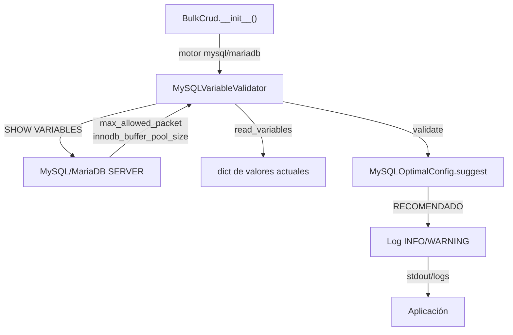

# MySQL Variables Validator

Proporciona validación read-only de variables críticas MySQL/MariaDB antes de operaciones bulk de alto volumen, leyendo la configuración del servidor sin requerir privilegios SUPER y sin modificar nada.

## 1. Arquitectura y Diseño

## 2. Modelo de Datos / Contratos

### API pública

#### Clase `MySQLVariableValidator`

| Método | Firma simplificada | Descripción | Retorna |
|---|---|---|---|
| `MySQLVariableValidator` | `(connection)` | Inicializa con conexión SQLAlchemy | `MySQLVariableValidator` |
| `read_variables` | `()` | Lee variables críticas del servidor | `dict[str, int]` (bytes) |
| `validate` | `(required: dict[str, int])` | Valida que valores actuales ≥ requeridos | `dict[str, bool]` |

#### Dataclass `MySQLOptimalConfig`

| Método / Atributo | Firma simplificada | Descripción | Retorna |
|---|---|---|---|
| `dev` | `()` *(estático)* | Config para desarrollo (< 50K filas) | `MySQLOptimalConfig` |
| `production` | `()` *(estático)* | Config para producción (100K–1M filas) | `MySQLOptimalConfig` |
| `high_volume` | `()` *(estático)* | Config para alto volumen (> 1M filas) | `MySQLOptimalConfig` |
| `suggest` | `(num_rows, avg_row_bytes?)` *(estático)* | Sugiere config óptima según tamaño de dataset | `MySQLOptimalConfig` |
| `innodb_buffer_pool_size` | `int` | Bytes recomendados de InnoDB buffer pool | — |
| `max_allowed_packet` | `int` | Bytes recomendados de max_allowed_packet | — |

### Contrato de entrada

| Parámetro | Tipo | Descripción | Restricciones |
|---|---|---|---|
| `connection` | `Any` | Conexión SQLAlchemy activa | No puede ser `None`; `ValueError` si es `None` |
| `required` | `dict[str, int]` | Variables y valores mínimos en bytes | Claves deben ser nombres válidos de variables MySQL |
| `num_rows` | `int` | Número de filas a insertar | Para `suggest()`; determina el perfil recomendado |

### Contrato de salida

- **`read_variables`** — `dict[str, int]` con nombre de variable → valor en bytes.
- **`validate`** — `dict[str, bool]` con nombre de variable → `True` si válido, `False` si insuficiente.
- **`suggest`** — `MySQLOptimalConfig` frozen con `innodb_buffer_pool_size` y `max_allowed_packet` recomendados.

### Errores y casos especiales

| Error / Situación | Cuándo ocurre |
|---|---|
| `ValueError` | `connection=None` al crear el validador |
| Variable no encontrada | DEBUG log; se omite del resultado sin error |
| Permisos insuficientes en `INFORMATION_SCHEMA` | WARNING log; variable omitida del resultado |

## 3. Componentes y Clases

| Clase | Responsabilidad |
|---|---|
| `MySQLVariableValidator` | Lectura y validación de variables del servidor MySQL/MariaDB |
| `MySQLOptimalConfig` | Perfiles predefinidos de configuración óptima por workload |

## 4. Dependencias y Requisitos

| Dependencia | Propósito | Requerida | Comportamiento sin ella |
|---|---|---|---|
| `sqlalchemy` | Conexión para ejecutar `SHOW VARIABLES` | Sí | Módulo no funciona |
| Permisos sobre `INFORMATION_SCHEMA` | Leer variables del servidor | Sí (lectura) | WARNING en log; variables omitidas del resultado |

## 5. Ejemplos Relacionados

- [Ejemplo: Validación de Variables MySQL/MariaDB](../examples/mysql_variables_example.md) — Uso de `MySQLVariableValidator` y perfiles `MySQLOptimalConfig`
