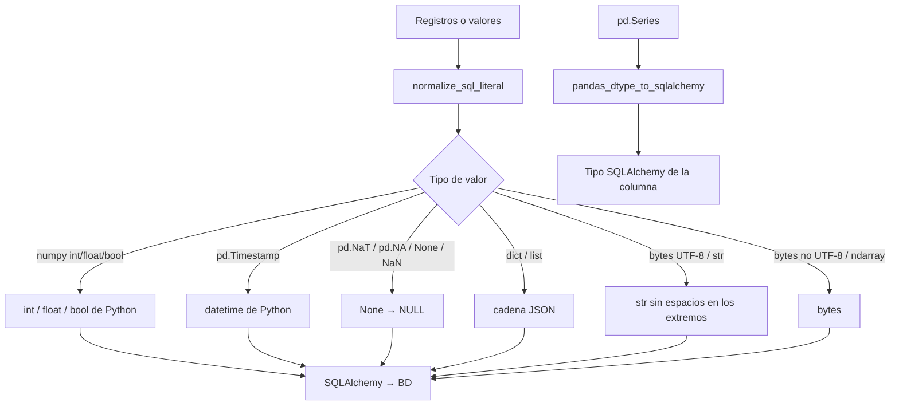

# Normalización de Datos (bulk.normalize)

Convierte los valores de pandas y numpy en valores nativos de Python que aceptan los drivers de todos los motores
(a través de SQLAlchemy), y deduce el tipo de columna SQLAlchemy de una serie de pandas. `BulkCrud` lo usa al preparar
cada lote; las funciones también se pueden usar sueltas.

## 1. Arquitectura y Diseño

## 2. Modelo de Datos / Contratos

### API pública

`normalize_records_for_sql` y `normalize_sql_literal` se exportan desde `util_bbdd.bulk`; el resto, desde
`util_bbdd.bulk.normalize`.

| Función | Firma simplificada | Descripción | Retorna |
|---|---|---|---|
| `normalize_sql_literal` | `(value)` | Normaliza un valor | Valor nativo de Python (o `None`) |
| `normalize_records_for_sql` | `(records: Sequence[dict])` | Normaliza una lista de diccionarios (claves a `str`) | `list[dict[str, Any]]` |
| `iter_normalize_records` | `(records: Sequence[dict])` | Igual, perezoso | `Iterator[dict[str, Any]]` |
| `pandas_dtype_to_sqlalchemy` | `(series: pd.Series)` | Tipo de columna SQLAlchemy para una serie | Tipo de SQLAlchemy |

### Contrato de salida

**`normalize_sql_literal`** (medido con la versión actual):

| Entrada | Salida |
|---|---|
| `np.int64`, `np.float32`/`np.float64`, `np.bool_` | `int`, `float`, `bool` |
| `pd.Timestamp` | `datetime.datetime` |
| `pd.NaT`, `pd.NA`, `None`, `np.nan` | `None` (→ `NULL`) |
| `dict`, `list` | Cadena JSON (`json.dumps(..., ensure_ascii=False)`) |
| `str` | La misma cadena sin espacios en los extremos |
| `bytes` decodificables como UTF-8 | `str` |
| `bytes` no UTF-8 | `bytes` sin cambios |
| `np.ndarray` | `bytes` (`tobytes()`) |
| `decimal.Decimal`, `datetime.date` | Sin cambios |

**`pandas_dtype_to_sqlalchemy`**:

| dtype de la serie | Tipo SQLAlchemy |
|---|---|
| Entero / flotante / booleano | `Integer` / `Float` / `Boolean` |
| `datetime64` | `DateTime` |
| `timedelta64` | `String(255)` |
| Cadenas | `String(longitud máxima + 1)`; `Text` desde 4000 caracteres |
| `object` con `dict`/`list` / con `bytes` | `JSON` / `LargeBinary` |
| Resto | `String(255)` |

### Errores y casos especiales

Las funciones no lanzan excepciones propias; un valor de un tipo no contemplado se devuelve tal cual.

## 3. Componentes y Clases

*No aplica para este módulo.* El módulo expone solo funciones; no define clases públicas.

## 4. Dependencias y Requisitos

| Dependencia | Propósito | Requerida | Comportamiento sin ella |
|---|---|---|---|
| `pandas` | DataFrames y tipos de datos | Sí (dependencia de la librería) | No aplica |
| `numpy` | Tipos numéricos numpy | Sí (dependencia de pandas) | No aplica |
| `sqlalchemy` | Tipos de `pandas_dtype_to_sqlalchemy` | Sí (dependencia de la librería) | No aplica |

## 5. Ejemplos Relacionados

- [Ejemplo: Normalizar Registros para SQL](../examples/normalize_records.md) — registros de un `DataFrame` a tipos nativos y tipo SQLAlchemy inferido por columna
- [Ejemplo: Bulk Insert desde CSV](../examples/bulk_insert_csv.md) — la normalización dentro de una carga
