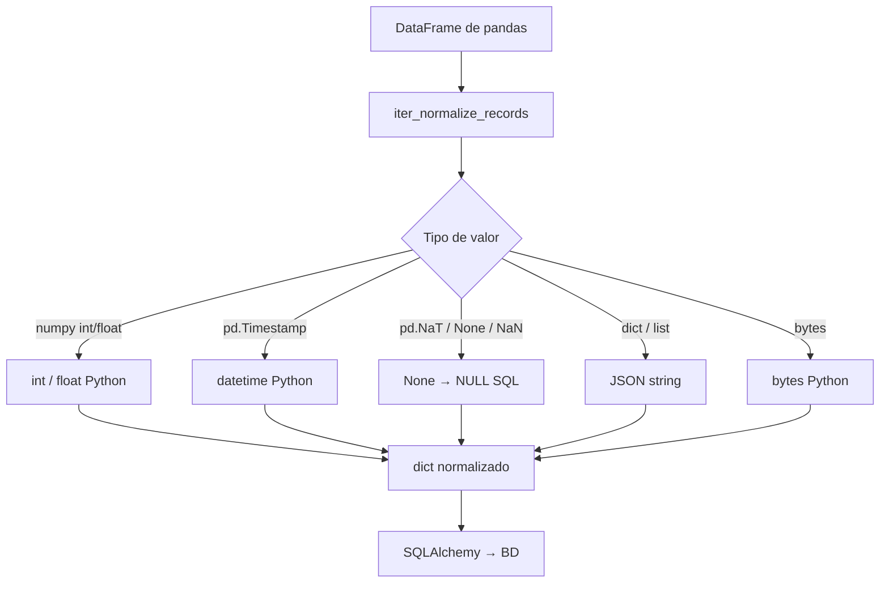

# Normalización de Datos (bulk.normalize)

Normaliza datos procedentes de DataFrames de pandas para que puedan insertarse en bases de datos multi-motor, traduciendo tipos numpy, pandas y Python a tipos SQL estándar sin pérdida de información.

## 1. Arquitectura y Diseño

## 2. Modelo de Datos / Contratos

### API pública

| Función | Firma simplificada | Descripción | Retorna |
|---|---|---|---|
| `normalize_records_for_sql` | `(records: Sequence[dict])` | Normaliza lista de diccionarios para SQL | `list[dict[str, Any]]` |
| `iter_normalize_records` | `(records: Sequence[dict])` | Itera y normaliza registros (eficiente en memoria) | `Iterator[dict[str, Any]]` |
| `normalize_sql_literal` | `(value: Any, sql_type: str)` | Normaliza un valor individual con tipado SQL | `str` (valor SQL con formato) |
| `pandas_dtype_to_sqlalchemy` | `(series: pd.Series)` | Detecta el tipo SQLAlchemy óptimo para una serie pandas | `TypeEngine` |

### Contrato de entrada

| Parámetro | Tipo | Descripción | Restricciones |
|---|---|---|---|
| `records` | `Sequence[dict[Any, Any]]` | Diccionarios con datos a normalizar | Lista vacía es válida; `None` no |
| `value` | `Any` | Valor individual a normalizar | `None` se normaliza a `NULL` |
| `sql_type` | `str` | Tipo SQL destino (p.ej. `"INTEGER"`, `"VARCHAR"`) | Dependiente del motor SQL |
| `series` | `pd.Series` | Serie de pandas | Sin restricción de longitud |

### Contrato de salida

| Función | Retorna | Detalles |
|---|---|---|
| `normalize_records_for_sql` | `list[dict[str, Any]]` | Claves originales; `None` Python → `NULL` en SQLAlchemy |
| `iter_normalize_records` | `Iterator[dict[str, Any]]` | Iterador perezoso; normaliza bajo demanda |
| `normalize_sql_literal` | `str` | Valor en formato SQL listo para concatenación. **Uso interno**; preferible usar `bindparam` de SQLAlchemy |
| `pandas_dtype_to_sqlalchemy` | `sqlalchemy.types.TypeEngine` | Tipo SQLAlchemy inferred: `Integer`, `String(255)`, `DateTime`, `JSON`, etc. |

**Mapeo de tipos principales:**

| Tipo de entrada | Tipo SQL resultante |
|---|---|
| `int`, `np.int8`–`np.int64` | `INTEGER` |
| `float`, `np.float32`–`np.float64` | `FLOAT` |
| `bool`, `np.bool_` | `BOOLEAN` (→ 1/0 según motor) |
| `datetime.datetime`, `pd.Timestamp` | `DATETIME` |
| `pd.NaT`, `None`, `np.nan` | `None` → `NULL` |
| `dict`, `list` | JSON string |

### Errores y casos especiales

*No aplica para este módulo.* Las funciones no lanzan excepciones; los valores no normalizables se pasan tal cual.

## 3. Componentes y Clases

*No aplica para este módulo.* El módulo expone solo funciones; no define clases públicas.

## 4. Dependencias y Requisitos

| Dependencia | Propósito | Requerida | Comportamiento sin ella |
|---|---|---|---|
| `pandas` | DataFrames y tipos de datos | Sí | Módulo no funciona |
| `numpy` | Tipos numéricos numpy | Sí | Tipos numpy no se normalizan |
| `sqlalchemy` | Tipos `TypeEngine` para `pandas_dtype_to_sqlalchemy` | Sí | `pandas_dtype_to_sqlalchemy` no funciona |

## 5. Ejemplos Relacionados

!!! info "Ejemplo en preparación"
    Pendiente — crear ejemplo en docs/examples/normalize.md
