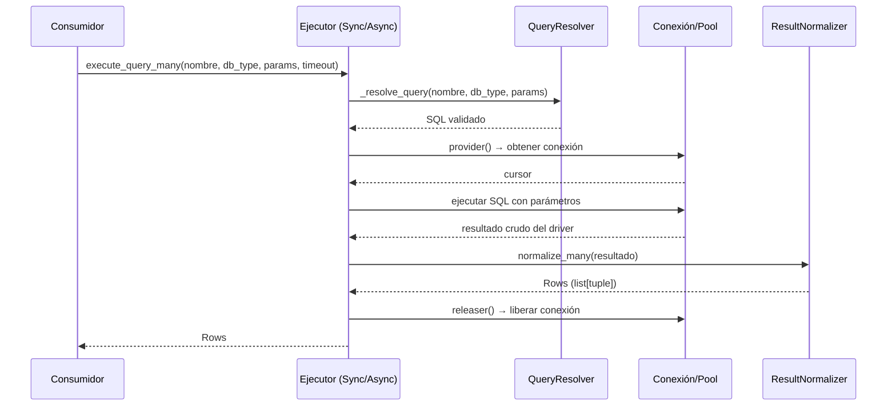

# Referencia Técnica: Ejecución de Consultas

## Responsabilidad del módulo

Proporciona `SyncQueryExecutor` y `AsyncQueryExecutor` para ejecutar consultas SQL registradas
o libres sobre múltiples motores, y los tipos `Row`, `Rows`, `RowOrNone` junto con
`ResultNormalizer` para convertir resultados crudos de drivers a contratos estables.

## Diagrama



## API pública

### SyncQueryExecutor

| Método | Firma simplificada | Descripción | Retorna |
|---|---|---|---|
| `execute_query_many` | `(query_name, db_type, params, timeout)` | Query registrada → múltiples filas | `Rows` |
| `execute_query_one` | `(query_name, db_type, params, timeout)` | Query registrada → una fila o `None` | `RowOrNone` |
| `execute_custom_many` | `(sql, params, timeout)` | SQL libre → múltiples filas | `Rows` |
| `execute_custom_one` | `(sql, params, timeout)` | SQL libre → una fila o `None` | `RowOrNone` |

### AsyncQueryExecutor

| Método | Firma simplificada | Descripción | Retorna |
|---|---|---|---|
| `execute_query_many` | `(query_name, db_type, params, deadline_seconds)` | Async: query registrada → múltiples filas | `Rows` |
| `execute_query_one` | `(query_name, db_type, params, deadline_seconds)` | Async: query registrada → una fila o `None` | `RowOrNone` |
| `execute_custom_many` | `(sql, params, deadline_seconds)` | Async: SQL libre → múltiples filas | `Rows` |
| `execute_custom_one` | `(sql, params, deadline_seconds)` | Async: SQL libre → una fila o `None` | `RowOrNone` |

### ResultNormalizer

| Método | Firma simplificada | Descripción | Retorna |
|---|---|---|---|
| `normalize_one` | `(result: Any)` | Normaliza `fetchone()` → `tuple` o `None` | `RowOrNone` |
| `normalize_many` | `(result: Any)` | Normaliza `fetchall()` → lista materializada | `Rows` |

### Tipos de resultado

| Tipo | Definición | Descripción |
|---|---|---|
| `Row` | `tuple[Any, ...]` | Fila única devuelta por un cursor DB-API |
| `Rows` | `list[Row]` | Lista materializada de filas |
| `RowOrNone` | `Row \| None` | Resultado singular o ausente |
| `QueryResult` | `RowOrNone \| Rows` | Unión interna para capas intermedias |

## Contrato de entrada

### SyncQueryExecutor / AsyncQueryExecutor — constructor

| Parámetro | Tipo | Descripción | Restricciones |
|---|---|---|---|
| `connection_provider` | `Callable[[], Any]` | Devuelve una conexión activa | Requerido |
| `connection_releaser` | `Callable[[Any], None]` | Libera la conexión | Requerido |
| `registry` | `QueryRegistry \| None` | Registro de queries nombradas | Crea uno por defecto si `None` |
| `resolver` | `QueryResolver \| None` | Resuelve queries por nombre y motor | Crea uno por defecto si `None` |

### execute_query_* — parámetros comunes (Sync)

| Parámetro | Tipo | Descripción | Restricciones |
|---|---|---|---|
| `query_name` | `str` | Nombre de la query registrada | Debe existir en `QueryRegistry` |
| `db_type` | `str` | Motor: `"sqlite"`, `"mariadb"`, `"postgresql"`, etc. | Validado por `DatabaseTypeValidator` |
| `params` | `dict[str, Any]` | Parámetros nombrados | Claves deben coincidir con `:param` en el SQL |
| `timeout` | `float \| None` | Máximo en segundos | `None` = sin límite |

### execute_custom_* — parámetros (Sync)

| Parámetro | Tipo | Descripción | Restricciones |
|---|---|---|---|
| `sql` | `str` | SQL libre | No vacío |
| `params` | `dict[str, Any] \| None` | Parámetros opcionales | `None` si el SQL no tiene placeholders |
| `timeout` | `float \| None` | Máximo en segundos | `None` = sin límite |

> Para `AsyncQueryExecutor`, el parámetro de tiempo se llama `deadline_seconds` y acepta
> el mismo contrato (`float | None`).

## Contrato de salida

- `execute_*_many`: siempre `list[tuple]`, nunca `None`; lista vacía si no hay filas.
- `execute_*_one`: `tuple` con valores de la primera fila, o `None` si no hay resultado.
- Los valores de columna son tipos nativos del driver, sin conversión adicional.

## Errores y casos especiales

| Error | Cuándo ocurre |
|---|---|
| `QueryNotFoundError` | La query no está registrada en `QueryRegistry` |
| `QueryValidationError` | Los parámetros no coinciden con los placeholders del SQL |
| `QueryTimeoutError` | Se supera el timeout o `deadline_seconds` configurado |
| `DatabaseOperationError` | Error genérico de ejecución (conexión caída, SQL inválido) |
| `DriverError` | Error específico del driver del motor |

`SyncQueryExecutor` aplica automáticamente un fallback con cursor binario para MariaDB si
detecta un error de decodificación de charset, sin requerir configuración adicional.

## Ejemplo técnico mínimo

```python
from util_bbdd.executors import SyncQueryExecutor
from util_bbdd.query import QueryRegistry

# Ejecutor con SQL libre (sin QueryRegistry necesario)
executor = SyncQueryExecutor(
    connection_provider=lambda: manager.get_connection(),
    connection_releaser=lambda conn: manager.release_connection(conn),
)

# Una sola fila con timeout
fila = executor.execute_custom_one(
    "SELECT nombre, email FROM usuarios WHERE id = :id",
    params={"id": 42},
    timeout=3.0,
)
# fila → ("Ana García", "ana@ejemplo.com")  o  None

# Múltiples filas sin timeout
filas = executor.execute_custom_many(
    "SELECT id, nombre FROM departamentos ORDER BY nombre",
)
# filas → [(1, "Contabilidad"), (2, "Operaciones"), ...]
```
