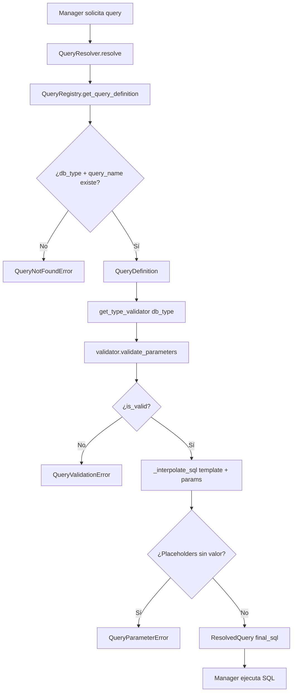

## Responsabilidad del módulo

El sistema de queries tiene dos clases con responsabilidades separadas:

- **`QueryRegistry`**: carga `sql_queries.json` en memoria al inicializarse y proporciona `QueryDefinition` (template SQL + parámetros requeridos) por par `(db_type, query_name)`. No ejecuta ni valida parámetros.
- **`QueryResolver`**: orquesta el flujo completo: obtiene la definición del registry, valida parámetros con el `DatabaseTypeValidator` del motor, interpola y retorna `ResolvedQuery` (SQL final listo para ejecutar).

## Diagrama

## API pública

### Clase `QueryRegistry`

| Método | Firma simplificada | Descripción | Retorna |
|---|---|---|---|
| `QueryRegistry` | `(queries_file?)` | Carga el JSON de queries en init | `QueryRegistry` |
| `get_query_definition` | `(db_type, query_name)` | Definición de query con template y parámetros | `QueryDefinition` |
| `get_available_queries` | `(db_type)` | Nombres de queries disponibles para el motor | `list[str]` |
| `get_all_db_types` | `()` | Todos los db_types cargados del JSON | `list[str]` |
| `queries` | propiedad | Acceso completo al dict cargado | `dict[str, dict[str, str]]` |

### Clase `QueryResolver`

| Método | Firma simplificada | Descripción | Retorna |
|---|---|---|---|
| `QueryResolver` | `(registry?, db_type?)` | Inicializa con registry opcional y db_type opcional | `QueryResolver` |
| `resolve` | `(query_name, params?)` | Valida e interpola la query; retorna SQL final | `ResolvedQuery` |
| `bind` | `(db_type)` | Crea nuevo resolver ligado al db_type con el mismo registry | `QueryResolver` |

## Contrato de entrada

| Parámetro | Tipo | Descripción | Restricciones |
|---|---|---|---|
| `queries_file` | `Path \| None` | Ruta al JSON de queries | Si `None`, usa `data/sql_queries.json` interno del paquete |
| `db_type` | `str` | Tipo de motor para resolver queries | Se normaliza a minúsculas; si no se pasa al constructor, debe proporcionarse en `resolve` |
| `query_name` | `str` | Nombre de la query en el JSON | Sensible al casing del JSON; normalmente en snake_case |
| `params` | `dict[str, Any] \| None` | Parámetros a interpolar en el template | `None` equivale a `{}`; los valores se insertan como texto (no como bind params) |

## Contrato de salida

- **`QueryDefinition`** — dataclass con campos `name`, `db_type`, `sql_template` (template con `{placeholder}`), `required_params` (lista de nombres extraídos por regex), `metadata`.
- **`ResolvedQuery`** — dataclass con `final_sql` (SQL interpolado sin placeholders), `validated: bool`, `warnings: list[str]`, `metadata` (contiene `elapsed_ms` y `db_type`).
- **`get_available_queries`** — lista vacía si el `db_type` no existe en el JSON (no lanza excepción).

## Errores y casos especiales

| Error | Cuándo ocurre |
|---|---|
| `FileNotFoundError` | El JSON de queries no existe en la ruta indicada (en init del registry) |
| `ValueError` | JSON inválido o estructura incorrecta (raíz no es dict, o valor no es dict) |
| `QueryNotFoundError` | `db_type` o `query_name` no encontrado en el JSON |
| `QueryValidationError` | Validación de parámetros falla (`is_valid=False` del validador) |
| `QueryParameterError` | Error al interpolar parámetros (placeholder sin valor) o error inesperado |

**Casos especiales:**
- El registry carga el JSON una sola vez en `__init__`: cambios al fichero durante la sesión no se reflejan sin crear una nueva instancia.
- `QueryResolver.bind(db_type)` devuelve un nuevo resolver que comparte el mismo `registry` (no recarga el JSON); útil para managers que crean un resolver por motor en `__init__` y lo reutilizan.
- Los parámetros interpolados son **identificadores** (nombres de BD, tabla, esquema), no valores de datos de usuario. Para valores de usuario usar bind parameters de SQLAlchemy en `execute_custom_*`.
- `warnings` en `ResolvedQuery` puede ser no vacío aunque `validated=True`: indica advertencias no bloqueantes (ej.: parámetro opcional no proporcionado).
