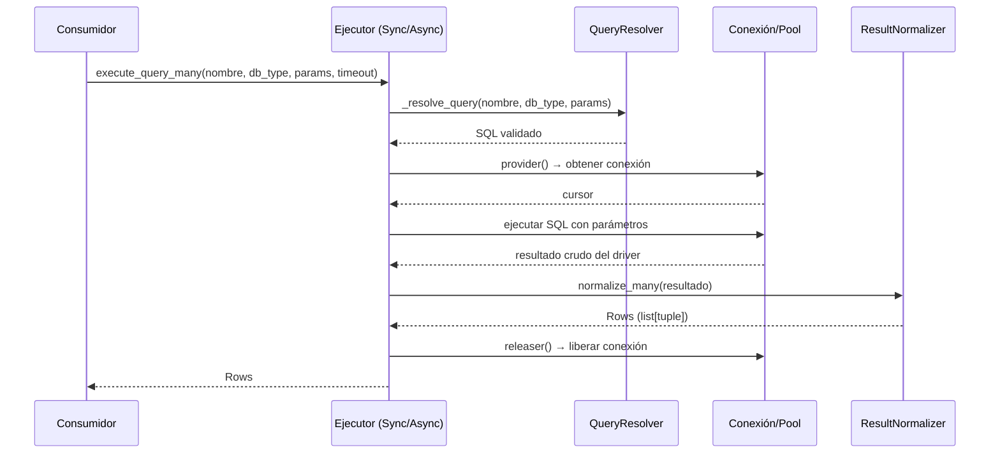

# Ejecución de Consultas (SyncQueryExecutor / AsyncQueryExecutor)

Proporciona ejecutores sync y async para lanzar consultas SQL registradas o libres sobre múltiples motores, junto con `ResultNormalizer` para convertir resultados crudos de drivers a contratos estables.

## 1. Arquitectura y Diseño

## 2. Modelo de Datos / Contratos

### API pública

#### SyncQueryExecutor

| Método | Firma simplificada | Descripción | Retorna |
|---|---|---|---|
| `execute_query_many` | `(query_name, db_type, params, timeout=None)` | Query registrada → múltiples filas | `Rows` |
| `execute_query_one` | `(query_name, db_type, params, timeout=None)` | Query registrada → una fila o `None` | `RowOrNone` |
| `execute_custom_many` | `(sql, params=None, timeout=None)` | SQL libre → múltiples filas | `Rows` |
| `execute_custom_one` | `(sql, params=None, timeout=None)` | SQL libre → una fila o `None` | `RowOrNone` |
| `execute_custom_result` | `(sql, params=None, timeout=None, *, read_only=False, max_rows=None, db_type=None)` | SQL libre → columnas y filas (desde 5.0.0) | `CustomQueryResult` |

#### AsyncQueryExecutor

| Método | Firma simplificada | Descripción | Retorna |
|---|---|---|---|
| `execute_query_many` / `execute_query_one` | `async (query_name, db_type, params=None, deadline_seconds=None)` | Query registrada async → múltiples filas / una fila o `None` | `Rows` / `RowOrNone` |
| `execute_custom_many` | `async (sql, params=None, deadline_seconds=None)` | SQL libre async → múltiples filas | `Rows` |
| `execute_custom_one` | `async (sql, params=None, deadline_seconds=None)` | SQL libre async → una fila o `None` | `RowOrNone` |
| `execute_custom_result` | `async (sql, params=None, deadline_seconds=None, *, read_only=False, max_rows=None, db_type=None)` | SQL libre async → columnas y filas (desde 5.0.0) | `CustomQueryResult` |

#### ResultNormalizer

| Método | Firma simplificada | Descripción | Retorna |
|---|---|---|---|
| `normalize_one` | `(result: Any)` | Normaliza `fetchone()` | `RowOrNone` |
| `normalize_many` | `(result: Any)` | Normaliza `fetchall()` | `Rows` |

### Contrato de entrada

#### Constructor de ejecutores

| Parámetro | Tipo | Descripción | Restricciones |
|---|---|---|---|
| `connection_provider` | `Callable[[], Any]` | Devuelve una conexión activa | Requerido |
| `connection_releaser` | `Callable[[Any], None]` | Libera la conexión | Requerido |
| `registry` | `QueryRegistry \| None` | Registro de queries nombradas | Crea uno por defecto si `None` |
| `resolver` | `QueryResolver \| None` | Resolución del SQL de las queries nombradas | Crea uno sobre `registry` si `None` |

En `AsyncQueryExecutor`, `connection_provider` y `connection_releaser` son corrutinas. Los managers construyen sus
ejecutores; normalmente se usan a través de `execute_query_*` / `execute_custom_*` del manager.

#### Métodos de ejecución

| Parámetro | Tipo | Descripción | Restricciones |
|---|---|---|---|
| `query_name` | `str` | Nombre de la query registrada | Debe existir en `QueryRegistry` |
| `db_type` | `str` | Motor cuya sección del JSON de queries se usa | — |
| `params` | `dict[str, Any]` | Parámetros nombrados | Claves deben coincidir con `:param` en el SQL |
| `timeout` / `deadline_seconds` | `float \| None` | Máximo en segundos | `None` = sin límite |
| `sql` | `str` | SQL libre | No vacío |

### Contrato de salida

- `execute_*_many`: siempre `list[tuple]`, nunca `None`; lista vacía si no hay filas.
- `execute_*_one`: `tuple` con valores de la primera fila, o `None` si no hay resultado.
- Los valores de columna son tipos nativos del driver, sin conversión adicional.

### Errores y casos especiales

| Error | Cuándo ocurre |
|---|---|
| `QueryNotFoundError` | Query no registrada en `QueryRegistry` |
| `QueryValidationError` / `QueryParameterError` | Parámetros que no pasan la validación o placeholders sin valor (desde `QueryResolver`) |
| `QueryTimeoutError` | Se supera el timeout o `deadline_seconds` configurado |
| `DatabaseOperationError` | Cualquier otro error de ejecución (conexión caída, SQL inválido), con el original en `__cause__` |

## 3. Componentes y Clases

| Clase | Responsabilidad |
|---|---|
| `SyncQueryExecutor` | Ejecución sync de queries registradas y libres |
| `AsyncQueryExecutor` | Ejecución async de queries registradas y libres |
| `ResultNormalizer` | Conversión de resultados crudos de driver a tipos estables (`Row`, `Rows`, `RowOrNone`) |

## 4. Dependencias y Requisitos

| Dependencia | Propósito | Requerida | Comportamiento sin ella |
|---|---|---|---|
| `QueryRegistry` (interno) | Almacenamiento de queries nombradas | Solo para `execute_query_*` | `QueryNotFoundError` en toda query por nombre |
| `QueryResolver` (interno) | Validación e interpolación del SQL | Solo para `execute_query_*` | Idem |
| Conexión BD (vía provider) | Ejecución de sentencias SQL | Sí | Sin conexión no hay ejecución |

## 5. Ejemplos Relacionados

- [Ejemplo: Ejecución de Consultas](../examples/query_execution_example.md) — Queries libres y registradas con `SyncQueryExecutor`
