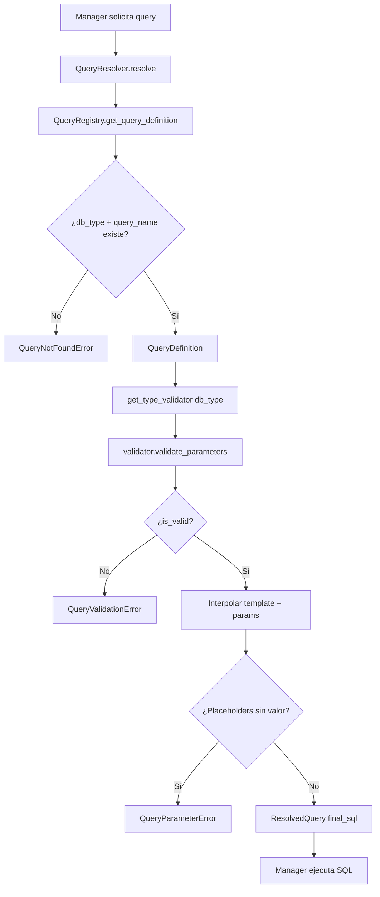

# Registry y Resolver de Queries

`QueryRegistry` carga un fichero JSON de consultas (`queries_file`; el del paquete, `data/sql_queries.json`, está vacío desde E2 de ADR-003) en memoria y proporciona definiciones de query por par `(db_type, query_name)`; `QueryResolver` orquesta la validación de parámetros, la interpolación y devuelve el SQL final listo para ejecutar.

## 1. Arquitectura y Diseño

## 2. Modelo de Datos / Contratos

### API pública

#### Clase `QueryRegistry`

| Método | Firma simplificada | Descripción | Retorna |
|---|---|---|---|
| `QueryRegistry` | `(queries_file?)` | Carga el JSON de queries en init | `QueryRegistry` |
| `get_query_definition` | `(db_type, query_name)` | Definición con template y parámetros | `QueryDefinition` |
| `get_available_queries` | `(db_type)` | Nombres de queries disponibles para el motor | `list[str]` |
| `get_all_db_types` | `()` | Todos los `db_type` cargados del JSON | `list[str]` |
| `queries` | propiedad | Acceso completo al dict cargado | `dict[str, dict[str, str]]` |

#### Clase `QueryResolver`

| Método | Firma simplificada | Descripción | Retorna |
|---|---|---|---|
| `QueryResolver` | `(registry=None, *, db_type=None)` | Inicializa con registry opcional | `QueryResolver` |
| `resolve` | `(query_name, params?)` | Valida, interpola y retorna SQL final | `ResolvedQuery` |
| `bind` | `(db_type)` | Nuevo resolver ligado al motor con el mismo registry | `QueryResolver` |

### Contrato de entrada

| Parámetro | Tipo | Descripción | Restricciones |
|---|---|---|---|
| `queries_file` | `Path \| None` | Ruta al JSON de queries (`{"<db_type>": {"<nombre>": "<SQL>"}}`) | `None` usa `data/sql_queries.json` del paquete, que no trae consultas: sin `queries_file`, toda query por nombre da `QueryNotFoundError` |
| `db_type` | `str` | Motor para resolver queries | Se normaliza a minúsculas |
| `query_name` | `str` | Nombre de la query en el JSON | Snake_case; sensible al casing del JSON |
| `params` | `dict[str, Any] \| None` | Parámetros a interpolar en el template | `None` equivale a `{}`; son identificadores, no valores de datos |

### Contrato de salida

- **`QueryDefinition`** (`util_bbdd.models`) — dataclass: `name`, `db_type`, `sql_template`, `required_params`, `optional_params`, `docstring`, `metadata`.
- **`ResolvedQuery`** (`util_bbdd.models`) — dataclass: `query_definition`, `final_sql` (SQL interpolado), `validated: bool`, `warnings: list[str]`, `metadata` (con `elapsed_ms` y `db_type`).
- **`get_available_queries`** — lista vacía si el `db_type` no existe (no lanza excepción).

### Errores y casos especiales

| Error | Cuándo ocurre |
|---|---|
| `FileNotFoundError` | JSON de queries no encontrado en `__init__` del registry |
| `ValueError` | JSON inválido o estructura incorrecta |
| `QueryNotFoundError` | `db_type` o `query_name` no en el JSON |
| `QueryValidationError` | `is_valid=False` del validador |
| `QueryParameterError` | Placeholder sin valor al interpolar; `resolve` en un resolver sin `db_type` (usar `bind`) |

## 3. Componentes y Clases

| Clase | Responsabilidad |
|---|---|
| `QueryRegistry` | Carga y exposición de definiciones de queries desde JSON |
| `QueryResolver` | Validación de parámetros e interpolación del SQL final |

## 4. Dependencias y Requisitos

| Dependencia | Propósito | Requerida | Comportamiento sin ella |
|---|---|---|---|
| `data/sql_queries.json` (interno) | Definiciones de queries por motor | Sí | `FileNotFoundError` al crear `QueryRegistry` |
| `DatabaseTypeValidator` (interno) | Validación de parámetros por motor | Sí | Sin validador no se puede resolver queries por nombre |

## 5. Ejemplos Relacionados

- [Ejemplo: Ejecución de Consultas](../examples/query_execution_example.md) — Uso de `QueryRegistry` y `QueryResolver` para queries nombradas
