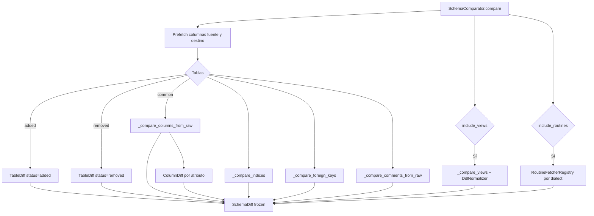

## Responsabilidad del módulo

`SchemaComparator` compara dos esquemas de base de datos usando `SQLAlchemy Inspector` y produce un `SchemaDiff` inmutable con todas las diferencias encontradas. La comparación es configurable: se pueden activar o desactivar tablas, vistas, índices, FKs, comentarios y rutinas. Internamente prefetch las columnas de cada tabla para evitar el problema N+1 y delega la introspección de rutinas en `RoutineFetcherRegistry` (extensible por dialecto vía OCP). La normalización DDL para comparación semántica la realiza `DdlNormalizer`.

## Diagrama

## Modelos de datos

Todos los modelos son `frozen=True` (inmutables y hashables).

| Modelo | Campos principales | Descripción |
|---|---|---|
| `SchemaDiff` | `source_label`, `target_label`, `table_diffs`, `view_diffs`, `routine_diffs`, `summary` | Resultado raíz de la comparación |
| `TableDiff` | `table_name`, `status`, `column_diffs`, `index_diffs`, `fk_diffs`, `comment_diffs` | Diferencias de una tabla |
| `ColumnDiff` | `column_name`, `attribute`, `source_value`, `target_value` | Diferencia en un atributo de columna |
| `IndexDiff` | `index_name`, `table_name`, `status`, `source_columns`, `target_columns`, `source_unique`, `target_unique` | Diferencia en un índice |
| `ForeignKeyDiff` | `fk_name`, `table_name`, `status`, `source_columns`, `target_columns`, `source_referred_table`, `target_referred_table` | Diferencia en una FK |
| `CommentDiff` | `object_name`, `column_name` (None=tabla), `source_comment`, `target_comment` | Diferencia en comentario |
| `ViewDiff` | `view_name`, `status`, `source_definition`, `target_definition` | Diferencia en una vista |
| `RoutineDiff` | `routine_name`, `routine_type`, `status`, `source_definition`, `target_definition` | Diferencia en rutina |

**Propiedades de `SchemaDiff`:**
- `has_differences: bool` — `True` si hay alguna diferencia en cualquier categoría
- `total_differences: int` — número total de diferencias de primer nivel

## API pública

### Clase `SchemaComparator`

| Método | Firma simplificada | Descripción | Retorna |
|---|---|---|---|
| `compare` | `(source, target, *, source_schema?, target_schema?, include_tables?, include_views?, include_indices?, include_foreign_keys?, include_comments?, include_routines?)` | Comparación completa configurable | `SchemaDiff` |

### Clase `SchemaDiffReporter`

| Método | Firma simplificada | Descripción | Retorna |
|---|---|---|---|
| `SchemaDiffReporter` | `(word_template_path?, sql_dialect?, sql_source_inspector?, sql_source_schema?)` | Crea fachada de reportes | `SchemaDiffReporter` |
| `render` | `(diff, output_dir, format, filename?)` | Genera reporte en un formato | `Path` |
| `render_all` | `(diff, output_dir, formats?, raise_on_error?)` | Genera reportes en múltiples formatos | `list[Path]` |

### Reporters individuales

| Clase | Formato | Constructor args |
|---|---|---|
| `HtmlDiffReporter` | `.html` | `template_dir?`, `template_name?` |
| `ExcelDiffReporter` | `.xlsx` | — |
| `WordDiffReporter` | `.docx` | `template_path?` |
| `MarkdownDiffReporter` | `.md` | — |
| `SqlDiffReporter` | `.sql` | `dialect?`, `source_inspector?`, `source_schema?` |

### Clase `DdlNormalizer`

| Método | Firma simplificada | Descripción | Retorna |
|---|---|---|---|
| `normalize_view_ddl` | `(raw_ddl)` *(estático)* | Elimina ALGORITHM/DEFINER/SQL SECURITY | `str` |
| `normalize_routine_ddl` | `(raw_ddl)` *(estático)* | Elimina DEFINER | `str` |
| `normalize_for_comparison` | `(raw_ddl)` *(estático)* | Normalización completa: artefactos + espacios + minúsculas | `str` |
| `extract_view_body` | `(raw_ddl)` *(estático)* | Extrae cuerpo SELECT/WITH del CREATE VIEW | `str` |

## Contrato de entrada

| Parámetro | Tipo | Descripción | Restricciones |
|---|---|---|---|
| `source` / `target` | `Inspector` | Inspectors SQLAlchemy de las dos BDs | Ambos activos y con permisos de lectura sobre metadatos |
| `source_schema` / `target_schema` | `str \| None` | Schema a comparar | `None` usa el schema por defecto del motor; Oracle requiere valor explícito para rutinas |
| `include_routines` | `bool` | Comparar procedures y funciones | Default `False`; no soportado en HSQLDB; puede triplicar el número de queries |
| `format` en `render` | `str` | Formato de salida | `"html"`, `"excel"`, `"word"`, `"markdown"`, `"sql"` |
| `sql_dialect` en `SqlDiffReporter` | `str` | Dialecto para script SQL | `"generic"`, `"mariadb"`, `"mysql"`, `"postgresql"`, `"sqlserver"`, `"oracle"`, `"sqlite"` |
| `raise_on_error` en `render_all` | `bool` | Propagar errores de formatos individuales | Default `False`; en `True` cualquier fallo de un formato aborta el resto |

## Contrato de salida

- **`compare()`** — `SchemaDiff` inmutable con todos los diffs agrupados. Si no hay diferencias, `has_differences=False` y las listas de diffs están vacías.
- **`render()`** / **`render_all()`** — `Path` o `list[Path]` de los ficheros generados; escritos en `output_dir`.
- **`ColumnDiff.attribute`** — uno de: `"type"`, `"nullable"`, `"primary_key"`, `"default"`, `"existence"`.
- **`TableDiff.status`** / **`ViewDiff.status`** / **`RoutineDiff.status`** — `"added"`, `"removed"` o `"modified"`.
- **`SchemaDiff.summary`** — cadena legible: `"Tablas: X añadidas, Y eliminadas, Z modificadas | Vistas: ..."`.

## Errores y casos especiales

| Error | Cuándo ocurre |
|---|---|
| `SchemaDiffValidationError` | `render()` con `format` no soportado |
| `DiffReportGenerationError` | Error interno al generar un reporter específico |
| `ComparerError` | Error genérico de comparación (base) |
| `FileNotFoundError` | `WordDiffReporter` con `template_path` que no existe |

**Casos especiales:**
- Métodos `_*_safe()` capturan `NotImplementedError` del Inspector (motores que no implementan una operación) y retornan valor por defecto sin lanzar excepción.
- `RoutineFetcherRegistry` es un registro extensible: `SchemaComparator._ROUTINE_FETCHERS[dialect] = callable` añade soporte para un nuevo motor sin modificar la clase.
- `_DB_TYPE_TO_DIALECT` mapea los nombres internos de util_bbdd al nombre de dialecto de SQLAlchemy (`"sqlserver"` → `"mssql"`); usar el nombre incorrecto puede resultar en que las rutinas no se comparen.
- El prefetch de columnas evita el problema N+1: para un esquema de 100 tablas, `include_tables=True` solo lanza la consulta de columnas dos veces (fuente y destino), no 200 veces.
- SQLite: `SqlDiffReporter` emite comentarios `-- ⚠ SQLite no soporta...` para operaciones no soportadas (ALTER COLUMN, etc.) en lugar de SQL incorrecto.
- Índices sin nombre (`idx.get("name")` falsy) se ignoran en la comparación.
- `CommentDiff.column_name = None` indica comentario a nivel de tabla; valor no nulo indica columna específica.
