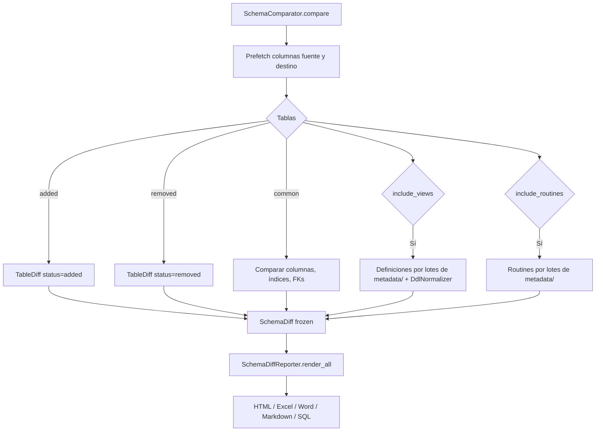

# Comparador y Reporters de Esquemas

`SchemaComparator` compara dos esquemas usando SQLAlchemy Inspector y produce un `SchemaDiff` inmutable. `SchemaDiffReporter` genera reportes en cinco formatos a partir del resultado.

## 1. Arquitectura y Diseño

## 2. Modelo de Datos / Contratos

### API pública

#### Clase `SchemaComparator`

| Método | Firma simplificada | Descripción | Retorna |
|---|---|---|---|
| `compare` | `(source, target, *, source_schema?, target_schema?, include_tables?, include_views?, include_indices?, include_foreign_keys?, include_comments?, include_routines?, source_label?, target_label?, on_progress?, cancel_token?)` | Comparación completa configurable | `SchemaDiff` |

#### Clase `SchemaDiffReporter`

| Método | Firma simplificada | Descripción | Retorna |
|---|---|---|---|
| `SchemaDiffReporter` | `(word_template_path=None, sql_dialect="generic", sql_source_inspector=None, sql_source_schema=None, *, mermaid_src=MERMAID_CDN_URL, mermaid_integrity=None)` | Crea fachada de reportes (se importa de `util_bbdd.comparar`) | `SchemaDiffReporter` |
| `render` | `(diff, output_dir, format, filename=None)` | Genera reporte en un formato | `Path` |
| `render_all` | `(diff, output_dir, formats=None, raise_on_error=False)` | Genera reportes en múltiples formatos | `list[Path]` |

#### Modelos de datos (todos `frozen=True`)

| Modelo | Campos principales |
|---|---|
| `SchemaDiff` | `source_label`, `target_label`, `table_diffs`, `view_diffs`, `routine_diffs`, `summary`; propiedades `has_differences`, `total_differences`, `total_leaf_differences`; `to_dict()` / `from_dict(data)` (4.2.0) |
| `TableDiff` | `table_name`, `status`, `column_diffs`, `index_diffs`, `fk_diffs`, `comment_diffs` |
| `ColumnDiff` | `column_name`, `attribute`, `source_value`, `target_value` |
| `IndexDiff` | `index_name`, `table_name`, `status`, `source_columns`, `target_columns`, `source_unique`, `target_unique` |
| `ViewDiff` | `view_name`, `status`, `source_definition`, `target_definition` |
| `RoutineDiff` | `routine_name`, `routine_type`, `status`, `source_definition`, `target_definition` |
| `ForeignKeyDiff` / `CommentDiff` | Diferencias de FK y de comentarios dentro de `TableDiff` |

### Contrato de entrada

| Parámetro | Tipo | Descripción | Restricciones |
|---|---|---|---|
| `source` / `target` | `Inspector` | Inspectors SQLAlchemy de las dos BDs | Ambos activos y con permisos de lectura |
| `source_schema` / `target_schema` | `str \| None` | Schema a comparar | `None` usa el schema por defecto; Oracle requiere valor explícito para rutinas |
| `source_label` / `target_label` | `str \| None` | Etiqueta de cada lado en el `SchemaDiff`, el log, los informes y el nombre de sus ficheros (4.2.0) | `None` usa `motor [schema]` (`oracle [ESQ_ORIGEN]`, `postgresql [public]`), sin host, puerto, usuario, ruta ni parámetros de la URL |
| `on_progress` | `ProgressCallback \| None` | Recibe los `ProgressEvent` de la comparación ([Progreso y cancelación](progress_autodoc.md)) (4.2.0) | Operación `"compare"`: `"metadata"` (0, 1 y 2 de 2 lados), `"tables"` (`0` de N y uno por tabla común, con su nombre), `"views"` y `"routines"` (`0` y `1` de 1); solo las fases incluidas |
| `cancel_token` | `CancellationToken \| None` | Parada cooperativa (4.2.0) | Se comprueba al empezar cada fase, entre los dos lados de la lectura y entre tablas: `OperationCancelledError`, sin `SchemaDiff` parcial |
| `include_routines` | `bool` | Comparar procedures y funciones | Default `False`; MariaDB, MySQL, Oracle (sueltas, sin packages), PostgreSQL (sin agregados ni funciones ventana) y SQL Server; motores sin catálogo en `metadata/` (HSQLDB): se omite salvo un fetcher registrado en `SchemaComparator._ROUTINE_FETCHERS` |
| `format` en `render` | `str` | Formato de salida | `"html"`, `"excel"`, `"word"`, `"markdown"`, `"sql"` |
| `sql_dialect` en `SqlDiffReporter` | `str` | Dialecto para script SQL | `"generic"`, `"mariadb"`, `"mysql"`, `"postgresql"`, `"sqlserver"`, `"oracle"`, `"sqlite"` |

### Contrato de salida

- **`compare()`** — `SchemaDiff` inmutable con todos los diffs. `has_differences=False` si los esquemas son idénticos.
- **`SchemaDiff.to_dict()`** — `dict` con tipos JSON, `format="util_bbdd.schema_diff"` y `format_version=1`;
  `SchemaDiff.from_dict(diff.to_dict()) == diff`. `from_dict` lanza `SchemaDiffValidationError` con un `format` o
  `format_version` desconocidos, un campo obligatorio ausente o un valor de otro tipo (indica la ruta, p. ej.
  `table_diffs[2].status`), e ignora las claves que no son campos.
- **`render()`** / **`render_all()`** — `Path` o `list[Path]` de ficheros generados en `output_dir`.
- **Informe HTML y Mermaid** (4.2.0) — por defecto carga `mermaid@12.2.0` de jsDelivr con `integrity` (SRI;
  constantes `MERMAID_VERSION`, `MERMAID_CDN_URL` y `MERMAID_SRI` de `util_bbdd.comparar.reporters.html_reporter`;
  hasta 5.1.0, `mermaid@10.9.8`).
  `mermaid_src` lo cambia: URL `http(s)` o relativa (un asset propio con la CSP de la aplicación; `mermaid_integrity`
  opcional), `Path` a un `mermaid.min.js` local que se incrusta en el HTML (informe sin red, unos 3 MB más) o `None`
  (sin Mermaid). Otro esquema de URL o un fichero ilegible lanzan `SchemaDiffValidationError`. Si Mermaid no carga,
  pestañas, filtros y búsqueda siguen funcionando y los diagramas se ven como texto.
- `TableDiff.status` / `ViewDiff.status` — `"added"`, `"removed"` o `"modified"`.
- `ColumnDiff.attribute` — `"type"`, `"nullable"`, `"primary_key"`, `"default"` o `"existence"`.
- Los nombres de tablas, columnas, índices, FKs, vistas y routines (y las columnas de índices y FKs) se comparan sin
  distinguir mayúsculas, para poder comparar motores con convenciones distintas (Oracle `EMP` frente a PostgreSQL
  `emp`). Los diffs conservan el nombre real de cada motor.
- Las FKs cuyo nombre genera el motor (Oracle `SYS_C…`, SQL Server `FK__…__XXXXXXXX`, PostgreSQL `…_fkey`, MySQL/MariaDB
  `…_ibfk_N`, o sin nombre) se emparejan por estructura (columnas, tabla y columnas referenciadas) si no casan por
  nombre: la misma FK no sale como eliminada + añadida. Si alguno de los dos nombres lo puso el usuario, un nombre
  distinto sí es una diferencia. Igual con los índices (columnas y unicidad) de un `UNIQUE` sin nombre: Oracle
  `SYS_C…`, SQL Server `UQ__…__XXXXXXXXXXXXXXXX`, PostgreSQL `…_key`/`…_idx`. MySQL/MariaDB nombran el índice como su
  columna, así que no se reconoce como generado.
- Las sobrecargas de PostgreSQL se emparejan por firma (tipos de los argumentos); `routine_name` lleva la firma solo
  si hay sobrecargas en ese lado.
- Definiciones de vistas y routines: las del catálogo, leídas con una consulta por lado y tipo de objeto
  (`metadata.reflection.view_definitions` / `schema_routines`, ADR-003). En MySQL/MariaDB son el `SELECT` de la vista
  (`VIEW_DEFINITION`) y el `CREATE` reconstruido de la routine, sin `DEFINER`; en SQL Server y SQLite, la sentencia
  `CREATE VIEW` completa. Al comparar se ignora el prefijo del propio schema (`app.v`, `[app].[v]`): la misma vista o
  routine en dos schemas no es una diferencia.

### Errores y casos especiales

| Error | Cuándo ocurre |
|---|---|
| `SchemaDiffValidationError` | `render()` con `format` no soportado; `sql_dialect` no soportado; ruta de Word que no es un `.docx` |
| Excepción del reporter | En `render()`, se propaga tal cual. En `render_all()`, se registra (ERROR) y se sigue con el siguiente formato; con `raise_on_error=True` se relanza la primera |
| `FileNotFoundError` | `WordDiffReporter` con `template_path` inexistente |
| Warning `Se omite la comparación de routines` | Con `include_routines=True`, un lado no permite listar sus routines (conexión, permisos u Oracle sin `schema`): `routine_diffs` queda vacío en lugar de dar falsos «añadida/eliminada» |

## 3. Componentes y Clases

| Clase | Responsabilidad |
|---|---|
| `SchemaComparator` | Comparación y producción del `SchemaDiff` |
| `SchemaDiffReporter` | Fachada para generar reportes en múltiples formatos |
| `HtmlDiffReporter` / `ExcelDiffReporter` / `WordDiffReporter` / `MarkdownDiffReporter` / `SqlDiffReporter` | Reporters individuales por formato |
| `DdlNormalizer` | Normalización semántica de DDL de vistas y rutinas antes de comparar |

## 4. Dependencias y Requisitos

| Dependencia | Propósito | Requerida | Comportamiento sin ella |
|---|---|---|---|
| `sqlalchemy` | Inspector para leer metadatos de esquema | Sí | Módulo no funciona |
| `Jinja2` | Generación de reportes HTML | Solo para `HtmlDiffReporter` | Error al generar HTML |
| `openpyxl` | Generación de reportes Excel | Solo para `ExcelDiffReporter` | Error al generar Excel |
| `python-docx` | Generación de reportes Word | Solo para `WordDiffReporter` | Error al generar Word |

## 5. Ejemplos Relacionados

- [Ejemplo: Comparación de Esquemas](../examples/schema_comparison.md) — Comparación completa con `SchemaComparator` y exportación a múltiples formatos
- [Ejemplo: Diff Reporters](../examples/diff_reporters.md) — Todos los formatos de reporte de diferencias
