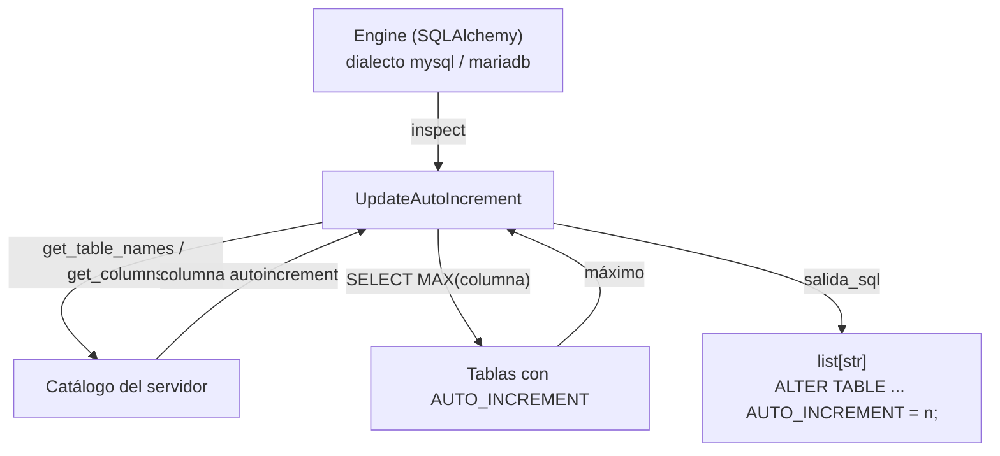

# UpdateAutoIncrement

Genera las sentencias `ALTER TABLE ... AUTO_INCREMENT = MAX + 1` de un esquema MariaDB/MySQL **sin ejecutarlas**, para reajustar los contadores que hayan quedado por detrás del valor máximo real tras una carga masiva con claves primarias explícitas.

## 1. Arquitectura y Diseño

Vive en `connection/mariadb/` y solo depende de SQLAlchemy y de `_core`: recibe el `Engine` por parámetro y no importa `factory/` ni `managers/` (Regla #6). Descubre las columnas `AUTO_INCREMENT` con el Inspector de SQLAlchemy, una excepción a la Regla #2 documentada en el propio módulo (igual que `comparar/`); no contiene SQL de introspección propio.

## 2. Modelo de Datos / Contratos

### API pública

#### Clase `UpdateAutoIncrement`

| Método | Firma simplificada | Descripción | Retorna |
|---|---|---|---|
| `UpdateAutoIncrement` | `(engine, schema=None)` | Valida el dialecto y guarda el `Engine` | `UpdateAutoIncrement` |
| `salida_sql` | `()` | Devuelve las sentencias sin ejecutarlas | `list[str]` |

### Contrato de entrada

| Parámetro | Tipo | Descripción | Restricciones |
|---|---|---|---|
| `engine` | `Engine` | Engine de SQLAlchemy ya creado | Dialecto `mysql` o `mariadb`; su ciclo de vida es de quien lo crea |
| `schema` | `str \| None` | Esquema (base de datos) a recorrer | Si es `None`, el de la conexión |

### Contrato de salida

- **`salida_sql`** — lista de sentencias `ALTER TABLE ... AUTO_INCREMENT = n;`, ordenada por nombre de tabla.
- Solo aparecen las tablas base con una columna `AUTO_INCREMENT` de tipo entero. Las vistas no se recorren.
- `n = MAX(columna) + 1`; `1` si la tabla está vacía o el máximo no es positivo.
- Los identificadores (tabla y esquema) van siempre entre backticks y los backticks internos se duplican.

### Errores y casos especiales

| Error / Situación | Cuándo ocurre |
|---|---|
| `TypeError` | Se pasa un `dict` de configuración (firma anterior); el mensaje indica cómo crear el `Engine` |
| `InvalidDatabaseType` | El dialecto del `Engine` no es MariaDB/MySQL |
| `DatabaseOperationError` | Falla la lectura del catálogo o del máximo de una tabla; conserva la causa original |
| Tabla sin `AUTO_INCREMENT` | Se omite sin aviso |
| `AUTO_INCREMENT` sobre tipo no entero (`FLOAT`, `DOUBLE`) | Se omite con `WARNING` en el log |

> **Cambio de firma respecto a la versión anterior.** El constructor ya no recibe el `dict` de configuración, sino un `Engine`: `UpdateAutoIncrement(conf)` pasa a `UpdateAutoIncrement(SQLAlchemyEngineFactory.create_engine(db_type, conf, database))`.

## 3. Componentes y Clases

| Clase | Responsabilidad |
|---|---|
| `UpdateAutoIncrement` | Localizar la columna `AUTO_INCREMENT` de cada tabla, leer su máximo y emitir la sentencia de reajuste |

## 4. Dependencias y Requisitos

| Dependencia | Propósito | Requerida | Comportamiento sin ella |
|---|---|---|---|
| `sqlalchemy` | `Engine`, Inspector y `SELECT MAX` | Sí | Módulo no funciona |
| Permiso `SELECT` sobre las tablas | Leer el máximo de cada columna | Sí | `DatabaseOperationError` |
| Lectura del catálogo | Reflexión de tablas y columnas | Sí | `DatabaseOperationError` |

El script refleja el máximo **en el momento de generarlo**: con escrituras concurrentes puede quedarse corto. Conviene ejecutarlo en una ventana sin escrituras y revisarlo antes de aplicarlo.

El reajuste a `MAX + 1` también **reduce** los contadores que iban por delante del máximo (por ejemplo, tras borrar filas): los identificadores de filas eliminadas pueden volver a asignarse. Revisa el script si algún sistema externo conserva esos identificadores.

Para reajustar los contadores directamente, sin pasar por un script, usar `BulkCrud.sync_pk_sequences()`.

## 5. Ejemplos Relacionados

- [Ejemplo: Reajuste de AUTO_INCREMENT en MariaDB](../examples/update-auto-increment-example.md) — Generar y revisar el script de reajuste de un esquema
