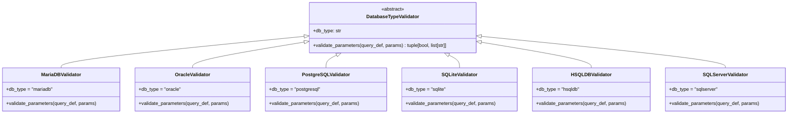

## Responsabilidad del módulo

Define la interfaz abstracta `DatabaseTypeValidator` que todos los validadores de motor deben implementar, y expone `get_type_validator(db_type)` como punto de entrada para obtener el validador concreto de cada motor. El `QueryResolver` usa este subsistema para validar parámetros antes de interpolar SQL.

Motores con validador concreto: MariaDB, MySQL, Oracle, PostgreSQL, SQL Server, SQLite, HSQLDB.

## Diagrama

## API pública

### Clase abstracta `DatabaseTypeValidator`

| Elemento | Tipo | Descripción |
|---|---|---|
| `db_type` | `str` (atributo de clase) | Identificador del motor que valida |
| `validate_parameters` | `abstractmethod (query_def, params) → tuple[bool, list[str]]` | Valida parámetros y retorna `(is_valid, warnings)` |

### Función de acceso

| Función | Firma simplificada | Descripción | Retorna |
|---|---|---|---|
| `get_type_validator` | `(db_type)` | Obtiene el validador concreto para el motor | `DatabaseTypeValidator` |

## Contrato de entrada

| Parámetro | Tipo | Descripción | Restricciones |
|---|---|---|---|
| `query_def` | `QueryDefinition` | Definición de la query con `required_params` declarados | Proporcionado por `QueryRegistry` |
| `params` | `dict[str, Any]` | Parámetros a validar | Puede estar vacío si la query no requiere parámetros |
| `db_type` | `str` | Tipo de motor en `get_type_validator` | Debe coincidir con un motor registrado |

## Contrato de salida

- **`validate_parameters`** — siempre retorna `tuple[bool, list[str]]`:
  - `(True, [])` — validación correcta sin advertencias.
  - `(True, ["aviso..."])` — validación correcta con advertencias no bloqueantes.
  - `(False, ["error..."])` — validación fallida; el `QueryResolver` lanzará `QueryValidationError`.
- **`get_type_validator`** — instancia del validador concreto para el motor indicado.

## Errores y casos especiales

| Error | Cuándo ocurre |
|---|---|
| `KeyError` / `ValueError` | `get_type_validator` con un `db_type` no registrado |
| `TypeError` | Instanciar una subclase que no implementa `validate_parameters` |

**Casos especiales:**
- El contrato prohíbe explícitamente lanzar excepciones dentro de `validate_parameters`: los errores deben retornarse como `(False, [mensaje])`. Una excepción no controlada en un validador rompe el `QueryResolver`.
- Las advertencias (`list[str]` con `is_valid=True`) permiten validaciones permisivas: el llamador puede registrar los avisos o ignorarlos sin interrumpir el flujo.
- Cada motor tiene exactamente una subclase concreta. No existe herencia entre validadores de distintos motores.
