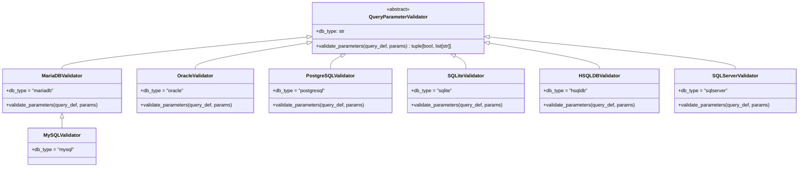

# Sistema de Validadores (QueryParameterValidator)

Define la interfaz abstracta `QueryParameterValidator` que todos los validadores de parámetros de query deben implementar, y expone `get_type_validator(db_type)` como punto de entrada para obtener el validador concreto de cada motor. Se importan de `util_bbdd.validators`; `QueryResolver` los usa al resolver una query con nombre.

!!! note "No confundir con `DatabaseTypeValidator`"
    Hasta 2026-09-22 esta clase base se llamaba `DatabaseTypeValidator`; se renombró porque colisionaba con
    `_drivers.validator.DatabaseTypeValidator`, que valida si un `db_type` está soportado (no parámetros de query).

## 1. Arquitectura y Diseño

## 2. Modelo de Datos / Contratos

### API pública

#### Clase abstracta `QueryParameterValidator`

| Elemento | Tipo | Descripción |
|---|---|---|
| `db_type` | `str` (atributo de clase) | Identificador del motor que valida |
| `validate_parameters` | `abstractmethod (query_def, params) → tuple[bool, list[str]]` | Valida parámetros y retorna `(is_valid, warnings)` |

#### Función de acceso

| Función | Firma simplificada | Descripción | Retorna |
|---|---|---|---|
| `get_type_validator` | `(db_type)` | Obtiene el validador concreto para el motor (sin distinguir mayúsculas; una instancia cacheada por motor) | `QueryParameterValidator` |

### Contrato de entrada

| Parámetro | Tipo | Descripción | Restricciones |
|---|---|---|---|
| `query_def` | `QueryDefinition` | Definición de la query con `required_params` | Proporcionado por `QueryRegistry` |
| `params` | `dict[str, Any]` | Parámetros a validar | Puede estar vacío si la query no requiere parámetros |
| `db_type` | `str` | Tipo de motor en `get_type_validator` | Debe coincidir con un motor registrado |

### Contrato de salida

- **`validate_parameters`** — siempre retorna `tuple[bool, list[str]]`:
  - `(True, [])` — validación correcta sin advertencias.
  - `(True, ["aviso..."])` — validación correcta con advertencias no bloqueantes.
  - `(False, ["error..."])` — validación fallida; el `QueryResolver` lanzará `QueryValidationError`.
- **`get_type_validator`** — instancia del validador concreto para el motor indicado.

### Errores y casos especiales

| Error | Cuándo ocurre |
|---|---|
| `ValueError` | `get_type_validator` con `db_type` no registrado (el mensaje lista los 7 soportados) |
| `TypeError` | Subclase sin implementar `validate_parameters` al instanciarla |

**Contrato crítico:** está prohibido lanzar excepciones dentro de `validate_parameters`. Los errores deben retornarse como `(False, [mensaje])`. Una excepción no controlada en un validador rompe el `QueryResolver`.

## 3. Componentes y Clases

| Clase | Responsabilidad |
|---|---|
| `QueryParameterValidator` | Interfaz abstracta; contrato para todos los validadores |
| `MariaDBValidator` | Reglas de validación específicas para MariaDB |
| `MySQLValidator` | Las de MariaDB (subclase) |
| `OracleValidator` | Reglas de validación específicas para Oracle |
| `PostgreSQLValidator` | Reglas de validación específicas para PostgreSQL |
| `SQLiteValidator` | Reglas de validación específicas para SQLite |
| `HSQLDBValidator` | Reglas de validación específicas para HSQLDB |
| `SQLServerValidator` | Reglas de validación específicas para SQL Server |

## 4. Dependencias y Requisitos

| Dependencia | Propósito | Requerida | Comportamiento sin ella |
|---|---|---|---|
| `QueryDefinition` (de `query_system`) | Definición de la query a validar | Sí | Sin `QueryDefinition` no hay nada que validar |

## 5. Ejemplos Relacionados

- [Ejemplo: Patrón de Validadores](../examples/validators_pattern.md) — `get_type_validator`, casos válido, inválido y con avisos, motor no soportado y caché de instancias
