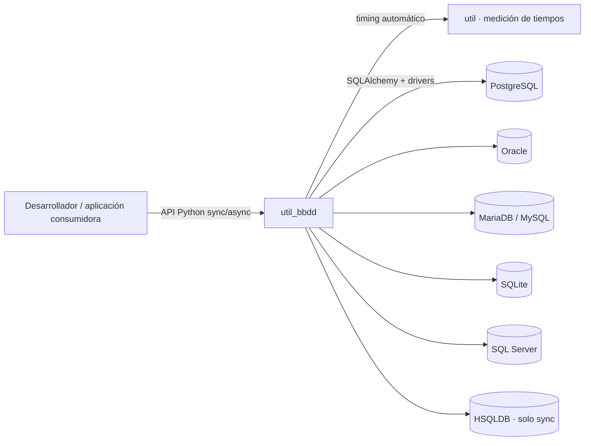
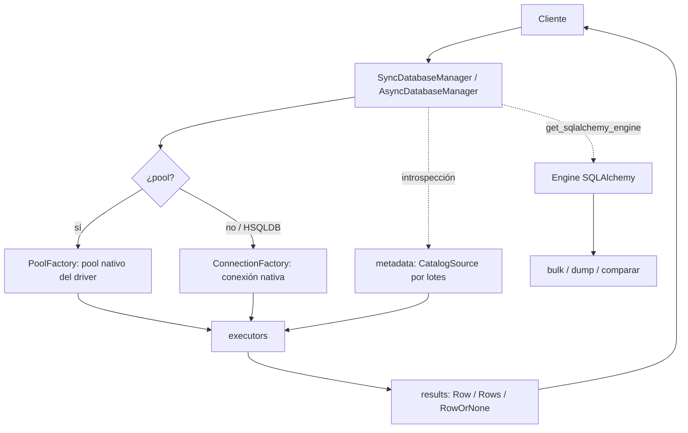

# Arquitectura del Sistema — util_bbdd

Vista panorámica de cómo está organizado `util_bbdd`: una librería en capas que abstrae conexión, introspección y operaciones de alto nivel sobre `sqlalchemy`. Esta página es el modelo **arc42-lite + C4** del sistema; las decisiones puntuales con trade-offs viven en el [log de ADR](adr/ADR-001-STRUCTURE-REFACTORING.md).

> Las 5 secciones mapean un subconjunto de [arc42](https://arc42.org): §1 ≈ arc42 1+3 (objetivos + contexto, C4 nivel 1), §2 ≈ arc42 5 (building blocks, C4 nivel 3), §3 ≈ arc42 6 (runtime), §4 ≈ arc42 8+10 (transversal + calidad), §5 ≈ arc42 9+11 (decisiones + riesgos).

## 1. Visión General y Objetivos de Calidad

`util_bbdd` se organiza en **capas con responsabilidad única**:

- **Orquestación** (`managers/`): punto de entrada público; gestiona ciclo de vida de conexión y expone operaciones.
- **Infraestructura** (`factory/`, `connection/`, `executors/`): construye conexiones/pools y ejecuta SQL contra el engine de `sqlalchemy`.
- **Operaciones** (`bulk/`, `comparar/`, `dump/`, `migrate/`, `metadata/`, `query/`, `analysis/`, `doc/`): capacidades de alto nivel.
- **Soporte** (`results/`, `validators/`, `_core/`, `core/`, `_drivers/`, `models.py`): tipos de retorno, validación, excepciones canónicas y detección de capacidades por motor.

**Frontera de la librería**: usa `sqlalchemy` como abstracción (no construye SQL raw en managers) y concentra la introspección en `metadata/`. Queda **fuera de su alcance** la gestión de credenciales/secretos y la orquestación de procesos externos.

### Objetivos de calidad

| Objetivo de calidad | Por qué importa |
|---|---|
| **Portabilidad multi-motor** | El mismo código opera sobre 7 motores (MariaDB y MySQL por separado); cambiar de motor no debe cambiar la lógica de aplicación. |
| **Mantenibilidad (SOLID/SRP)** | Cada módulo tiene una única razón de cambio; facilita evolución y auditoría. |
| **Fiabilidad de datos** | Operaciones masivas con auditoría, cierres explícitos y excepciones canónicas evitan estados a medias. |
| **Rendimiento en cargas masivas** | Pool, tamaño de lote (`chunk_size`) y carga paralela hacen viables volúmenes grandes. |
| **Seguridad de tipos** | API tipada (`py.typed` + mypy) detecta errores de contrato antes de ejecución. |

### Diagrama de contexto (C4 nivel 1)



## 2. Mapa de Módulos (Building Blocks)

Vista estática equivalente a **C4 nivel 3 (Component)**.

```text
src/util_bbdd/
  managers/      # SyncDatabaseManager, AsyncDatabaseManager (API pública)
  factory/       # ConnectionFactory, PoolFactory
  connection/    # build_conn_params, configuración por motor
  executors/     # ejecutores de queries (sync/async)
  metadata/      # CatalogSource → SchemaSnapshot por lotes (ADR-003), CatalogDialect por motor, contratos *MetadataProvider
  bulk/          # CRUD masivo desde DataFrame + auditoría + ParallelBulkLoader
  comparar/      # SchemaComparator, SchemaDiff, reporters (SQL/HTML/Word/Excel/MD)
  dump/          # DumpOrchestrator, DumpConfig (volcado entre esquemas/motores)
  migrate/       # MigrationPlanner, MigrationPlan (migración DDL)
  query/         # QueryRegistry, QueryResolver, ejecución de queries nombradas
  validators/    # validación de parámetros de queries
  audit/         # auditoría común de bulk, dump y migrate (AuditEvent, AuditSink)
  analysis/      # grafos de relaciones entre tablas (Graphviz)
  doc/           # documentación de BD (Word, Excel, HTML/Jinja2)
  results/       # Row, Rows, RowOrNone, QueryResult
  core/          # capabilities.py (capacidades por motor)
  _core/         # exceptions.py (jerarquía canónica de excepciones)
  _drivers/      # detección de drivers, get_supported_db_types
  models.py      # modelos de datos compartidos
  async_utils.py # maybe_await
  exceptions.py  # módulo público de excepciones (re-exporta _core/exceptions.py)
  __init__.py    # API pública (13 símbolos)
```

| Módulo | Responsabilidad |
|---|---|
| `managers/` | Ciclo de vida de conexión (init, pool, cierre) y operaciones de BD |
| `factory/` | Factory de conexiones y pools; abstracción del engine SQLAlchemy |
| `connection/` | Construcción de parámetros y configuración de conexión por motor |
| `executors/` | Ejecución de queries síncrona/asíncrona |
| `metadata/` | Introspección de esquemas; caché de sesión; **único punto autorizado** para SQL de introspección |
| `bulk/` | CRUD masivo desde DataFrame con auditoría y carga paralela |
| `comparar/` | Comparación de dos esquemas; diff estructurado; reporters por formato |
| `dump/` | Volcado de datos entre esquemas/motores |
| `migrate/` | Planificación de migración DDL entre motores |
| `query/` | Registry de queries nombradas, resolver y parámetros |
| `validators/` | Validación de parámetros de queries antes de ejecutar |
| `audit/` | Punto canónico de la auditoría de `bulk`, `dump` y `migrate`: modelo de evento y destinos |
| `analysis/` | Grafos de relaciones entre tablas (Graphviz) |
| `doc/` | Documentación de BD en Word, Excel y HTML vía Jinja2 |
| `results/` | Tipos de retorno: `Row`, `Rows`, `RowOrNone`, `QueryResult` |
| `_core/` | Jerarquía de excepciones canónica |

### Capas e imports reales

Los tres niveles de la arquitectura (Foundation → Servicios → Especialización), divididos en capas, con los imports que hay hoy entre los paquetes de `src/util_bbdd/`. Cada flecha va de quien importa hacia quien es importado.

<figure class="arq-figure">
<div class="arq-scroll">
--8<-- "assets/diagrams/arquitectura-capas.svg"
</div>
<figcaption>Instantánea de <code>develop</code> en v3.0.3 (2026-10-16) medida con <code>ast</code> sobre 339 ficheros. Capas y niveles según <code>.ai/architecture.md</code>; <code>models.py</code> y <code>async_utils.py</code> son módulos raíz de Foundation: no importan nada de la librería. El <code>__init__.py</code> raíz y <code>exceptions.py</code> (re-exports públicos) no aparecen.</figcaption>
</figure>

Capas, de mayor a menor dependencia (tabla generada por el mismo script que la figura):

--8<-- "assets/diagrams/arquitectura-capas-tabla.txt"

Cómo leerlo:

- **Capas estrictas**: un paquete importa solo de paquetes de una capa de número menor; los de una misma capa son independientes entre sí. Ningún import lo incumple, ni siquiera bajo `TYPE_CHECKING`.
- **Guarda**: la [Regla #6](https://github.com/fmanza/util_bbdd/blob/main/.github/instructions/architecture.instructions.md) exige capas estrictas y `tests/unit/test_architecture_import_rules.py` la vigila: imports solo hacia capas inferiores, sin ciclos y con capa asignada a todo paquete.
- **Contratos, no la fachada**: `analysis/` depende de `RelationshipGraphSource` y `doc/` de `DocumentationSourcePort`; ninguno importa `managers/`. El manager, el adaptador de `doc/` y su puerto los cumplen de forma estructural, y `tests/unit/test_protocol_conformance.py` lo comprueba (con mypy, también las firmas).
- **Operaciones por parámetro**: `bulk/`, `dump/`, `comparar/` y `migrate/` no importan `managers/`, `factory/` ni `executors/`: reciben un `Engine` o un `Inspector` de SQLAlchemy (o, en `migrate`, un manager o `MetadataSource` que cumple el contrato) y leen el catálogo con `metadata/`.

Para regenerar la figura tras cambiar imports: `python scripts/gen_arquitectura_capas.py`. Si el dibujo deja de coincidir con los imports reales, el script falla sin escribir nada; `--edges` imprime la tabla medida. Guía completa: [Diagrama de arquitectura (regenerar)](guides/architecture_diagram_guide.md).

## 3. Flujo en Ejecución (Runtime)

Flujo típico de una operación de lectura/escritura a través de las capas:



Los managers ejecutan sobre las conexiones nativas del driver (de su pool o la única). Las operaciones de alto nivel
(`bulk/`, `comparar/`, `dump/`) reciben un `Engine` de SQLAlchemy —el de `get_sqlalchemy_engine()` u otro creado por
quien llama—, leen la estructura con `metadata/` y ejecutan con SQLAlchemy; `migrate/` lee el catálogo a través del
manager o de un `MetadataSource`.

## 4. Conceptos Transversales y Estándares No Funcionales

### Conceptos transversales

Principios aplicados en todas las capas (ver [`.github/SHARED_INSTRUCTIONS.md`](https://github.com/fmanza/util_bbdd/blob/main/.github/SHARED_INSTRUCTIONS.md)):

- **SOLID operativo**: cada servicio tiene una sola razón de cambio (SRP); la orquestación depende de servicios, no de detalles de IO (DIP).
- **Acceso a metadatos**: `metadata/` es el **único punto autorizado** para SQL de introspección.
- **Abstracción de motor**: `sqlalchemy` como capa común; `db_type` se valida al inicio y lanza `InvalidDatabaseType` antes de conectar.
- **Cierres explícitos**: usar el manager como context manager o llamar a `close()`.
- **Tipos de retorno uniformes**: `Row`, `Rows`, `RowOrNone` (y `QueryResult`) desde `results/`.
- **Excepciones canónicas**: jerarquía centralizada en `_core/exceptions.py`, publicada en `util_bbdd.exceptions`, que es la ruta que muestran trazas, `repr` y pickle.

### Checklist no funcional

Estándares que toda evolución debe preservar. Cada fila se ancla a un mecanismo real del código:

| Dimensión | Requisito | Cómo se cumple en util_bbdd |
|---|---|---|
| **Seguridad** | Credenciales fuera del código y no expuestas en logs | `conn_params: dict` provisto externamente; `db_type` validado (`InvalidDatabaseType`) antes de conectar; la librería no persiste secretos |
| **Observabilidad** | Logging estructurado (sin `print`) y métricas de tiempo | `self.logger` en clases con lógica; `util.timing` (`medir_tiempo`) mide las operaciones de `bulk` y el CSV de auditoría registra `tiempo_seg` por operación; eventos opcionales `AuditEvent` (`audit/`); `exc_info=True` en errores inesperados |
| **Rendimiento** | Pool, batching, paralelismo y caché | `PoolFactory`; `chunk_size` (y lote por motor y operación) en `bulk/`; `ParallelBulkLoader` con los hilos decididos por `ParallelPlanner` (v3.0.0: reglas medidas por motor y operación, compartidas con `dump`); caché de metadatos por schema (`SnapshotCache`) |
| **Compatibilidad** | Matriz de motores, versionado y tipado público | Matriz de soporte en [Inicio](index.md#5-compatibilidad-y-soporte); [CHANGELOG](https://github.com/fmanza/util_bbdd/blob/main/CHANGELOG.md) (SemVer); `py.typed` distribuido |
| **Robustez / errores** | Errores tipados y sin estados a medias | Jerarquía canónica en `_core/exceptions.py`; cierres explícitos vía context manager / `close()` |
| **Tipado / calidad** | Análisis estático y pruebas automatizadas | `mypy`, `ruff` y `pytest` (extra `[dev]` en `pyproject.toml`); `py.typed` distribuido |

Estado de cobertura:

- [x] Seguridad — credenciales externas y validación previa de `db_type`
- [x] Observabilidad — logging + auditoría temporal en CSV
- [x] Rendimiento — pool, `chunk_size`, carga paralela y caché de metadatos
- [x] Compatibilidad — matriz de motores y `py.typed`
- [x] Robustez / errores — excepciones canónicas y cierres explícitos
- [x] Tipado / calidad — mypy + ruff + pytest

## 5. Decisiones, Extensión y Límites

### Decisiones arquitectónicas (ADR)

Las decisiones de diseño con trade-offs se registran como ADR en [`docs/adr/`](adr/ADR-001-STRUCTURE-REFACTORING.md) (formato MADR-lite, ver [Plantilla ADR](adr/ADR-TEMPLATE.md)). Vigentes: [ADR-001 — Structure Refactoring](adr/ADR-001-STRUCTURE-REFACTORING.md), [ADR-002 — Módulo de auditoría](adr/ADR-002-modulo-auditoria.md), [ADR-003 — Metadatos centralizados](adr/ADR-003-metadata-centralizada.md), [ADR-004 — Resolución perezosa de la versión de Oracle](adr/ADR-004-lazy-oracle-version-resolution.md) y [ADR-005 — Conexiones multimotor](adr/ADR-005-conexiones-multimotor.md).

### Riesgos y deuda técnica

| Riesgo / deuda | Impacto | Mitigación |
|---|---|---|
| HSQLDB sin soporte async | Funcionalidad async no disponible para ese motor | Las factorías async lanzan error explícito; documentado en la matriz de soporte |
| Dependencia interna `util` desde `git+@develop` | Instalación falla sin acceso a GitHub | Procedimiento `--no-deps` documentado en [Instalación](installation.md#5-solucion-de-problemas) |

### Extensión y límites

Formas soportadas de extender el sistema:

- **Nuevo reporter de comparación**: añadir un reporter en `comparar/reporters/` respetando el contrato de salida de `SchemaDiff`.
- **Nueva query nombrada**: añadirla al JSON propio que se pasa como `queries_file` (`{motor: {nombre: SQL}}`); las reglas de validación de parámetros por motor están en `validators/`.
- **Capacidades por motor**: declararlas en `core/capabilities.py` y la detección de driver en `_drivers/`.

Anti-patrones a evitar:

- Construir SQL raw en `managers/` en lugar de delegar en `sqlalchemy`/`executors/`.
- Ejecutar SQL de introspección fuera de `metadata/`.
- Introducir estado global mutable o `print()` dentro de la librería (usar `self.logger`).

### Pendiente de verificación

- El procedimiento de alta de un **motor nuevo** de extremo a extremo (factory + connection + capabilities + drivers) no está documentado de forma consolidada; conviene confirmarlo con el equipo y, si se formaliza, registrarlo como ADR.
