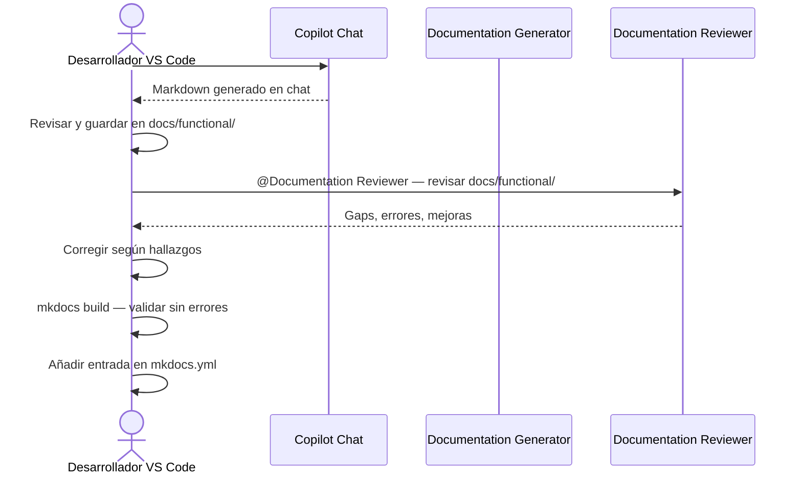

# Guía: Generación de documentación desde VS Code

Guía paso a paso para generar documentación funcional y técnica de **util_gitlab** usando las cuatro herramientas de IA disponibles, directamente desde VS Code.

---

## ⚠️ Contexto previo recomendado

Lee **primero**:
- [`.github/copilot-instructions.md`](../../.github/copilot-instructions.md) — Instrucciones para Copilot Chat
- [`CLAUDE.md`](../../CLAUDE.md) — Instrucciones para Claude Code
- [`.github/AGENTS.md`](../../.github/AGENTS.md) — Agentes disponibles (Documentation Generator, Documentation Reviewer)

Estos ficheros contienen las directrices de cuándo usar cada herramienta y qué agentes invocar.

---

## Cuándo usar cada herramienta

Para recomendaciones detalladas, consulta:

| Herramienta | Referencia | Instalación |
|---|---|---|
| **Claude Code** | [Slash commands en CLAUDE.md](../../CLAUDE.md#slash-commands-de-claude-code) | Extensión Claude Code (Anthropic) |
| **Copilot Chat** | [Agentes en copilot-instructions.md](../../.github/copilot-instructions.md#agentes-disponibles-en-copilot-chat) | GitHub Copilot + Copilot Chat |
| **Codex** | [Guía de uso en docs/examples/codex_usage_complete_example.md](codex_usage_complete_example.md) | Extensión Codex (OpenAI) |
| **GitHub Actions** | [Workflow `.github/workflows/doc_agents.yml`](../../.github/workflows/doc_agents.yml) | Secreto `ANTHROPIC_API_KEY` o `OPENAI_API_KEY` |

**Resumen rápido**:
- **Claude Code**: Mejor para generar + guardar automáticamente en `docs/`
- **Copilot Chat**: Mejor para generar con agentes especializados + revisar antes de guardar
- **Codex**: Mejor para módulo concreto con prompt explícito
- **GitHub Actions**: Mejor para generación en batch o programada

---

## Tipos de documentación generables

| Tipo | Audiencia | Prompt base | Destino |
|---|---|---|---|
| **Funcional** | Jefes de proyecto, calidad | `.github/prompts/functional_doc.prompt.md` | `docs/functional/` |
| **Técnica con Mermaid** | Desarrolladores | `.github/prompts/technical_doc.prompt.md` | `docs/api/` o `docs/functional/` |

---

## Opción 1 — Claude Code (recomendado)

Claude Code puede leer el módulo, aplicar el prompt y escribir el archivo en `docs/` en un solo paso.

### Instalación en VS Code

1. Abrir VS Code
2. `Ctrl+Shift+X` → Buscar **Claude Code** (Anthropic)
3. Instalar y autenticarse con tu cuenta de Anthropic

### Paso 1 — Abrir el panel de Claude Code

`Ctrl+Shift+P` → **Claude Code: Open** (o icono de Claude en la barra lateral izquierda)

### Paso 2 — Documentación funcional (un módulo)

Escribe en el chat:

```text
Lee src/util_gitlab/timelog/time_utils.py y genera documentación funcional usando
el prompt en .github/prompts/functional_doc.prompt.md.

Guarda el resultado en docs/functional/time-utils.md.
```

Claude leerá el archivo, aplicará el prompt de Product Owner y escribirá el Markdown en `docs/functional/`.

### Paso 3 — Documentación técnica con Mermaid (un módulo)

```text
Lee src/util_gitlab/timelog/issue_helpers.py y genera documentación técnica con
diagrama Mermaid usando el prompt en .github/prompts/technical_doc.prompt.md.

Tipo de diagrama: flowchart TD (lógica de clasificación de incidentes).
Guarda el resultado en docs/functional/issue-helpers-tecnico.md.
```

### Paso 4 — Documentar todos los módulos de una vez

Para generar la documentación completa del módulo `timelog`:

```text
Necesito documentación técnica para todos los módulos de src/util_gitlab/timelog/.

Para cada módulo:
1. Lee el archivo
2. Aplica el prompt de .github/prompts/technical_doc.prompt.md
3. Guarda el resultado en docs/api/[nombre-modulo].md

Módulos a documentar:
- time_utils.py → docs/api/time-utils.md
- project_loader.py → docs/api/project-loader.md
- issue_helpers.py → docs/api/issue-helpers.md
- excel_formatter.py → docs/api/excel-formatter.md
- calendar.py → docs/api/calendar.md

Al final, indica las entradas que debo añadir en mkdocs.yml bajo la sección API.
```

### Paso 5 — Usar el agente Documentation Generator directamente

El agente `.github/agents/documentation-generator.agent.md` puede invocarse con:

```text
@Documentation Generator

Genera documentación funcional para src/util_gitlab/timelog/project_loader.py.
Tipo: functional.
Destino: docs/functional/project-loader.md.
```

### Validar el resultado

Tras generar, ejecuta en el terminal integrado de VS Code (`Ctrl+` `` ` ``):

```bash
python -m mkdocs build
```

Si no hay errores ni warnings nuevos, añade la entrada en `mkdocs.yml` y ejecuta `mkdocs serve` para verificar el renderizado de los diagramas Mermaid.

---

## Opción 2 — Copilot Chat

Copilot Chat usa los archivos de `.github/prompts/` mediante la sintaxis `#file:`.

### Instalación en VS Code

1. `Ctrl+Shift+X` → Buscar **GitHub Copilot** + **GitHub Copilot Chat**
2. Instalar y autenticarse con tu cuenta de GitHub (requiere suscripción Copilot)

### Paso 1 — Abrir Copilot Chat

`Ctrl+Alt+I` (Windows/Linux) o `Cmd+I` (Mac) → Se abre el panel de chat

### Paso 2 — Documentación funcional con `#file:`

En el chat, escribe:

```text
#file:.github/prompts/functional_doc.prompt.md
#file:src/util_gitlab/timelog/time_utils.py

Genera la documentación funcional del módulo indicado en el prompt.
```

Copilot cargará el prompt y el código, y generará el Markdown directamente en el chat.

**Guardar el resultado**:
1. Selecciona todo el Markdown generado en la respuesta
2. Abre VS Code: `Ctrl+N` → nuevo archivo
3. Pega el contenido
4. `Ctrl+Shift+P` → **Save As** → `docs/functional/time-utils.md`

### Paso 3 — Documentación técnica con Mermaid

```text
#file:.github/prompts/technical_doc.prompt.md
#file:src/util_gitlab/timelog/issue_helpers.py

Genera la documentación técnica con diagrama Mermaid.
El módulo tiene lógica de clasificación de incidentes — usa flowchart TD.
```

### Paso 4 — Usar el agente Documentation Generator

```text
@Documentation Generator

Analiza src/util_gitlab/timelog/project_loader.py y genera documentación técnica.
Incluye diagrama sequenceDiagram (flujo de autenticación y listado de proyectos).
```

### Paso 5 — Revisar con Documentation Reviewer antes de publicar

Antes de añadir los archivos generados a `mkdocs.yml`, pasa por el Reviewer:

```text
@Documentation Reviewer

Revisa los archivos generados en docs/functional/ y docs/api/.
Identifica: diagramas Mermaid incorrectos, terminología técnica en docs funcionales,
reglas de negocio incompletas o desactualizadas respecto al código real.
```

### Paso 6 — Flujo completo recomendado en Copilot Chat



---

## Opción 3 — Codex (OpenAI)

Codex es efectivo para generar documentación de módulos concretos con prompts explícitos.

### Instalación en VS Code

1. `Ctrl+Shift+X` → Buscar **Codex** (OpenAI)
2. Instalar y configurar con tu API key de OpenAI

### Paso 1 — Documentación funcional

Abre Codex y escribe:

```text
Trabaja sobre util_gitlab.
Lee src/util_gitlab/timelog/time_utils.py completo.
Lee también .github/prompts/functional_doc.prompt.md para ver el formato esperado.

Genera documentación funcional siguiendo exactamente el formato del prompt:
1. Objetivo de negocio (sin jerga técnica)
2. Precondiciones (lista)
3. Flujo principal (diagrama Mermaid sequenceDiagram)
4. Reglas de negocio críticas (tabla: Regla | Descripción | Impacto)
5. Límites del módulo (máx. 5 ítems)

Guarda el resultado en docs/functional/time-utils.md.
```

### Paso 2 — Documentación técnica

```text
Trabaja sobre util_gitlab.
Lee src/util_gitlab/timelog/project_loader.py completo.
Lee también .github/prompts/technical_doc.prompt.md.

Genera documentación técnica con estas secciones:
1. Responsabilidad (1 frase)
2. Diagrama Mermaid sequenceDiagram (flujo: config → GitLab API → lista proyectos filtrada)
   Criterios: máx. 12 nodos, etiquetas en español, sin variables internas
3. API pública (tabla)
4. Contrato de entrada (tabla con tipos Python)
5. Contrato de salida
6. Errores y casos especiales

Guarda en docs/api/project-loader.md.
Verifica con: python -m ruff check src y python -m mypy src (no cambia código, solo docs).
```

### Paso 3 — Criterios de cierre con Codex

Antes de dar la tarea por terminada, verifica:

```bash
python -m mkdocs build       # Sin nuevos warnings de links rotos
python -m mkdocs serve       # Diagramas Mermaid renderizan correctamente
```

---

## Opción 4 — GitHub Actions desde VS Code

El workflow `.github/workflows/doc_agents.yml` genera documentación automáticamente via API.

### Requisito previo — Configurar secretos en GitHub

1. Ir al repositorio en GitHub
2. **Settings** → **Secrets and variables** → **Actions**
3. **New repository secret**:
   - Nombre: `ANTHROPIC_API_KEY` (preferido)
   - Valor: tu API key de Anthropic (`sk-ant-...`)
   - O bien: `OPENAI_API_KEY` con tu key de OpenAI

### Lanzar manualmente desde VS Code (extensión GitHub Actions)

#### Instalación

`Ctrl+Shift+X` → Buscar **GitHub Actions** (GitHub) → Instalar

#### Paso 1 — Abrir el panel de GitHub Actions

En la barra lateral izquierda → icono de GitHub Actions → expandir **Workflows**

#### Paso 2 — Lanzar `Doc Agents`

1. Expandir **Doc Agents**
2. Click en el botón ▶ **Run workflow**
3. Rellenar los inputs:

| Input | Ejemplo | Descripción |
|---|---|---|
| `module_path` | `src/util_gitlab/timelog/time_utils.py` | Ruta al módulo a documentar |
| `doc_type` | `both` | `functional`, `technical` o `both` |
| `output_dir` | `docs/functional` | Directorio destino en docs/ |
| `dry_run` | `false` | `true` solo muestra el output sin guardar |

4. Click **Run workflow** → el job se ejecuta en GitHub

#### Paso 3 — Ver resultado y revisar el PR

El workflow crea automáticamente un Pull Request con:
- Los archivos `.md` generados en `docs/`
- Validación de `mkdocs build`
- Checklist de revisión humana

Desde VS Code, puedes ver el PR con la extensión **GitHub Pull Requests**:
`Ctrl+Shift+P` → **GitHub Pull Requests: Focus on Pull Request View**

### Lanzar desde terminal integrado de VS Code

Si prefieres la CLI sobre la extensión:

```bash
# Documentación funcional de time_utils.py
gh workflow run doc_agents.yml \
  --field module_path="src/util_gitlab/timelog/time_utils.py" \
  --field doc_type="functional" \
  --field output_dir="docs/functional" \
  --field dry_run=false

# Ver estado del workflow
gh run list --workflow=doc_agents.yml --limit=5

# Ver log del último run
gh run view --log
```

---

## Guía rápida de referencia

### Qué prompt usar según el objetivo

| Objetivo | Prompt a usar | Comando |
|---|---|---|
| Explicar un módulo a dirección | `functional_doc.prompt.md` | Sección "Objetivo de negocio" + Mermaid |
| Documentar API para desarrolladores | `technical_doc.prompt.md` | Tabla API + diagrama + contratos |
| Revisar documentación existente | `documentation_review.prompt.md` | Audit completo con gaps |
| Generar para todos los módulos | `doc_agents.yml` (Actions) | Workflow en batch |

### Qué tipo de diagrama Mermaid usar

| Módulo | Diagrama | Motivo |
|---|---|---|
| `load_gitlab.py`, `project_loader.py` | `sequenceDiagram` | Flujo auth → API → datos |
| `time_utils.py`, `issue_helpers.py` | `flowchart TD` | Lógica de decisión y parseo |
| `excel_formatter.py`, `crear_csv.py` | `flowchart TD` | Pipeline de transformación |
| `calendar.py` | `flowchart TD` | Cálculo semana ISO/fiscal |
| `decimal_utils.py` | `classDiagram` | Contratos de funciones utilitarias |

### Dónde guardar cada tipo de doc

```
docs/
├── functional/        ← Documentación para negocio (Product Owner)
│   ├── index.md       ← Visión general (ya existe)
│   ├── reglas-negocio.md  ← Reglas críticas (ya existe)
│   ├── time-utils.md      ← Generado por ti
│   └── issue-helpers.md   ← Generado por ti
├── api/               ← Documentación técnica (desarrolladores)
│   ├── index.md           ← Auto-generado por mkdocstrings
│   ├── project-loader.md  ← Generado por ti
│   └── excel-formatter.md ← Generado por ti
└── configuration/     ← Guía de configuración (ya existe)
```

### Checklist post-generación

Después de generar cualquier documento, verifica:

- [ ] `python -m mkdocs build` — sin warnings nuevos
- [ ] `python -m mkdocs serve` — los diagramas Mermaid renderizan
- [ ] La terminología de negocio es correcta (sin nombres de variables internas)
- [ ] Las reglas de negocio reflejan el comportamiento actual del código
- [ ] Se ha añadido la entrada en `mkdocs.yml` nav
- [ ] El documento tiene al menos 1 diagrama Mermaid

---

## Comparativa de las cuatro opciones

Para análisis detallado de cuándo usar cada herramienta, consulta:
- **Claude Code vs. Copilot Chat**: Tabla comparativa en [CLAUDE.md](../../CLAUDE.md#comparativa-claude-code-vs-copilot-chat)
- **Decisión de herramienta**: Tabla "Cuándo usar agentes vs. Claude Code" en [copilot-instructions.md](../../.github/copilot-instructions.md#cuándo-usar-agentes-vs-claude-code-vs-copilot-chat-directo)

### Tabla resumen rápido

| Aspecto | Claude Code | Copilot Chat | Codex | GitHub Actions |
|---|---|---|---|---|
| **Escribe archivos automáticamente** | ✅ | Manual (copiar-pegar) | ✅ | ✅ (vía PR) |
| **Requiere intervención humana** | Mínima | Guardar manualmente | Mínima | Revisar PR |
| **Mejor para** | Sesiones de desarrollo activo | Revisión interactiva antes de guardar | Módulo concreto con prompt explícito | Generación en batch o programada |
| **Coste de ejecución** | Tokens Claude API | Tokens Copilot | Tokens OpenAI | Tokens API según secreto |

---

## Flujo de trabajo recomendado (integración con instrucciones IA)

Para una experiencia consistente entre esta guía y las instrucciones de IA del proyecto:

1. **Consulta CLAUDE.md o copilot-instructions.md** para elegir herramienta según contexto
2. **Sigue los pasos de esta guía** (Opción 1-4) para la implementación práctica
3. **Usa agentes especializados** cuando disponibles (Documentation Generator, Documentation Reviewer)
4. **Aplica el checklist post-generación** para validar calidad
5. **Sincroniza con mkdocs.yml** y ejecuta `mkdocs build` antes de publicar

---

*Actualizado: 2026-05-02*
