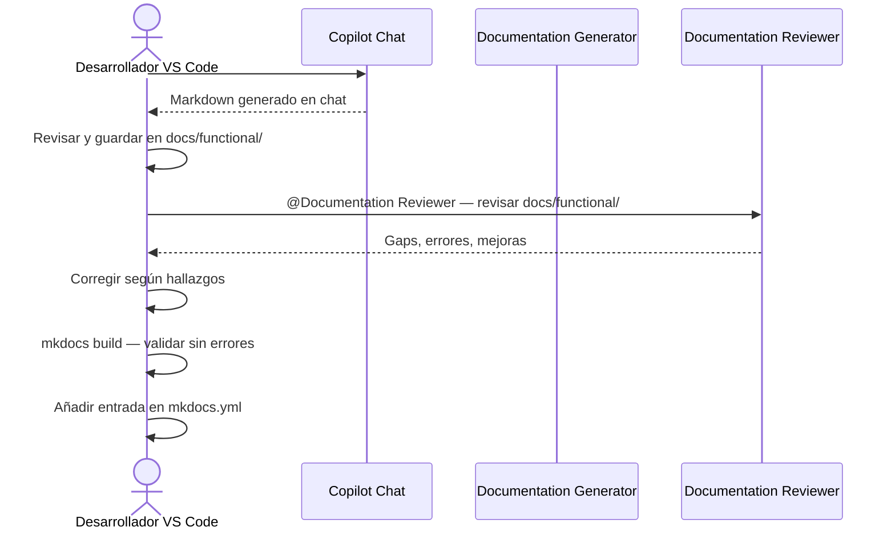

# Guía: Generación de documentación desde VS Code

Guía paso a paso para generar documentación funcional y técnica de **util_bbdd** usando las cuatro herramientas de IA disponibles, directamente desde VS Code.

---

## ⚠️ Contexto previo recomendado

Lee **primero**:
- [`.github/copilot-instructions.md`](../../.github/copilot-instructions.md) — Instrucciones para Copilot Chat
- [`CLAUDE.md`](../../CLAUDE.md) — Instrucciones para Claude Code
- [`.github/AGENTS.md`](../../.github/AGENTS.md) — Agentes disponibles (Documentation Generator, Documentation Reviewer)

Estos ficheros contienen las directrices de cuándo usar cada herramienta y qué agentes invocar.

---

## Cuándo usar cada herramienta

Para recomendaciones detalladas, consulta:

| Herramienta | Referencia | Instalación |
|---|---|---|
| **Claude Code** | [Slash commands en CLAUDE.md](../../CLAUDE.md#slash-commands-de-claude-code) | Extensión Claude Code (Anthropic) |
| **Copilot Chat** | [Agentes en copilot-instructions.md](../../.github/copilot-instructions.md#agentes-disponibles-en-copilot-chat) | GitHub Copilot + Copilot Chat |
| **Codex** | [Guía de uso en docs/examples/codex_usage_complete_example.md](codex_usage_complete_example.md) | Extensión Codex (OpenAI) |
| **GitHub Actions** | [Workflow `.github/workflows/doc_agents.yml`](../../.github/workflows/doc_agents.yml) | Secreto `ANTHROPIC_API_KEY` o `OPENAI_API_KEY` |

**Resumen rápido**:
- **Claude Code**: Mejor para generar + guardar automáticamente en `docs/`
- **Copilot Chat**: Mejor para generar con agentes especializados + revisar antes de guardar
- **Codex**: Mejor para módulo concreto con prompt explícito
- **GitHub Actions**: Mejor para generación en batch o programada

---

## Tipos de documentación generables

| Tipo | Audiencia | Prompt base | Destino |
|---|---|---|---|
| **Funcional** | Jefes de proyecto, calidad | `.github/prompts/functional_doc.prompt.md` | `docs/functional/` |
| **Técnica con Mermaid** | Desarrolladores | `.github/prompts/technical_doc.prompt.md` | `docs/api/` o `docs/functional/` |

---

## Opción 1 — Claude Code (recomendado)

Claude Code puede leer el módulo, aplicar el prompt y escribir el archivo en `docs/` en un solo paso.

### Instalación en VS Code

1. Abrir VS Code
2. `Ctrl+Shift+X` → Buscar **Claude Code** (Anthropic)
3. Instalar y autenticarse con tu cuenta de Anthropic

### Paso 1 — Abrir el panel de Claude Code

`Ctrl+Shift+P` → **Claude Code: Open** (o icono de Claude en la barra lateral izquierda)

### Paso 2 — Documentación funcional (un módulo)

Escribe en el chat:

```text
Lee src/util_bbdd/managers/sync_mgr.py y genera documentación funcional usando
el prompt en .github/prompts/functional_doc.prompt.md.

Guarda el resultado en docs/functional/managers-sync.md.
```

Claude leerá el archivo, aplicará el prompt de Product Owner y escribirá el Markdown en `docs/functional/`.

### Paso 3 — Documentación técnica con Mermaid (un módulo)

```text
Lee src/util_bbdd/metadata/_metadata_parser.py y genera documentación técnica con
diagrama Mermaid usando el prompt en .github/prompts/technical_doc.prompt.md.

Tipo de diagrama: flowchart TD (parsing de metadatos de bases de datos).
Guarda el resultado en docs/api/metadata-parser-tecnico.md.
```

### Paso 4 — Documentar todos los módulos de una vez

Para generar la documentación completa del módulo `managers` de util_bbdd:

```text
Necesito documentación técnica para los módulos principales de src/util_bbdd/managers/.

Para cada módulo:
1. Lee el archivo
2. Aplica el prompt de .github/prompts/technical_doc.prompt.md
3. Guarda el resultado en docs/api/[nombre-modulo].md

Módulos a documentar:
- sync_mgr.py → docs/api/managers-sync.md
- async_mgr.py → docs/api/managers-async.md
- _manager_lifecycle.py → docs/api/managers-lifecycle.md
- _manager_metadata_factory.py → docs/api/managers-metadata-factory.md

Al final, indica las entradas que debo añadir en mkdocs.yml bajo la sección API.
```

### Paso 5 — Usar el agente Documentation Generator directamente

El agente `.github/agents/documentation-generator.agent.md` puede invocarse con:

```text
@Documentation Generator

Genera documentación funcional para src/util_bbdd/managers/sync_mgr.py.
Tipo: functional.
Destino: docs/functional/managers-sync.md.
```

### Validar el resultado

Tras generar, ejecuta en el terminal integrado de VS Code (`Ctrl+` `` ` ``):

```bash
python -m mkdocs build
```
python -m mkdocs build
```

Si no hay errores ni warnings nuevos, añade la entrada en `mkdocs.yml` y ejecuta `mkdocs serve` para verificar el renderizado de los diagramas Mermaid.

---

## Opción 2 — Copilot Chat

Copilot Chat usa los archivos de `.github/prompts/` mediante la sintaxis `#file:`.

### Instalación en VS Code

1. `Ctrl+Shift+X` → Buscar **GitHub Copilot** + **GitHub Copilot Chat**
2. Instalar y autenticarse con tu cuenta de GitHub (requiere suscripción Copilot)

### Paso 1 — Abrir Copilot Chat

`Ctrl+Alt+I` (Windows/Linux) o `Cmd+I` (Mac) → Se abre el panel de chat

### Paso 2 — Documentación funcional con `#file:`

En el chat, escribe:

```text
#file:.github/prompts/functional_doc.prompt.md
#file:src/util_bbdd/managers/sync_mgr.py

Genera la documentación funcional del módulo indicado en el prompt.
```

Copilot cargará el prompt y el código, y generará el Markdown directamente en el chat.

**Guardar el resultado**:
1. Selecciona todo el Markdown generado en la respuesta
2. Abre VS Code: `Ctrl+N` → nuevo archivo
3. Pega el contenido
4. `Ctrl+Shift+P` → **Save As** → `docs/functional/time-utils.md`

### Paso 3 — Documentación técnica con Mermaid

```text
#file:.github/prompts/technical_doc.prompt.md
#file:src/util_bbdd/metadata/_metadata_parser.py

Genera la documentación técnica con diagrama Mermaid.
El módulo parsea metadatos de bases de datos — usa flowchart TD.
```

### Paso 4 — Usar el agente Documentation Generator

```text
@Documentation Generator

Analiza src/util_bbdd/managers/sync_mgr.py y genera documentación técnica.
Incluye diagrama sequenceDiagram (flujo: conexión → metadatos → resultados).
```

### Paso 5 — Revisar con Documentation Reviewer antes de publicar

Antes de añadir los archivos generados a `mkdocs.yml`, pasa por el Reviewer:

```text
@Documentation Reviewer

Revisa los archivos generados en docs/functional/ y docs/api/.
Identifica: diagramas Mermaid incorrectos, terminología técnica en docs funcionales,
reglas de negocio incompletas o desactualizadas respecto al código real.
```

### Paso 6 — Flujo completo recomendado en Copilot Chat



---

## Opción 3 — Codex (OpenAI)

Codex es efectivo para generar documentación de módulos concretos con prompts explícitos.

### Instalación en VS Code

1. `Ctrl+Shift+X` → Buscar **Codex** (OpenAI)
2. Instalar y configurar con tu API key de OpenAI

### Paso 1 — Documentación funcional

Abre Codex y escribe:

```text
Trabaja sobre util_bbdd.
Lee src/util_bbdd/managers/sync_mgr.py completo.
Lee también .github/prompts/functional_doc.prompt.md para ver el formato esperado.

Genera documentación funcional siguiendo exactamente el formato del prompt:
1. Objetivo de negocio (sin jerga técnica)
2. Precondiciones (lista)
3. Flujo principal (diagrama Mermaid sequenceDiagram)
4. Reglas de negocio críticas (tabla: Regla | Descripción | Impacto)
5. Límites del módulo (máx. 5 ítems)

Guarda el resultado en docs/functional/managers-sync.md.
```

### Paso 2 — Documentación técnica

```text
Trabaja sobre util_bbdd.
Lee src/util_bbdd/metadata/_metadata_parser.py completo.
Lee también .github/prompts/technical_doc.prompt.md.

Genera documentación técnica con estas secciones:
1. Responsabilidad (1 frase)
2. Diagrama Mermaid flowchart TD (flujo: request → parsing → metadata results)
   Criterios: máx. 12 nodos, etiquetas en español, sin variables internas
3. API pública (tabla)
4. Contrato de entrada (tabla con tipos Python)
5. Contrato de salida
6. Errores y casos especiales

Guarda en docs/api/metadata-parser.md.
Verifica con: python -m ruff check src y python -m mypy src (no cambia código, solo docs).
```

### Paso 3 — Criterios de cierre con Codex

Antes de dar la tarea por terminada, verifica:

```bash
python -m mkdocs build       # Sin nuevos warnings de links rotos
python -m mkdocs serve       # Diagramas Mermaid renderizan correctamente
```

---

## Opción 4 — GitHub Actions desde VS Code

El workflow `.github/workflows/doc_agents.yml` genera documentación automáticamente via API.

### Requisito previo — Configurar secretos en GitHub

1. Ir al repositorio en GitHub
2. **Settings** → **Secrets and variables** → **Actions**
3. **New repository secret**:
   - Nombre: `ANTHROPIC_API_KEY` (preferido)
   - Valor: tu API key de Anthropic (`sk-ant-...`)
   - O bien: `OPENAI_API_KEY` con tu key de OpenAI

### Lanzar manualmente desde VS Code (extensión GitHub Actions)

#### Instalación

`Ctrl+Shift+X` → Buscar **GitHub Actions** (GitHub) → Instalar

#### Paso 1 — Abrir el panel de GitHub Actions

En la barra lateral izquierda → icono de GitHub Actions → expandir **Workflows**

#### Paso 2 — Lanzar `Doc Agents`

1. Expandir **Doc Agents**
2. Click en el botón ▶ **Run workflow**
3. Rellenar los inputs:

| Input | Ejemplo | Descripción |
|---|---|---|
| `module_path` | `src/util_bbdd/managers/sync_mgr.py` | Ruta al módulo a documentar |
| `doc_type` | `both` | `functional`, `technical` o `both` |
| `output_dir` | `docs/functional` | Directorio destino en docs/ |
| `dry_run` | `false` | `true` solo muestra el output sin guardar |

4. Click **Run workflow** → el job se ejecuta en GitHub

#### Paso 3 — Ver resultado y revisar el PR

El workflow crea automáticamente un Pull Request con:
- Los archivos `.md` generados en `docs/`
- Validación de `mkdocs build`
- Checklist de revisión humana

Desde VS Code, puedes ver el PR con la extensión **GitHub Pull Requests**:
`Ctrl+Shift+P` → **GitHub Pull Requests: Focus on Pull Request View**

### Lanzar desde terminal integrado de VS Code

Si prefieres la CLI sobre la extensión:

```bash
# Documentación funcional de sync_mgr.py
gh workflow run doc_agents.yml \
  --field module_path="src/util_bbdd/managers/sync_mgr.py" \
  --field doc_type="functional" \
  --field output_dir="docs/functional" \
  --field dry_run=false

# Ver estado del workflow
gh run list --workflow=doc_agents.yml --limit=5

# Ver log del último run
gh run view --log
```

---

## Guía rápida de referencia

### Qué prompt usar según el objetivo

| Objetivo | Prompt a usar | Comando |
|---|---|---|
| Explicar un módulo a dirección | `functional_doc.prompt.md` | Sección "Objetivo de negocio" + Mermaid |
| Documentar API para desarrolladores | `technical_doc.prompt.md` | Tabla API + diagrama + contratos |
| Revisar documentación existente | `documentation_review.prompt.md` | Audit completo con gaps |
| Generar para todos los módulos | `doc_agents.yml` (Actions) | Workflow en batch |

### Qué tipo de diagrama Mermaid usar

| Módulo | Diagrama | Motivo |
|---|---|---|
| `_drivers/*.py`, `validators/*.py` | `sequenceDiagram` | Flujo conexión → validación → adaptador |
| `managers/sync_mgr.py`, `managers/async_mgr.py` | `flowchart TD` | Orquestación de ciclo de vida manager |
| `metadata/_metadata_parser.py`, `metadata/_metadata_context.py` | `flowchart TD` | Parsing y extracción de metadatos |
| `query/*.py` | `flowchart TD` | Pipeline de construcción de queries |
| `bulk/*.py` | `flowchart TD` | Operaciones bulk: insert, update, delete |
| `results/*.py` | `classDiagram` | Contratos de resultados y serialización |

### Dónde guardar cada tipo de doc

```
docs/
├── functional/        ← Documentación para Product Owner (negocio)
│   ├── index.md       ← Visión general (ya existe)
│   ├── managers-sync.md      ← Generado por ti
│   ├── managers-async.md     ← Generado por ti
│   └── metadata-parsing.md   ← Generado por ti
├── api/               ← Documentación técnica (desarrolladores)
│   ├── index.md           ← Auto-generado por mkdocstrings
│   ├── managers-sync.md    ← Generado por ti
│   ├── managers-async.md   ← Generado por ti
│   ├── metadata-parser.md  ← Generado por ti
│   └── query-builder.md    ← Generado por ti
└── configuration/     ← Guía de configuración (ya existe)
```

### Checklist post-generación

Después de generar cualquier documento, verifica:

- [ ] `python -m mkdocs build` — sin warnings nuevos
- [ ] `python -m mkdocs serve` — los diagramas Mermaid renderizan
- [ ] La terminología de negocio es correcta (sin nombres de variables internas)
- [ ] Las reglas de negocio reflejan el comportamiento actual del código
- [ ] Se ha añadido la entrada en `mkdocs.yml` nav
- [ ] El documento tiene al menos 1 diagrama Mermaid

---

## Comparativa de las cuatro opciones

Para análisis detallado de cuándo usar cada herramienta, consulta:
- **Claude Code vs. Copilot Chat**: Tabla comparativa en [CLAUDE.md](../../CLAUDE.md#comparativa-claude-code-vs-copilot-chat)
- **Decisión de herramienta**: Tabla "Cuándo usar agentes vs. Claude Code" en [copilot-instructions.md](../../.github/copilot-instructions.md#cuándo-usar-agentes-vs-claude-code-vs-copilot-chat-directo)

### Tabla resumen rápido

| Aspecto | Claude Code | Copilot Chat | Codex | GitHub Actions |
|---|---|---|---|---|
| **Escribe archivos automáticamente** | ✅ | Manual (copiar-pegar) | ✅ | ✅ (vía PR) |
| **Requiere intervención humana** | Mínima | Guardar manualmente | Mínima | Revisar PR |
| **Mejor para** | Sesiones de desarrollo activo | Revisión interactiva antes de guardar | Módulo concreto con prompt explícito | Generación en batch o programada |
| **Coste de ejecución** | Tokens Claude API | Tokens Copilot | Tokens OpenAI | Tokens API según secreto |

---

## Recorrido completo del proyecto util_bbdd

Esta sección muestra cómo generar **documentación funcional y técnica** para todos los subsistemas de `util_bbdd` usando las rutas reales del proyecto. El recorrido está ordenado por prioridad de impacto.

### Inventario de módulos prioritarios

| Prioridad | Módulo | Tipo doc | Destino |
|---|---|---|---|
| Alta | `src/util_bbdd/managers/sync_mgr.py` | Técnica | `docs/api/managers-sync.md` |
| Alta | `src/util_bbdd/managers/async_mgr.py` | Técnica | `docs/api/managers-async.md` |
| Alta | `src/util_bbdd/metadata/manager.py` | Funcional | `docs/functional/metadata-extraction.md` |
| Alta | `src/util_bbdd/doc/database_documentation.py` | Funcional | `docs/functional/database-documentation.md` |
| Alta | `src/util_bbdd/connection/factory.py` | Funcional | `docs/functional/drivers-selection.md` |
| Alta | `src/util_bbdd/bulk/crud.py` | Funcional | `docs/functional/bulk-operations.md` |
| Media | `src/util_bbdd/metadata/cache.py` | Técnica | `docs/api/metadata-cache.md` |
| Media | `src/util_bbdd/metadata/fetcher.py` | Técnica | `docs/api/metadata-fetcher.md` |
| Media | `src/util_bbdd/query/registry.py` | Funcional | `docs/functional/query-registry.md` |
| Media | `src/util_bbdd/bulk/audit.py` | Funcional | `docs/functional/bulk-audit.md` |
| Media | `src/util_bbdd/validators/base_validator.py` | Funcional | `docs/functional/validators-pattern.md` |
| Alta | `src/util_bbdd/comparar/comparator.py` | Funcional | `docs/functional/schema-comparison.md` |
| Alta | `src/util_bbdd/comparar/comparator.py` | Técnica | `docs/api/schema-comparator.md` |
| Baja | `src/util_bbdd/connection/builder.py` | Técnica | `docs/api/connection-builder.md` |
| Baja | `src/util_bbdd/query/resolver.py` | Técnica | `docs/api/query-resolver.md` |

### Qué tipo de diagrama usar por módulo

| Módulo | Diagrama Mermaid | Motivo |
|---|---|---|
| `managers/sync_mgr.py`, `managers/async_mgr.py` | `flowchart TD` | Ciclo de vida: create → connect → execute → close |
| `metadata/manager.py`, `metadata/fetcher.py` | `sequenceDiagram` | Flujo: usuario → metadata → BD → resultado |
| `doc/database_documentation.py` | `sequenceDiagram` | Flujo: config → render → fichero de salida |
| `connection/factory.py` | `flowchart TD` | Lógica de decisión por driver |
| `bulk/crud.py`, `bulk/audit.py` | `flowchart TD` | Pipeline de transformación |
| `query/registry.py`, `query/resolver.py` | `flowchart TD` | Resolución de queries por driver |
| `validators/base_validator.py` | `classDiagram` | Jerarquía de validators por motor |
| `comparar/comparator.py` | `flowchart TD` | Prefetch → comparación de tablas/columnas/índices/FKs → SchemaDiff |
| `comparar/reporters/` | `sequenceDiagram` | SchemaDiff → reporter(s) → ficheros Word/Excel/HTML/Markdown/SQL |

---

### Fase 1 — Documentación funcional (para Product Owner y QA)

Ejecuta cada prompt en Claude Code en orden. Claude leerá el módulo, aplicará el prompt de PO y guardará el Markdown en `docs/functional/`.

#### 1.1 Extracción de metadatos

```text
Lee src/util_bbdd/metadata/manager.py y genera documentación funcional usando
el prompt en .github/prompts/functional_doc.prompt.md.

Guarda el resultado en docs/functional/metadata-extraction.md.
```

#### 1.2 Generación de documentación de base de datos

```text
Lee src/util_bbdd/doc/database_documentation.py y genera documentación funcional usando
el prompt en .github/prompts/functional_doc.prompt.md.

Guarda el resultado en docs/functional/database-documentation.md.
```

#### 1.3 Selección de driver de conexión

```text
Lee src/util_bbdd/connection/factory.py y genera documentación funcional usando
el prompt en .github/prompts/functional_doc.prompt.md.

Guarda el resultado en docs/functional/drivers-selection.md.
```

#### 1.4 Operaciones bulk (inserción y actualización masiva)

```text
Lee src/util_bbdd/bulk/crud.py y genera documentación funcional usando
el prompt en .github/prompts/functional_doc.prompt.md.

Guarda el resultado en docs/functional/bulk-operations.md.
```

#### 1.5 Auditoría de operaciones bulk

```text
Lee src/util_bbdd/bulk/audit.py y genera documentación funcional usando
el prompt en .github/prompts/functional_doc.prompt.md.

Guarda el resultado en docs/functional/bulk-audit.md.
```

#### 1.6 Registro y resolución de queries

```text
Lee src/util_bbdd/query/registry.py y src/util_bbdd/query/resolver.py y genera
documentación funcional usando el prompt en .github/prompts/functional_doc.prompt.md.

Guarda el resultado en docs/functional/query-registry.md.
```

#### 1.7 Validadores por motor

```text
Lee src/util_bbdd/validators/base_validator.py y genera documentación funcional usando
el prompt en .github/prompts/functional_doc.prompt.md.

Guarda el resultado en docs/functional/validators-pattern.md.
```

#### 1.8 Comparación de esquemas

```text
Lee src/util_bbdd/comparar/comparator.py y src/util_bbdd/comparar/reporters/ y genera
documentación funcional usando el prompt en .github/prompts/functional_doc.prompt.md.

Contexto: el módulo compara dos bases de datos y puede exportar las diferencias en cinco
formatos (HTML, Excel, Word, Markdown, script SQL de nivelación).

Guarda el resultado en docs/functional/schema-comparison.md.
```

#### Validar Fase 1

```bash
python -m mkdocs build    # Sin errores ni warnings nuevos
python -m mkdocs serve    # Verificar diagramas Mermaid en el navegador
```

---

### Fase 2 — Documentación técnica (para desarrolladores)

#### 2.1 Manager síncrono (ciclo de vida)

```text
Lee src/util_bbdd/managers/sync_mgr.py y genera documentación técnica usando
el prompt en .github/prompts/technical_doc.prompt.md.

Tipo de diagrama: flowchart TD (ciclo de vida: create → connect → introspect → execute → close).

Guarda el resultado en docs/api/managers-sync.md.
```

#### 2.2 Manager asíncrono

```text
Lee src/util_bbdd/managers/async_mgr.py y genera documentación técnica usando
el prompt en .github/prompts/technical_doc.prompt.md.

Tipo de diagrama: flowchart TD (mismo ciclo que sync con operaciones await).

Guarda el resultado en docs/api/managers-async.md.
```

#### 2.3 Caché de metadatos

```text
Lee src/util_bbdd/metadata/cache.py y genera documentación técnica usando
el prompt en .github/prompts/technical_doc.prompt.md.

Tipo de diagrama: flowchart TD (hit/miss/invalidación de caché).

Guarda el resultado en docs/api/metadata-cache.md.
```

#### 2.4 Fetcher de metadatos

```text
Lee src/util_bbdd/metadata/fetcher.py y genera documentación técnica usando
el prompt en .github/prompts/technical_doc.prompt.md.

Tipo de diagrama: sequenceDiagram (manager → fetcher → adaptador de motor → BD → resultado).

Guarda el resultado en docs/api/metadata-fetcher.md.
```

#### 2.5 Comparador de esquemas

```text
Lee src/util_bbdd/comparar/comparator.py, src/util_bbdd/comparar/models.py y
src/util_bbdd/comparar/contracts.py y genera documentación técnica usando
el prompt en .github/prompts/technical_doc.prompt.md.

Tipo de diagrama: flowchart TD (prefetch columnas → comparación por categoría → SchemaDiff).
Incluye: modelos de datos (ColumnDiff, TableDiff, SchemaDiff, etc.), API de SchemaComparator,
SchemaDiffReporter con los cinco reporters (HTML, Excel, Word, Markdown, SQL) y DdlNormalizer.

Guarda el resultado en docs/api/schema-comparator.md.
```

#### 2.6 Constructor de parámetros de conexión

```text
Lee src/util_bbdd/connection/builder.py y genera documentación técnica usando
el prompt en .github/prompts/technical_doc.prompt.md.

Tipo de diagrama: flowchart TD (driver → parámetros → cadena de conexión → objeto conexión).

Guarda el resultado en docs/api/connection-builder.md.
```

#### Validar Fase 2

```bash
python -m mkdocs build    # Sin errores ni warnings nuevos
python -m mkdocs serve    # Verificar diagramas Mermaid en el navegador
```

---

### Fase 3 — Generación en batch (GitHub Actions)

Para generar toda la documentación en paralelo sin intervención manual:

```bash
# Documentación funcional — módulos de alta prioridad
for module in \
  "src/util_bbdd/metadata/manager.py:docs/functional" \
  "src/util_bbdd/doc/database_documentation.py:docs/functional" \
  "src/util_bbdd/connection/factory.py:docs/functional" \
  "src/util_bbdd/bulk/crud.py:docs/functional" \
  "src/util_bbdd/bulk/audit.py:docs/functional" \
  "src/util_bbdd/validators/base_validator.py:docs/functional" \
  "src/util_bbdd/comparar/comparator.py:docs/functional"
do
  MODULE_PATH="${module%%:*}"
  OUTPUT_DIR="${module##*:}"
  gh workflow run doc_agents.yml \
    --field module_path="$MODULE_PATH" \
    --field doc_type="functional" \
    --field output_dir="$OUTPUT_DIR" \
    --field dry_run=false
done
```

```bash
# Documentación técnica — módulos principales
for module in \
  "src/util_bbdd/managers/sync_mgr.py:docs/api" \
  "src/util_bbdd/managers/async_mgr.py:docs/api" \
  "src/util_bbdd/metadata/cache.py:docs/api" \
  "src/util_bbdd/metadata/fetcher.py:docs/api" \
  "src/util_bbdd/comparar/comparator.py:docs/api" \
  "src/util_bbdd/connection/builder.py:docs/api"
do
  MODULE_PATH="${module%%:*}"
  OUTPUT_DIR="${module##*:}"
  gh workflow run doc_agents.yml \
    --field module_path="$MODULE_PATH" \
    --field doc_type="technical" \
    --field output_dir="$OUTPUT_DIR" \
    --field dry_run=false
done
```

```bash
# Ver estado de los jobs lanzados
gh run list --workflow=doc_agents.yml --limit=20
```

#### En Copilot Chat (batch secuencial con revisión previa)

```text
@Documentation Generator

Genera documentación funcional para los siguientes módulos de util_bbdd.
Para cada uno, aplica el prompt de .github/prompts/functional_doc.prompt.md:

1. src/util_bbdd/metadata/manager.py → docs/functional/metadata-extraction.md
2. src/util_bbdd/connection/factory.py → docs/functional/drivers-selection.md
3. src/util_bbdd/bulk/crud.py → docs/functional/bulk-operations.md
4. src/util_bbdd/validators/base_validator.py → docs/functional/validators-pattern.md

Para cada módulo: lee el archivo, aplica el prompt de PO y muestra el Markdown
en el chat para revisión antes de guardarlo.
```

---

### Fase 4 — Sincronización con mkdocs.yml

Añade las entradas generadas en la sección `nav` de `mkdocs.yml`:

```yaml
nav:
  - Funcional:
    - Extracción de metadatos: functional/metadata-extraction.md
    - Generación de documentación de BD: functional/database-documentation.md
    - Selección de driver: functional/drivers-selection.md
    - Operaciones bulk: functional/bulk-operations.md
    - Auditoría bulk: functional/bulk-audit.md
    - Registro de queries: functional/query-registry.md
    - Validadores por motor: functional/validators-pattern.md
  - API:
    - Manager síncrono: api/managers-sync.md
    - Manager asíncrono: api/managers-async.md
    - Caché de metadatos: api/metadata-cache.md
    - Fetcher de metadatos: api/metadata-fetcher.md
    - Comparador de esquemas: api/schema-comparator.md
    - Constructor de conexiones: api/connection-builder.md
```

```bash
python -m mkdocs build    # Validación final: sin links rotos ni warnings
python -m mkdocs serve    # Revisar navegación y diagramas completos
```

---

### Árbol de documentación resultante

```
docs/
├── functional/
│   ├── metadata-extraction.md       ← Extracción de metadatos de BD
│   ├── database-documentation.md    ← Generación de documentación de esquema
│   ├── drivers-selection.md         ← Selección y configuración de driver
│   ├── bulk-operations.md           ← Inserción y actualización masiva
│   ├── bulk-audit.md                ← Auditoría de operaciones bulk
│   ├── query-registry.md            ← Registro y resolución de queries
│   └── validators-pattern.md        ← Validadores por motor de BD
└── api/
    ├── managers-sync.md             ← Ciclo de vida: manager síncrono
    ├── managers-async.md            ← Ciclo de vida: manager asíncrono
    ├── metadata-cache.md            ← Estrategia de caché de metadatos
    ├── metadata-fetcher.md          ← Obtención de metadatos por motor
    ├── schema-comparator.md         ← Comparación de esquemas entre BDs
    └── connection-builder.md        ← Construcción de parámetros de conexión
```

### Tiempo estimado

| Fase | Enfoque | Tiempo |
|---|---|---|
| 1 — Funcional (7 módulos) | Claude Code, prompt a prompt | 1-2 horas |
| 2 — Técnica (6 módulos) | Claude Code, prompt a prompt | 1-2 horas |
| 3 — Batch completo | GitHub Actions (paralelo) | 30 min lanzar + ~1 h esperar |
| 4 — Sincronización mkdocs | Manual | 30 min |
| **Total** | | **3-5 horas** |

### Herramienta recomendada por fase

| Fase | Mejor opción | Razón |
|---|---|---|
| 1-2 (Módulo a módulo) | Claude Code | Escribe en `docs/` directamente sin pasos manuales |
| 1-2 (Revisión previa) | Copilot Chat | Permite revisar el Markdown antes de guardar |
| 3 (Batch completo) | GitHub Actions | Paralelo, sin intervención manual, crea PR automático |
| 4 (Validación) | Terminal VS Code | `mkdocs build` detecta links rotos y Mermaid inválido |

---

Para una experiencia consistente entre esta guía y las instrucciones de IA del proyecto:

1. **Consulta CLAUDE.md o copilot-instructions.md** para elegir herramienta según contexto
2. **Sigue los pasos de esta guía** (Opciones 1-4) para la implementación práctica
3. **Usa agentes especializados** cuando disponibles (Documentation Generator, Documentation Reviewer)
4. **Aplica el checklist post-generación** para validar calidad
5. **Sincroniza con mkdocs.yml** y ejecuta `mkdocs build` antes de publicar

---

*Actualizado: 2026-05-02*
