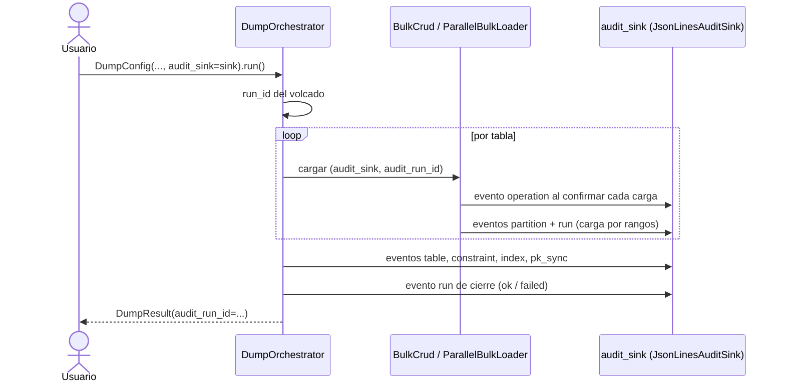

# Auditoría centralizada

## 1. Descripción General

`util_bbdd.audit` es el punto único de la auditoría de las cargas masivas (`bulk`), los volcados entre esquemas (`dump`) y las migraciones DDL (`migrate`). Ofrece dos cosas:

- **El CSV de auditoría de siempre**, con el mismo formato y el mismo comportamiento (ver [Auditoría de Operaciones Bulk](bulk_audit.md)) y el CSV de filas rechazadas. Ahora viven en este módulo; `bulk` y `dump` los usan desde aquí.
- **Eventos de auditoría opcionales**: un registro común (`AuditEvent`) para lo que ocurre en los tres módulos. Una operación de `BulkCrud`, una partición de una carga paralela, una tabla, una constraint o un índice de un volcado, una sentencia DDL de una migración o un aviso de un plan de migración se describen todos igual: qué fue, dónde, cuándo, con qué resultado, cuántas filas y cuánto tardó. Los eventos de una misma ejecución comparten un identificador (`run_id`).

Los eventos se escriben en un **destino** (`AuditSink`) que se pasa como `AuditOptions(sink=...)` en `BulkCrud` y `ParallelBulkLoader` y como parámetro `audit_sink` en `DumpConfig` y `migrate`. La librería trae tres:

| Destino | Para qué |
|---|---|
| `JsonLinesAuditSink(ruta)` | Fichero JSON Lines: una línea por evento, fecha con zona horaria, todos los campos. Mezcla eventos de `bulk`, `dump` y `migrate` en el mismo fichero |
| `MemoryAuditSink()` | Guarda los eventos en memoria (tests, inspección de una ejecución corta) |
| `NullAuditSink()` | Descarta los eventos |

También se puede usar un destino propio: cualquier objeto con los métodos `write(eventos)` y `close()`.

**Precondiciones:**

- Ninguna para el CSV: se activa como siempre, con `AuditOptions(csv_path=...)` (`BulkCrud`, `ParallelBulkLoader`) o `bulk_audit_path` (`DumpConfig`).
- Para los eventos, pasar `AuditOptions(sink=...)` a `BulkCrud` o `ParallelBulkLoader`, o `audit_sink` a `DumpConfig`, `MigrationPlan.execute` o `MigrationPlan.validate_views`. Sin él (por defecto) no se genera ningún evento y nada cambia.

## 2. Reglas de Negocio

| Regla | Descripción | Impacto si se viola |
|---|---|---|
| Formato del CSV congelado | Columnas, orden, separador, fecha y coma decimal del CSV de auditoría y del de rechazos no cambian. Un test los compara byte a byte con ficheros generados con v0.28.0 | Los informes y procesos que leen esos CSV dejarían de funcionar |
| Opcional y sin efectos si no se usa | Sin `audit_sink` el comportamiento es el de siempre | — |
| Mismo momento que el CSV | En `bulk`, el evento de una operación se escribe cuando su fila del CSV: al confirmarse la transacción. Si la sesión se deshace, no hay evento. Con `AuditOptions(strict=True)`, antes del commit | El destino diría «hecho» de una carga deshecha |
| Misma política de fallo que el CSV | En `bulk`, si el destino falla: con `audit.strict=False` se registra un ERROR y se cuenta en `audit_failures`, y la operación sigue; con `audit.strict=True` la operación falla y, dentro de una sesión, se deshace | — |
| El resumen nunca interrumpe | Los eventos de cierre (particiones y `run` de una carga paralela, tablas y `run` de un volcado, sentencias y `run` de una migración) se escriben aparte: si el destino falla, se registra un ERROR y el resultado no cambia | Un fallo de auditoría haría repetir una carga o una migración ya aplicadas |
| Un `run_id` por ejecución | Todos los eventos de un volcado (también los de sus cargas) llevan el `run_id` del volcado (`DumpResult.audit_run_id`). Una carga paralela usa el suyo (`ParallelLoadResult.audit_run_id`) y una `BulkCrud`, uno por instancia (`BulkCrud.audit_run_id`), salvo que se pase `audit_run_id` | Sin él no se pueden atribuir los eventos a una ejecución |
| Sin datos de filas | Los eventos no llevan valores de las filas ni el texto SQL. De una sentencia DDL solo la primera línea (120 caracteres) | — |
| Mensajes de error con datos | `message` lleva el texto del error, y el de un `IntegrityError` incluye valores de clave. Va a una sola línea y se trunca a 500 caracteres | Tratar el fichero de eventos como información sensible si los datos lo son |

## 3. Casos de Uso

### Flujo principal: un volcado con eventos

### Flujos alternativos

**Migración con rastro:** `plan.execute(destino, audit_sink=sink)` registra los avisos del plan, un evento por sentencia (posición, primera línea, duración y, si falla, el tipo de error) y un `run` de cierre. Si el plan está bloqueado por avisos `ERROR`, registra los avisos y un `run` fallido, y lanza `ValueError` como siempre.

**Avisos de un plan sin ejecutarlo:** `sink.write(plan.audit_events())`.

**Validación de vistas:** `plan.validate_views(destino, audit_sink=sink)` añade un evento por vista (`ok`, `failed` o `skipped` si no se pudo validar).

**Solo eventos, sin CSV:** `BulkCrud(engine, audit=AuditOptions(sink=sink))` sin `csv_path`. La auditoría funciona igual (al confirmar, `strict`) y no se avisa de «auditoría deshabilitada».

**Límites y exclusiones:**

- No envía eventos a sistemas externos (OpenTelemetry, SIEM, colas): para eso, un destino propio.
- El fichero JSON Lines crece sin límite: la rotación es responsabilidad del operador.
- Los locks de fichero son por proceso: varios **procesos** sobre el mismo fichero pueden intercalar líneas.
- Las filas rechazadas no generan un evento cada una: constan en `rows_rejected` de los eventos de partición y de tabla, y sus valores en el CSV de rechazos.

## 4. Criterios de Aceptación

Derivados de los tests del módulo de auditoría y de sus consumidores.

| ID | Dado | Cuando | Entonces |
|---|---|---|---|
| AC-01 | Las mismas operaciones que generaron los CSV de referencia de v0.28.0 | Se escribe el CSV de auditoría o el de rechazos | El fichero es idéntico byte a byte al de referencia |
| AC-02 | `AuditOptions(sink=...)` y un INSERT dentro de `bulk_session` | Se confirma la sesión | El evento llega al destino al confirmar, no antes |
| AC-03 | Una sesión con destino que se deshace después de insertar | Termina la sesión | No se emite ningún evento de lo deshecho |
| AC-04 | El destino falla, sin `strict` | Se inserta | Las filas quedan en la base de datos y `audit_failures` cuenta el fallo |
| AC-05 | El destino falla, con `strict=True`, dentro de una sesión | Se inserta | La operación falla y la sesión se deshace: no queda ninguna fila |
| AC-06 | Una carga paralela cuyo destino falla al escribir los eventos de cierre | Termina la carga | El resultado no cambia (todas las filas, sin errores de partición) y el log registra un ERROR |
| AC-07 | Un mensaje de error con saltos de línea o de más de 500 caracteres | Se crea el evento | El mensaje queda en una sola línea y truncado a 500 caracteres |
| AC-08 | Una `BulkCrud` sin destino de eventos | Se consulta su `audit_run_id` | Es `None` |

## 5. Glosario y Términos

| Término | Definición |
|---|---|
| Evento (`AuditEvent`) | Registro inmutable de un hecho auditado: `source`, `kind`, `status`, `timestamp`, `engine`, `namespace`, `target`, `operation`, `rows`, `elapsed_s`, `error_type`, `message`, `run_id`, `parent_id`, `attributes` |
| Destino (`AuditSink`) | Dónde se escriben los eventos: `write(eventos)` y `close()` |
| `source` | Módulo que emite el evento: `bulk`, `dump` o `migrate` |
| `kind` | Qué se audita: `operation`, `partition`, `run`, `table`, `constraint`, `index`, `pk_sync`, `plan_warning`, `statement`, `view_validation` |
| `status` | Resultado: `ok`, `failed`, `skipped`; en avisos, `info`, `warning` o `error` |
| `run_id` | Identificador común de los eventos de una ejecución (volcado, carga paralela, migración) |
| CSV heredado | El CSV de auditoría de `bulk` (`AuditOptions.csv_path`), con su formato de siempre |
