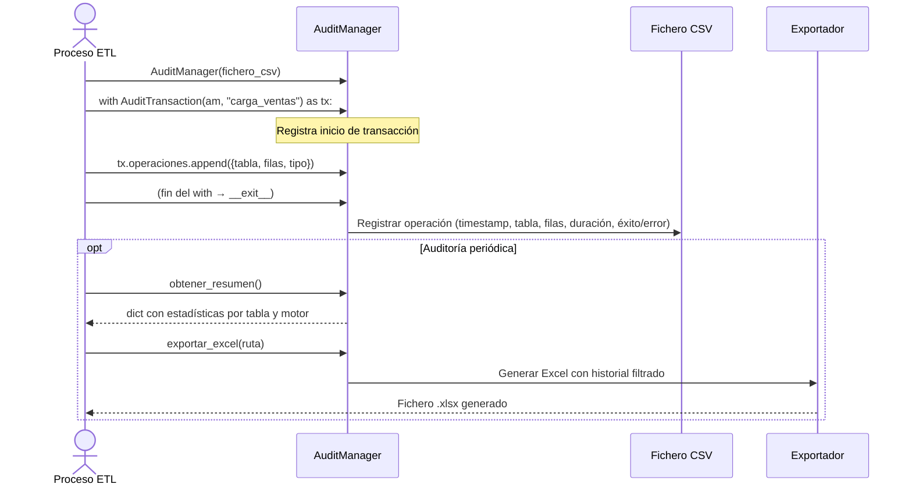

## Objetivo de negocio

Registra automáticamente cada operación de datos masiva (INSERT, UPDATE, DELETE en lote) en un fichero CSV persistente, permitiendo rastrear qué proceso tocó qué tabla, cuándo, cuántos registros afectó y si la operación fue exitosa o falló.

Proporciona análisis básico del historial (estadísticas por tabla, filtrado por fecha, resumen de errores) y exportación a Excel, JSON o HTML para reportes de auditoría o revisiones de calidad de datos.

## Precondiciones

- Directorio de salida accesible con permisos de escritura para el fichero CSV de auditoría
- Librería `pandas` instalada (requerida para el registro y exportación)
- Para exportación Excel: `openpyxl` instalado
- Si se usa con `bulk_crud`, el `AuditManager` se configura antes de iniciar las operaciones

## Flujo principal del usuario

## Reglas de negocio críticas

| Regla | Descripción | Impacto si se viola |
|---|---|---|
| Context manager obligatorio | Las operaciones se registran correctamente solo dentro de un bloque `with AuditTransaction(...)` | Operaciones fuera del context manager no se escriben al CSV ni al historial |
| Registro en caso de error | Si la operación falla, el error se captura y se registra igualmente (con `exito=False`) | El historial refleja intentos fallidos, permitiendo identificar tablas problemáticas |
| CSV como fuente persistente | El registro se escribe en CSV al finalizar cada transacción, independientemente de lo que haga el llamador | El CSV sobrevive a reinicios del proceso; el historial en memoria no |
| Invalidación de caché en éxito | Si `cache_enabled=True` en el manager, el caché se invalida al completar la transacción exitosamente | Sin invalidación, consultas posteriores al bulk pueden devolver datos desactualizados |
| Nombre de transacción obligatorio | `AuditTransaction` rechaza nombres vacíos o solo espacios con `AuditValidationError` | Facilita la trazabilidad: cada operación registrada tiene identificador legible |

## Límites y exclusiones

- Solo registra metadatos de la operación (tabla, tipo, filas, duración): no guarda los datos modificados
- El CSV de auditoría puede crecer sin límite: la rotación o limpieza del fichero es responsabilidad del operador
- No integra con sistemas de auditoría externos (Splunk, ELK, CloudWatch): solo produce ficheros locales
- No garantiza atomicidad del registro: si el proceso se interrumpe durante la escritura al CSV, la entrada puede quedar corrupta
- No cifra ni protege el CSV de auditoría: tratar el fichero como información sensible si los nombres de tabla son confidenciales
