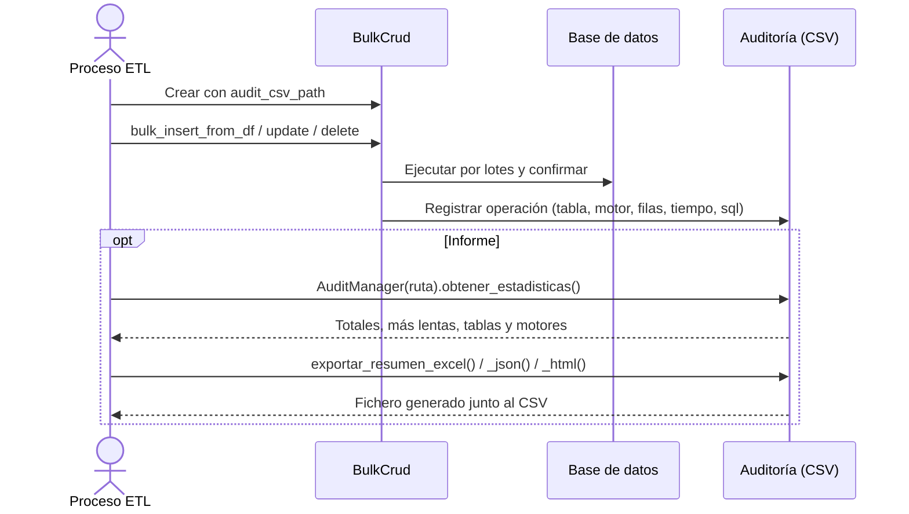

# Auditoría de Operaciones Bulk

## 1. Descripción General

Registra cada operación de datos masiva (INSERT, UPDATE o DELETE en lote) en un fichero CSV persistente: qué tabla, en qué motor, cuándo terminó, cuántas filas se enviaron, cuánto tardó y si se generó un fichero SQL en lugar de ejecutar en la base de datos. Así se puede rastrear después qué cargas se hicieron y cuánto costaron.

Sobre ese historial ofrece estadísticas (totales, operaciones más lentas, tablas y motores más usados), filtros (por operación, tabla, motor, rango de fechas o tiempo) y exportación a Excel, JSON o HTML para informes.

**Precondiciones:**

- Indicar la ruta del CSV de auditoría (`audit_csv_path`) al crear `BulkCrud` o `ParallelBulkLoader`. Sin ruta, la auditoría está desactivada.
- Directorio de salida con permisos de escritura. Se crea si no existe.

## 2. Reglas de Negocio

| Regla | Descripción | Impacto si se viola |
|---|---|---|
| Una fila por operación | Cada llamada a `bulk_insert_from_df`, `bulk_update_from_df` o `bulk_delete_from_df` escribe una fila; `bulk_insert_from_chunks` escribe una por chunk. No se escribe una fila por registro de datos | — |
| Solo lo confirmado | Dentro de `bulk_session` la fila se escribe cuando la transacción se confirma. Si la carga se deshace (rollback), no queda rastro en el CSV y se avisa en el log. Con commits periódicos (`commit_every_n_chunks`) lo confirmado se escribe por tandas (64 filas de auditoría o 1 segundo) y siempre al terminar la sesión | El CSV coincide con lo que realmente quedó en la base de datos; reintentar una carga no duplica filas de auditoría |
| Cuadrar carga y auditoría | `audited_rows` dice cuántas filas constan en el CSV, sin tener que leerlo. Con commits periódicos, si la carga falla, las filas ya confirmadas de una operación a medias no constan en el CSV y se cuentan en `unaudited_committed_rows`. Con `audit_strict=True`, si falla el commit después de escribir la auditoría, esos registros se cuentan en `audit_uncommitted_records` y `ParallelBulkLoader` no reintenta la partición | Sin estos contadores, una diferencia entre filas cargadas y filas auditadas no tenía explicación |
| La auditoría no bloquea la carga | Si el CSV no se puede escribir (abierto en Excel, disco lleno, permisos), la operación sigue: sus datos ya están en la base de datos. Se registra un error con los datos perdidos y se cuenta en `audit_failures`. Con `audit_strict=True`, en cambio, el fallo detiene la operación y, dentro de una sesión, la deshace | Sin esta regla, un error de auditoría llevaba a reintentar una carga ya aplicada y a duplicar datos |
| Filas enviadas, no afectadas | `total_filas` son las filas enviadas a la operación. Un DELETE o UPDATE con claves que no existen las cuenta igualmente | El CSV no sirve para saber cuántas filas cambió realmente la base de datos |
| Generación de SQL aparte | Con `generar_sql=True` no se ejecuta nada en la base de datos; la fila se marca con `sql=Sí` y su tiempo es el de generar el fichero SQL | Los resúmenes de Excel separan ambos tipos para no mezclar tiempos |
| Escrituras concurrentes seguras | Varias cargas en paralelo dentro del mismo proceso pueden escribir en el mismo CSV sin intercalar filas | Varios **procesos** distintos sobre el mismo CSV sí pueden intercalar filas: usar un CSV por proceso |

## 3. Casos de Uso

### Flujo principal

### Flujos alternativos

**Carga dentro de `bulk_session` que falla:** las operaciones ejecutadas en la sesión no se anotan hasta el commit. Si la sesión se deshace, se descartan y el log avisa de cuántos registros se descartaron. Con `commit_every_n_chunks`, las operaciones ya confirmadas por un commit periódico sí quedan anotadas; una operación que falla con parte de sus lotes confirmados no se anota (`rows_committed` indica esas filas).

**CSV no escribible:** la carga termina, los datos quedan en la base de datos y el error aparece en el log con tabla, operación, filas y tiempo de cada registro perdido.

**Análisis sin cargar datos:** se crea un `AuditManager` sobre un CSV existente para filtrar, calcular estadísticas o exportar, sin tocar ninguna base de datos.

**Límites y exclusiones:**

- Solo registra metadatos de la operación (tabla, tipo, filas, duración), nunca los datos modificados.
- El CSV crece sin límite: la rotación o limpieza es responsabilidad del operador.
- No se integra con sistemas de auditoría externos (Splunk, ELK, CloudWatch): solo produce ficheros locales.
- Si el proceso se interrumpe durante la escritura, la última fila puede quedar incompleta.
- No cifra ni protege el CSV: tratarlo como información sensible si los nombres de tabla lo son. Abrir el CSV directamente en Excel puede interpretar como fórmula un nombre de tabla que empiece por `=`; los exports a Excel de la librería ya lo guardan como texto.

## 4. Glosario y Términos

| Término | Definición |
|---|---|
| CSV de auditoría | Fichero de texto separado por tabuladores con una fila por operación bulk: `timestamp`, `tabla`, `motor`, `operacion`, `total_filas`, `tiempo_seg`, `sql` |
| Operación | Una llamada a `bulk_insert_from_df`, `bulk_update_from_df` o `bulk_delete_from_df`, o un chunk de `bulk_insert_from_chunks` |
| `sql=Sí` | La operación generó un fichero SQL en lugar de ejecutar en la base de datos |
| `audit_strict` | Opción de `BulkCrud`: si es `True`, un fallo al escribir el CSV detiene la operación en vez de registrarse y seguir |
| `audit_failures` | Número de registros de auditoría que no se pudieron escribir en el CSV (con `audit_strict=False`) |
| `audited_rows` | Filas que constan en el CSV de auditoría |
| `unaudited_committed_rows` | Filas confirmadas en la base de datos por commits periódicos que no constan en el CSV porque la carga falló a mitad de una operación |
| `audit_uncommitted_records` | Registros escritos en el CSV antes de un commit que falló (solo con `audit_strict=True`): el CSV los tiene, la base de datos no |
