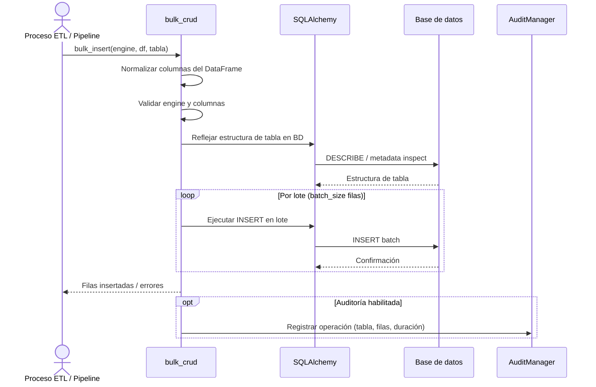

## Objetivo de negocio

Permite cargar, actualizar o eliminar grandes volúmenes de datos en base de datos usando DataFrames de pandas como fuente, sin escribir SQL manualmente. Internamente divide los datos en lotes y usa SQLAlchemy para adaptarse al dialecto de cada motor, garantizando compatibilidad con Oracle, MySQL/MariaDB, PostgreSQL, SQLite, SQL Server y HSQLDB.

El objetivo principal es reducir el tiempo de desarrollo en procesos ETL e integración de datos, donde el patrón "recibo un DataFrame, lo persisto en BD" es muy frecuente.

## Precondiciones

- Tabla de destino ya existente en la base de datos (no crea esquema)
- Para UPDATE y DELETE: la tabla debe tener claves primarias definidas y el DataFrame debe incluirlas
- Engine de SQLAlchemy activo y con permisos de escritura sobre la tabla de destino (obtener con `SyncDatabaseManager.get_sqlalchemy_engine()`)
- Librería `pandas` y `numpy` instaladas en el entorno

## Flujo principal del usuario



## Reglas de negocio críticas

| Regla | Descripción | Impacto si se viola |
|---|---|---|
| Tabla debe existir | `bulk_insert`, `bulk_update` y `bulk_delete` fallan si la tabla no existe en BD | Error de SQLAlchemy al intentar reflejar la tabla; no se crea automáticamente |
| Claves primarias requeridas en UPDATE/DELETE | El módulo las detecta automáticamente desde la definición de tabla en BD | Sin PKs definidas en BD, UPDATE y DELETE no pueden identificar qué filas modificar |
| Normalización de identificadores por motor | Oracle y PostgreSQL usan minúsculas; MySQL/MariaDB, SQL Server y HSQLDB usan mayúsculas | Usar identificadores en caso incorrecto provoca errores de columna no encontrada |
| Procesamiento por lotes | Los datos se envían en lotes (configurable con `chunk_size`) para evitar saturar memoria y BD | Lotes muy grandes pueden agotar la memoria del proceso o superar límites del driver |
| Transaccionalidad implícita | Cada lote se ejecuta en su propia transacción; un fallo a mitad de proceso deja datos parcialmente insertados | No hay rollback automático entre lotes; el llamador debe gestionar reintento o limpieza |

## Límites y exclusiones

- No crea tablas ni modifica el esquema: solo opera sobre tablas existentes
- No soporta operaciones async: requiere engine síncrono de SQLAlchemy
- No realiza validaciones de negocio sobre los datos del DataFrame (tipos, rangos, FK): eso es responsabilidad del llamador
- No deduplica registros automáticamente antes de insertar
- No soporta UPSERT nativo en todos los motores: la lógica de upsert debe implementarse fuera de este módulo

## Performance Monitoring

Todas las operaciones bulk (`bulk_insert_from_df`, `bulk_update_from_df`, `bulk_delete_from_df`) miden automáticamente su duración usando la dependencia interna `util.timing`. Las métricas se registran en el CSV de auditoría con columna `tiempo_seg` (duración en segundos).

**Análisis de performance en Python**:
```python
import pandas as pd

# Leer CSV de auditoría generado
df = pd.read_csv('audit_insert_20260508_143045.csv')

# Analizar duración promedio por tabla
print(df.groupby('tabla')['tiempo_seg'].agg(['mean', 'sum', 'max']))

# Calcular ms por fila
df['ms_por_fila'] = (df['tiempo_seg'] * 1000) / df['total_filas']
print(df[['tabla', 'total_filas', 'ms_por_fila']].head(10))
```

**Recomendaciones de optimización**:
- Si `tiempo_seg` es alto y `total_filas` es bajo → aumentar batch_size
- Si `tiempo_seg` es alto y `total_filas` es alto → revisar índices/constraints de tabla destino
- Si `ms_por_fila` > 50 ms → considerar paralelizar en chunks independientes
