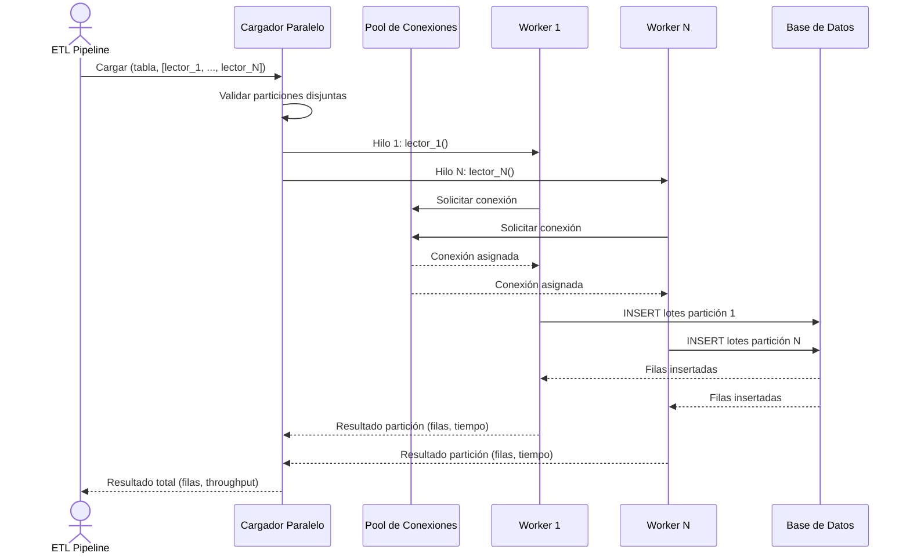

# Carga Masiva Paralela

## 1. Descripción General

Acelera la carga masiva de grandes volúmenes de datos (millones de filas) dividiendo los datos en particiones disjuntas y cargando cada partición en paralelo usando múltiples conexiones y workers. Ideal para procesos ETL de larga duración donde el throughput de inserción es el cuello de botella.

Casos de uso típicos: refrescar un data lake con datos de un data warehouse; migrar historiales de transacciones entre bases de datos; consolidar logs de auditoría desde múltiples fuentes.

**Precondiciones:**

- Tabla de destino preexistente en la base de datos (no crea esquema)
- Particiones disjuntas: los datos de entrada deben estar divididos en rangos que no se solapen (p.ej. PK 1–250K, 250K–500K). Solapamientos causarían colisiones de inserción
- Pool de conexiones adecuado: debe soportar al menos tantas conexiones simultáneas como workers configurados
- Origen de datos accesible: un callable que, por cada partición, retorna un iterador de DataFrames listos para insertar
- Permisos de escritura en la tabla de destino

## 2. Reglas de Negocio

| Regla | Descripción | Impacto si se viola |
|---|---|---|
| Particiones disjuntas | Los rangos de cada partición no deben solaparse | Colisiones de inserción → error de integridad en destino |
| Nº de workers ≤ pool capacity | El número de workers no debe exceder la capacidad del pool de conexiones | Bloqueo de workers; degradación exponencial de latencia |
| Thread-safety del lector | Cada lector de partición se ejecuta en su propio hilo; si accede a estado compartido sin locks, hay condición de carrera | Lectura inconsistente; filas duplicadas o perdidas |
| Distribución equilibrada de volumen | Cada partición debe tener un volumen similar para distribución equilibrada de carga | Desbalanceo: tiempo total = máx(tiempos de worker) |
| Best-effort, no atómico | Un error en una partición no cancela las demás; el volcado continúa | Datos parcialmente cargados; requiere validación post-carga |

## 3. Casos de Uso

### Flujo principal

### Flujos alternativos

**Partición con error:** Si una partición falla, el error se registra y la carga continúa con las demás particiones. El resultado final indica las particiones con error y el total de filas insertadas.

**Validación post-carga:** Dado que la carga no es atómica, se recomienda verificar el recuento de filas en destino después de la operación.

**Límites y exclusiones:**

- No apto para cargas < 100K filas (overhead de paralelización supera el beneficio)
- No apto para datos con solapamiento de PK entre particiones
- No incluye generación automática de rangos de partición; el usuario debe definir rangos disjuntos
- No incluye reintento automático de particiones fallidas
- No garantiza atomicidad global: un volcado interrumpido deja datos parcialmente cargados

## 4. Glosario y Términos

| Término | Definición |
|---|---|
| Partición | Subconjunto disjunto del total de datos a cargar, definido por un rango de valores de la clave primaria |
| Lector de partición | Callable que, dado un rango de PK, retorna un iterador de DataFrames con las filas de esa partición |
| Throughput | Velocidad de inserción medida en filas por segundo; métrica principal de rendimiento de la carga paralela |
| Best-effort | Estrategia de carga que continúa aunque falle alguna partición, en lugar de cancelar todo ante el primer error |
