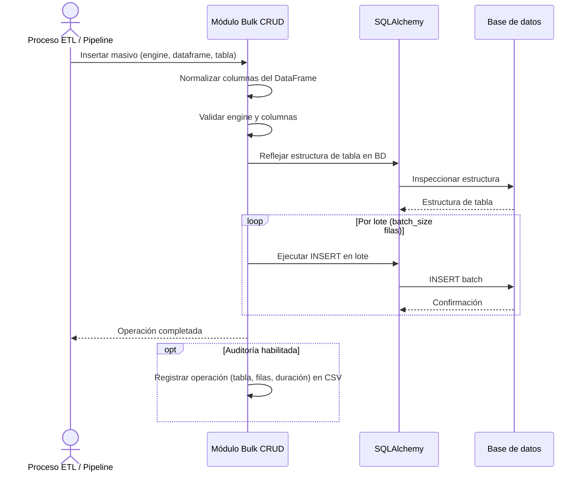

# Operaciones Bulk (CRUD Masivo)

## 1. Descripción General

Permite cargar, actualizar o eliminar grandes volúmenes de datos en base de datos usando DataFrames de pandas como fuente, sin escribir SQL manualmente. Internamente divide los datos en lotes y se adapta al dialecto de cada motor, con Oracle, MySQL/MariaDB, PostgreSQL, SQLite, SQL Server y HSQLDB.

El objetivo principal es reducir el tiempo de desarrollo en procesos ETL e integración de datos, donde el patrón "recibo un DataFrame, lo persisto en BD" es muy frecuente. Todas las operaciones miden su duración automáticamente y pueden registrarla en un CSV de auditoría.

Al crearse, el módulo revisa una vez por engine la configuración del motor y avisa en el log de lo que penaliza las cargas. En MySQL o MariaDB lee además las variables críticas (`max_allowed_packet`, `innodb_buffer_pool_size`).

**Precondiciones:**

- Tabla de destino ya existente en la base de datos (no crea esquema)
- Para UPDATE y DELETE: la tabla debe tener claves primarias definidas y el DataFrame debe incluirlas
- Engine de SQLAlchemy activo y con permisos de escritura sobre la tabla de destino
- `pandas` (dependencia de la librería)

## 2. Reglas de Negocio

| Regla | Descripción | Impacto si se viola |
|---|---|---|
| Tabla debe existir | Las operaciones fallan si la tabla no existe en BD | Error al intentar reflejar la tabla; no se crea automáticamente |
| Claves primarias requeridas en UPDATE/DELETE | El módulo las detecta automáticamente desde la definición de tabla en BD | Sin PKs definidas en BD, UPDATE y DELETE no pueden identificar qué filas modificar |
| Columnas sin distinguir mayúsculas | Las columnas del DataFrame se emparejan con las de la tabla sin distinguir mayúsculas y se renombran al nombre real de la tabla | Si la tabla tiene dos columnas que solo difieren en mayúsculas, la coincidencia no es única y la columna del DataFrame no se empareja |
| Procesamiento por lotes | Los datos se envían en lotes (configurable) para evitar saturar memoria y BD | Lotes muy grandes pueden agotar la memoria del proceso o superar límites del driver |
| Una transacción por operación | Cada INSERT, UPDATE o DELETE se ejecuta en una sola transacción, aunque se envíe por lotes: si falla un lote, se deshace la operación entera. Con `commit_every_n_chunks` se confirma cada N lotes | Con `commit_every_n_chunks`, un fallo a mitad deja confirmados los lotes anteriores (`rows_committed`); el error indica el lote y las filas donde falló |
| Aislamiento de filas erróneas (opcional) | Con `on_error="isolate"` y `rejects_csv_path`, las filas que fallan por un error de datos (PK duplicada, FK, valor demasiado largo) se apartan a un CSV de rechazos y el resto se aplica | Sin activarlo, una sola fila con un error de datos deshace la operación entera. El CSV contiene datos de las filas |

## 3. Casos de Uso

### Flujo principal

### Flujos alternativos

**Uso con context manager de sesión:** Para loops de múltiples inserts sobre la misma tabla, se puede usar una sesión única que reutiliza la transacción y el caché de reflexión de tabla, mejorando el rendimiento.

**Carga streaming en chunks:** Para grandes volúmenes que se leen en streaming (por ejemplo, desde SQL con `chunksize`), existe la operación de inserción desde iterador que resuelve columnas e identidad una sola vez.

**Carga con filas erróneas:** Si unas pocas filas pueden fallar (claves repetidas, referencias inexistentes, textos demasiado largos) y no deben deshacer la carga, se activa el aislamiento de filas con un fichero de rechazos. Las filas buenas se aplican; cada rechazada queda en el fichero con su posición en la entrada, el error y sus valores, para corregirla y volver a cargarla. Un límite opcional de rechazos hace fallar la operación entera si se supera. En SQL Server el texto demasiado largo no se aísla (falla la operación como sin aislamiento), y en Oracle tampoco al actualizar columnas de texto largo o binarias; claves repetidas y referencias se aíslan en todos los motores.

**Validación automática MySQL/MariaDB:** La primera vez que se crea con un engine MySQL o MariaDB, el módulo lee las variables críticas del servidor y registra advertencias si la configuración no es óptima. Perfiles de referencia (`MySQLOptimalConfig`):

| Workload | Filas | `max_allowed_packet` recomendado | `innodb_buffer_pool_size` recomendado |
|---|---|---|---|
| Desarrollo local | < 50K | 16 MB | 256 MB |
| Producción estándar | 100K–1M | 64 MB | 1 GB |
| Alto volumen | > 1M | 128 MB | 4 GB |

**Límites y exclusiones:**

- No crea tablas ni modifica el esquema: solo opera sobre tablas existentes
- No soporta operaciones async: requiere engine síncrono de SQLAlchemy
- No realiza validaciones de negocio sobre los datos del DataFrame (tipos, rangos, FK)
- No deduplica registros automáticamente antes de insertar
- No hace UPSERT (insertar o actualizar en una sola operación): se usan `bulk_insert_from_df` y `bulk_update_from_df` por separado

## 4. Glosario y Términos

| Término | Definición |
|---|---|
| Lote (batch) | Subconjunto de filas del DataFrame que se inserta en una sola sentencia SQL |
| `chunk_size` | Número de filas por lote; controla el balance entre velocidad y consumo de memoria |
| Reflexión de tabla | Proceso de consultar la estructura de una tabla desde la BD para conocer columnas, tipos y PKs antes de insertar |
| CSV de rechazos | Fichero con las filas apartadas por el aislamiento de filas erróneas: posición en la entrada, error y valores |
| CSV de auditoría | Fichero de texto donde se registra automáticamente cada operación bulk con tabla, filas, duración y timestamp |
