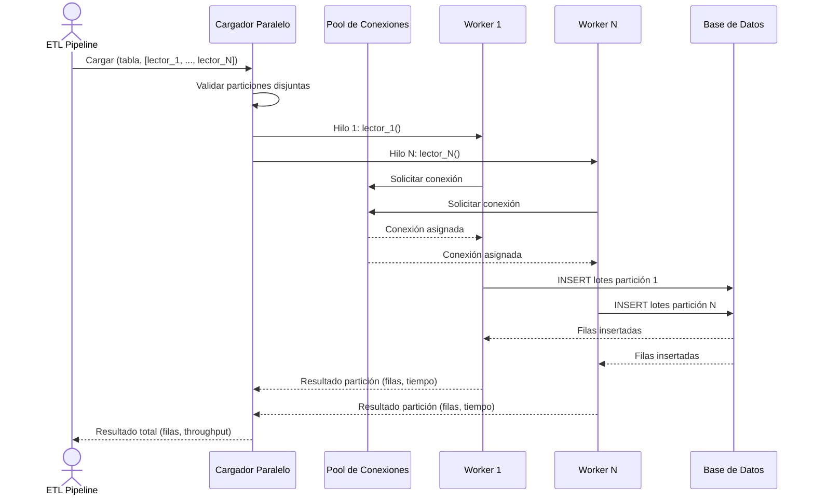

# Carga Masiva Paralela

## 1. Descripción General

Acelera la carga masiva de grandes volúmenes de datos (millones de filas) dividiendo los datos en particiones disjuntas y cargando cada partición en paralelo usando múltiples conexiones y workers. Ideal para procesos ETL de larga duración donde el throughput de inserción es el cuello de botella.

Casos de uso típicos: refrescar un data lake con datos de un data warehouse; migrar historiales de transacciones entre bases de datos; consolidar logs de auditoría desde múltiples fuentes.

**Precondiciones:**

- Tabla de destino preexistente en la base de datos (no crea esquema)
- Particiones disjuntas: los datos de entrada deben estar divididos en rangos que no se solapen (p.ej. PK 1–250K, 250K–500K). Solapamientos causarían colisiones de inserción
- Pool de conexiones adecuado: debe soportar al menos tantas conexiones simultáneas como workers configurados
- Origen de datos accesible: un callable que, por cada partición, retorna un iterador de DataFrames listos para insertar
- Permisos de escritura en la tabla de destino

## 2. Reglas de Negocio

| Regla | Descripción | Impacto si se viola |
|---|---|---|
| Particiones disjuntas | Los rangos de cada partición no deben solaparse | Colisiones de inserción → error de integridad en destino |
| Nº de workers ≤ pool capacity | El número de workers no debe exceder la capacidad del pool de conexiones. El cargador lo recorta solo, con un aviso | Bloqueo de workers; degradación exponencial de latencia |
| Un solo escritor en SQLite | SQLite no admite escrituras concurrentes: la carga va siempre con un hilo (v3.0.0) | Hasta v2.x, `database is locked` y la tabla a medio cargar |
| Thread-safety del lector | Cada lector de partición se ejecuta en su propio hilo; si accede a estado compartido sin locks, hay condición de carrera | Lectura inconsistente; filas duplicadas o perdidas |
| Distribución equilibrada de volumen | Cada partición debe tener un volumen similar para distribución equilibrada de carga. Usar `RangePartitioner` (PKs enteras/datetime) o `HashPartitioner` (PKs tipo string/UUID) para generarlas automáticamente | Desbalanceo: tiempo total = máx(tiempos de worker) |
| Best-effort, no atómico | Un error en una partición no cancela las demás; la carga continúa | Datos parcialmente cargados; requiere validación post-carga |

## 3. Casos de Uso

### Flujo principal



### Flujos alternativos

**Partición con error:** Si una partición falla, el error se registra y la carga continúa con las demás particiones. El resultado final indica las particiones con error y el total de filas insertadas.

**Validación post-carga:** Dado que la carga no es atómica, se recomienda verificar el recuento de filas en destino después de la operación.

**Límites y exclusiones:**

- En cargas pequeñas el coste de lanzar hilos y conexiones no compensa; la ganancia depende del motor (ver [benchmarks](../guides/benchmarks.md#carga-paralela-por-particiones))
- No apto para datos con solapamiento de PK entre particiones
- Reintento automático solo ante errores transitorios (`RetryOptions.max_retries`, por defecto 0): desconexiones, deadlocks y timeouts; los errores de datos o de permisos no se reintentan. Con commits periódicos (`commit_every_n_chunks`) el reintento continúa tras las filas ya confirmadas, sin duplicarlas
- `update` y `delete` siguen las mismas reglas que la carga (particiones disjuntas por PK); `ParallelOptions.disable_constraints` solo afecta a `load`
- No garantiza atomicidad global: un volcado interrumpido deja datos parcialmente cargados

### Hilos automáticos (`mode="auto"`, v3.0.0)

Cuántos hilos usar depende del motor y de la operación: en SQL Server el INSERT gana 2,6× con 4 hilos y en PostgreSQL no
gana nada. Con `ParallelOptions(mode="auto")` lo decide el planificador (`ParallelPlanner`) con las mediciones del banco:
paraleliza solo lo que ganó al menos 1,5× y desde el menor volumen medido; lo que no gana o no se ha medido va en serie.
Con `mode="manual"` (por defecto) se usan los hilos pedidos, recortados solo por la capacidad del pool, SQLite y el
UPDATE de PostgreSQL sin privilegio `TEMP`. El resultado dice qué se decidió y por qué (`result.plan.reasons`).

### Carga paralela desde `BulkCrud` (v3.0.0)

Para un DataFrame ya en memoria no hace falta construir lectores: `BulkCrud(engine, parallel=ParallelOptions(...))` reparte
el DataFrame en particiones disjuntas (por PK en UPDATE y DELETE) y las carga en paralelo con el mismo mecanismo.

| Situación | Comportamiento |
|---|---|
| El plan da más de un hilo | Particiones en paralelo, una transacción por partición: **deja de ser atómica**. Si alguna falla, las demás quedan confirmadas y se lanza `ParallelLoadError` con el resultado |
| El plan da un hilo (motor que no gana, volumen pequeño, SQLite) | En serie y atómica, como sin `parallel` |
| `generar_sql=True`, dentro de `bulk_session()` o en `*_from_chunks` | Siempre en serie |

```python
from util_bbdd.bulk import BulkCrud, ParallelOptions

crud = BulkCrud(engine, parallel=ParallelOptions(mode="auto"))
crud.bulk_insert_from_df(df_ventas, "ventas", generar_sql=False)
print(crud.last_parallel_result)  # None si fue en serie
```

### Generación automática de particiones

`RangePartitioner` y `HashPartitioner` generan particiones disjuntas sin escribir rangos manualmente:

| Helper | Cuándo usarlo | Método principal |
|---|---|---|
| `RangePartitioner` | PK de tipo entero o `datetime64` — distribución uniforme garantizada | `partition_dataframe(df, pk_col, n)` / `partition_ranges(min, max, n)` |
| `HashPartitioner` | PK de tipo `str`, `UUID` u otro tipo hashable, o compuesta (varias columnas, v3.0.0) | `partition_dataframe(df, pk_col, n)` |

`partition_ranges` es útil cuando el volumen supera la memoria disponible: genera los rangos `(lo, hi)` para construir lectores SQL con `WHERE pk BETWEEN :lo AND :hi` sin materializar el DataFrame completo.

### Preparación de tabla para alta carga (`maintenance_scope`)

Para cargas >1 M de filas conviene deshabilitar temporalmente las comprobaciones de integridad antes de insertar. En la
carga paralela se activa con `ParallelBulkLoader(engine, parallel=ParallelOptions(disable_constraints=True))`: cada worker abre su sesión y
usa `BulkCrud.maintenance_scope` sobre su propia conexión (en MySQL/MariaDB `FOREIGN_KEY_CHECKS` es de sesión, así que
envolver `loader.load(...)` en el `maintenance_scope` de otra `BulkCrud` no afectaría a los workers). Solo se aplica a
`load`; los índices no se desactivan en paralelo (en SQL Server bloquearía la tabla).

```python
from util_bbdd.bulk import ParallelBulkLoader, ParallelOptions

loader = ParallelBulkLoader(engine, parallel=ParallelOptions(max_workers=4, disable_constraints=True))
result = loader.load("pedidos", readers)
```

Con una sola `BulkCrud`, el mismo efecto se obtiene con `bulk_session()` + `maintenance_scope("pedidos")`.

Soporte por motor: MariaDB/MySQL (`FOREIGN_KEY_CHECKS`), Oracle (`DISABLE CONSTRAINT` de FK, CHECK y UNIQUE),
PostgreSQL (`DISABLE TRIGGER ALL`, requiere propietario), SQL Server (`NOCHECK CONSTRAINT ALL`); SQLite no lo admite y
carga sin optimización. Las restricciones se restauran siempre al salir, incluso si se produce una excepción.

## 4. Glosario y Términos

| Término | Definición |
|---|---|
| Partición | Subconjunto disjunto del total de datos a cargar, definido por un rango de valores de la clave primaria |
| Lector de partición | Callable que, dado un rango de PK, retorna un iterador de DataFrames con las filas de esa partición |
| Throughput | Velocidad de inserción medida en filas por segundo; métrica principal de rendimiento de la carga paralela |
| Best-effort | Estrategia de carga que continúa aunque falle alguna partición, en lugar de cancelar todo ante el primer error |
| `ParallelPlanner` | Decide cuántos hilos usar según el motor, la operación, el volumen y la capacidad del pool (v3.0.0) |
| `RangePartitioner` | Helper que divide un DataFrame (o genera tuplas `(lo, hi)`) en N rangos disjuntos ordenados por una PK entera o `datetime64` |
| `HashPartitioner` | Helper que asigna filas a N buckets usando `hash(pk_col) % N`; admite cualquier tipo hashable pero no garantiza particiones de igual tamaño |
| `maintenance_scope` | Context manager de `BulkCrud` que deshabilita constraints (y, opcionalmente, índices) durante la carga y los restaura al salir, incluso ante excepciones |
