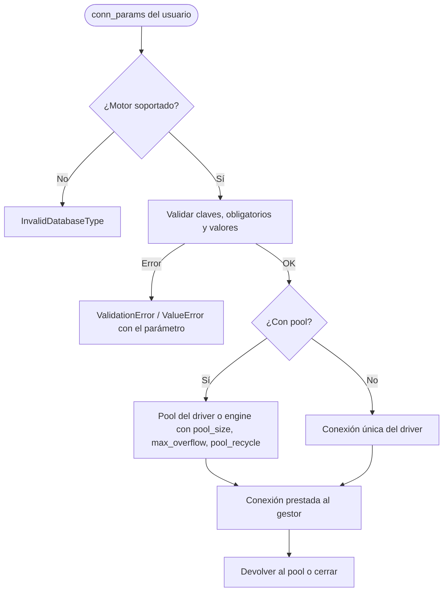

# Conexiones y Pools

## 1. Descripción General

Convierte los parámetros de conexión que escribe el usuario (`conn_params`) en conexiones, pools y engines de
SQLAlchemy listos para cada motor, sin que el resto de la librería tenga que conocer los nombres de parámetro de cada
driver. Valida los parámetros antes de intentar conectar, de modo que un error de configuración se detecta al crear el
gestor y no en la primera consulta, y protege las credenciales: no aparecen en los mensajes ni en la representación de
los objetos de configuración.

Lo usan los gestores (`SyncDatabaseManager`, `AsyncDatabaseManager`) y cualquier componente que necesite un engine
(`BulkCrud`, `DumpOrchestrator`). La selección del driver async de cada motor se describe en
[Selección de Driver](drivers_selection.md).

**Precondiciones:**

- Tipo de motor soportado: `mariadb`, `mysql`, `oracle`, `postgresql`, `sqlserver`, `sqlite` o `hsqldb`
- Parámetros obligatorios del motor (p. ej. `host`, `user`, `password` y `database` en MariaDB, MySQL, PostgreSQL y
  SQL Server; en Oracle, `user` y `password` más `dsn`, `service_name`, `sid` o `database`)
- Driver Python del motor instalado ([Instalación](../installation.md))

## 2. Reglas de Negocio

| Regla | Descripción | Impacto si se viola |
|---|---|---|
| Solo parámetros conocidos | Cada motor acepta una lista cerrada de claves en `conn_params`; una clave desconocida se rechaza nombrándola | Una errata en un parámetro (p. ej. `pool_sise`) falla al crear el gestor en lugar de ignorarse en silencio |
| Validación antes de conectar | Los parámetros obligatorios y los valores (números, booleanos, `init_command`) se validan antes de abrir ninguna conexión | Un error de configuración nunca llega al servidor |
| `init_command` de una sola sentencia (MariaDB/MySQL) | El driver lo ejecuta como una sentencia: con varias separadas por `;` se rechaza (un `;` entre comillas no cuenta) | Antes daba un error de sintaxis del servidor que no nombraba el parámetro |
| Credenciales protegidas | La representación de las configuraciones de conexión y de pool no muestra la contraseña; el driver sí la recibe | Las contraseñas no aparecen en logs ni trazas |
| Credenciales con caracteres especiales | Usuario y contraseña con `@`, `:`, `/`, `?`, `#` o `%` se codifican al construir la URL del engine | Sin ello, parte de la contraseña se interpretaría como host o base de datos |
| Pool de los engines | Por defecto `pool_size=5`, `max_overflow=10`, `pool_timeout=30` y `pool_recycle=3600`, ajustables en `conn_params`; SQLite no usa dimensionado de pool | Capacidad total del pool: `pool_size + max_overflow` |
| Cierre del pool | `close_timeout` (10 s por defecto) limita la espera al cerrar; `0` o negativo lo desactiva y un valor no válido vuelve a 10 | Un cierre no se queda colgado esperando conexiones prestadas |
| Cifrado obligatorio en SQL Server (pymssql) | Con `encryption="mandatory"`, si la sesión no está cifrada la conexión se cierra y se lanza error | Nunca se trabaja en claro cuando se pidió cifrado |

## 3. Casos de Uso

### Flujo principal

### Flujos alternativos

**Conexión devuelta a un pool cerrado:** si el pool ya se cerró, la conexión se cierra directamente y los errores de
ese cierre se ignoran; devolver `None` no hace nada.

**Pool recogido sin cerrar:** al destruirse un pool sin `close()`, se cierra forzado con su `close_timeout`.

**Oracle en modo thick:** con `oracle_thick_mode=True` (y `oracle_client_path`), la inicialización de Oracle Instant
Client se hace una sola vez por proceso, también desde los pools.

**Límites y exclusiones:**

- HSQLDB no tiene pool: siempre usa una conexión única
- No crea bases de datos ni usuarios: se conecta a los existentes
- La conexión async y la selección de su driver: ver [Selección de Driver](drivers_selection.md)

## 4. Criterios de Aceptación

Derivados de los tests de `connection` y `factory`.

| ID | Dado | Cuando | Entonces |
|---|---|---|---|
| AC-01 | `conn_params` con una clave que el motor no admite | Se validan | Se rechaza con un error que nombra la clave |
| AC-02 | Un tipo de motor no soportado | Se pide una conexión, una configuración de conexión o de pool | Se rechaza con `InvalidDatabaseType` |
| AC-03 | `init_command` con dos sentencias separadas por `;` | Se crea el gestor de MariaDB | Se rechaza con un error de validación sobre `init_command` antes de conectar; `SET NAMES utf8mb4;` o un `;` entre comillas se aceptan |
| AC-04 | Una contraseña en `conn_params` | Se muestra la configuración de conexión o de pool | La contraseña no aparece, pero el driver la recibe |
| AC-05 | Usuario y contraseña con metacaracteres de URL | Se construye la URL del engine | Host, usuario, contraseña y base de datos se conservan sin mezclarse |
| AC-06 | `conn_params` sin parámetros de pool | Se crea un engine de PostgreSQL | Usa `pool_size=5`, `max_overflow=10`, `pool_timeout=30` y `pool_recycle=3600`; en SQLite no se dimensiona el pool |
| AC-07 | `close_timeout` igual a `3`, `"2.5"`, `0`, `-1` o `"x"` | Se crea la configuración del pool | Queda en 3, 2,5, desactivado, desactivado y 10 segundos respectivamente |
| AC-08 | Un pool cerrado y una conexión prestada cuyo cierre falla | Se devuelve la conexión | Se cierra directamente y el error se ignora |
| AC-09 | SQL Server con pymssql y `encryption="mandatory"` | La sesión resulta no cifrada | La conexión se cierra y se lanza `ConnectionError` |

## 5. Glosario y Términos

| Término | Definición |
|---|---|
| `conn_params` | Diccionario con los parámetros de conexión del usuario (host, credenciales, pool, opciones del motor) |
| Pool | Conjunto de conexiones abiertas que se prestan y se devuelven para no conectar en cada operación |
| `pool_recycle` | Segundos tras los que una conexión del pool se renueva, para evitar las que el servidor ya cerró |
| `close_timeout` | Segundos de espera al cerrar un pool antes de forzar el cierre |
| Modo thick (Oracle) | Uso de Oracle Instant Client por el driver `oracledb`; necesario para Oracle 11g |
