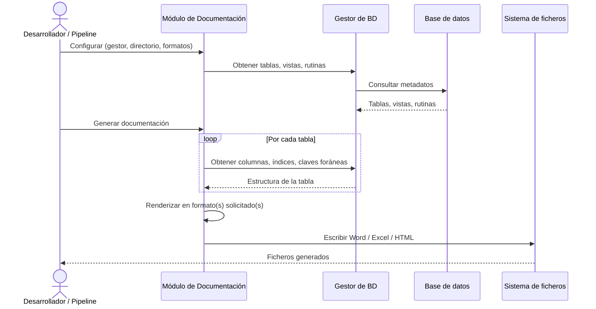

# Generación de Documentación de Base de Datos

## 1. Descripción General

Automatiza la generación de documentación técnica de bases de datos en múltiples formatos (Word, Excel, HTML) a partir de una conexión activa, sin que el usuario tenga que escribir SQL ni conocer el esquema de antemano. El resultado es un documento listo para compartir con equipos de arquitectura, auditoría o soporte.

Soporta MariaDB, Oracle, PostgreSQL, SQLite, SQL Server y HSQLDB. Puede generar diagramas de relaciones mediante Graphviz y dividir la salida Word en varios ficheros cuando el esquema es grande.

**Precondiciones:**

- Instancia del gestor síncrono de BD ya inicializada y con conexión activa
- Permisos de lectura sobre los metadatos del esquema, vistas de catálogo y DDL
- Directorio de salida accesible con permisos de escritura
- Dependencias opcionales de documentación instaladas (`util-bbdd[doc]`)
- Para grafos: Graphviz disponible cuando se activen diagramas de relaciones
- Formatos válidos: `word`, `excel`, `html`

## 2. Reglas de Negocio

| Regla | Descripción | Impacto si se viola |
|---|---|---|
| Delegación de metadatos | El módulo no consulta BD directamente; toda la introspección la hace el gestor proporcionado | Si el gestor no está inicializado o la conexión cae, la generación falla en la primera consulta |
| Inicialización sin generación | El constructor prepara configuración; los ficheros se escriben solo al llamar a `generate()` | Si se omite `generate()`, no se crea ninguna salida documental |
| Formatos normalizados | Solo acepta `word`, `excel` y `html`; elimina duplicados y rechaza valores no soportados | Un formato inválido detiene la ejecución con error de validación |
| Auto-naming de ficheros | Si no se especifica nombre de fichero, se genera automáticamente con identificador de BD y timestamp | En ejecuciones cercanas del mismo destino se puede reutilizar el nombre |
| Tablas por documento Word | Por defecto se generan 50 tablas por documento; esquemas grandes producen varios ficheros numerados | Valores muy altos pueden generar documentos Word difíciles de abrir |
| Grafos: profundidad máxima | La profundidad máxima de relaciones en los grafos controla la complejidad visual | Valores superiores a 3 en esquemas con muchas FK generan grafos ilegibles |

## 3. Casos de Uso

### Flujo principal

### Flujos alternativos

**Esquema grande con Word:** Cuando el número de tablas supera el límite configurado, se generan automáticamente múltiples ficheros Word numerados.

**Generación con grafos:** Si Graphviz está disponible y se habilita la opción de diagramas de relaciones, el módulo genera un grafo por tabla y los embebe en la salida Word o HTML.

**Límites y exclusiones:**

- Solo lectura: no modifica el esquema ni los datos de la base de datos
- No soporta modo async: requiere el gestor síncrono de BD
- No compara esquemas entre dos bases de datos
- No valida el contenido del documento generado: la calidad depende de los metadatos presentes en el motor
- No genera documentación mediante APIs externas

## 4. Glosario y Términos

| Término | Definición |
|---|---|
| `generate()` | Método que desencadena la escritura real de los ficheros de documentación al sistema de archivos |
| Auto-naming | Generación automática del nombre de fichero usando el identificador de la BD y un timestamp cuando no se especifica nombre manualmente |
| Tablas por documento | Número máximo de tablas incluidas en un solo fichero Word antes de crear un nuevo fichero numerado |
