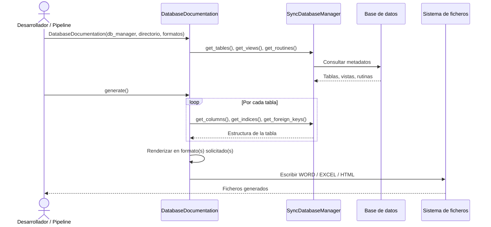

# Generación de documentación de base de datos

## Resumen funcional

`DatabaseDocumentation` genera documentación navegable y compartible de una base de datos a partir de un `SyncDatabaseManager` ya configurado. Está pensada para equipos que necesitan revisar estructura, tablas, vistas, rutinas, columnas, claves, índices y relaciones sin consultar manualmente el catálogo del motor.

## Objetivo de negocio

Automatiza la generación de documentación técnica de bases de datos en múltiples formatos (Word, Excel, HTML) a partir de una conexión activa, sin que el usuario tenga que escribir SQL ni conocer el esquema de antemano. El resultado es un documento listo para compartir con equipos de arquitectura, auditoría o soporte.

Soporta los motores gestionados por `SyncDatabaseManager` para documentación síncrona. En la configuración actual del proyecto se documentan MariaDB, Oracle, PostgreSQL, SQLite, SQL Server y HSQLDB según las capacidades disponibles en cada motor. Puede generar diagramas de relaciones mediante Graphviz y dividir la salida Word en varios ficheros cuando el esquema es grande.

## Precondiciones

- Instancia de `SyncDatabaseManager` ya inicializada y con conexión activa
- Permisos de lectura sobre los metadatos del esquema, vistas de catálogo y DDL necesarios
- Directorio de salida accesible con permisos de escritura
- Dependencias opcionales de documentación instaladas, por ejemplo `util-bbdd[doc]`
- Para grafos: Graphviz disponible cuando se activen diagramas de relaciones
- Para reutilizar SVG en Word: extra opcional `doc-svg` y dependencias de Cairo cuando aplique
- Lista de formatos válida: `word`, `excel`, `html`

## Flujo principal del usuario



## Reglas de negocio críticas

| Regla | Descripción | Impacto si se viola |
|---|---|---|
| Delegación de metadatos | `DatabaseDocumentation` no consulta BD directamente; toda la introspección la hace el `SyncDatabaseManager` proporcionado | Si el manager no está inicializado o la conexión cae, la generación falla en la primera consulta de metadatos |
| Inicialización sin generación | El constructor prepara configuración y metadatos; los ficheros se escriben solo al llamar a `generate()` | Si se omite `generate()`, no se crea ninguna salida documental |
| Formatos normalizados | `formatos` acepta `word`, `excel` y `html`; elimina duplicados y rechaza valores no soportados | Un formato inválido detiene la ejecución con error de validación |
| Auto-naming de ficheros | Si `fichero_salida` es `None`, el nombre se genera automáticamente con identificador de base de datos y timestamp | En ejecuciones cercanas del mismo destino se reutiliza el nombre durante una ventana de 90 segundos |
| Tablas por documento Word | Por defecto se generan 50 tablas por documento; esquemas grandes producen varios ficheros numerados | Cambiar `tablas_por_documento` a un valor muy alto puede generar documentos Word difíciles de abrir |
| Grafos: profundidad máxima | `grafo.max_depth` controla cuántos niveles de relaciones se muestran en el grafo | Valores > 3 en esquemas con muchas FK generan grafos ilegibles o fallos de memoria en Graphviz |

## Ejemplo de funcionamiento

Este ejemplo usa SQLite porque no requiere credenciales ni servicios externos. Crea una base temporal, inicializa `SyncDatabaseManager`, configura documentación HTML y genera la salida en una carpeta local.

```python
import sqlite3

from pathlib import Path

from util_bbdd.doc import DatabaseDocumentation
from util_bbdd.managers import SyncDatabaseManager

db_path = Path("demo_documentation.db")
with sqlite3.connect(db_path) as conn:
    conn.executescript(
        """
        CREATE TABLE IF NOT EXISTS users (
            id INTEGER PRIMARY KEY,
            name TEXT NOT NULL
        );
        CREATE VIEW IF NOT EXISTS active_users AS
        SELECT id, name FROM users;
        """
    )

manager = SyncDatabaseManager(
    db_type="sqlite",
    conn_params={"database": str(db_path)},
    use_pool=False,
)

documentation = DatabaseDocumentation(
    db_manager=manager,
    directorio_salida=Path("generated_docs"),
    fichero_salida=Path("demo-sqlite"),
    imprimir={
        "tablas": {"imprimir_tablas": True, "ddl": True, "columnas": True},
        "vistas": {"imprimir_vistas": True, "ddl": True, "columnas": True},
        "rutinas": {"imprimir_procedures": False, "imprimir_function": False},
    },
    formatos=["html"],
)
documentation.generate()
manager.close()
```

Salida esperada: carpeta `generated_docs/demo-sqlite/HTML/` con la documentación HTML generada.

## Límites y exclusiones

- Solo lectura: no modifica el esquema ni los datos de la base de datos
- No soporta modo async: requiere `SyncDatabaseManager`, no `AsyncDatabaseManager`
- No compara esquemas entre dos bases de datos distintas: eso corresponde al módulo de comparación
- No valida el contenido del documento generado: la calidad depende de los metadatos presentes en el motor
- No genera documentación mediante APIs externas
