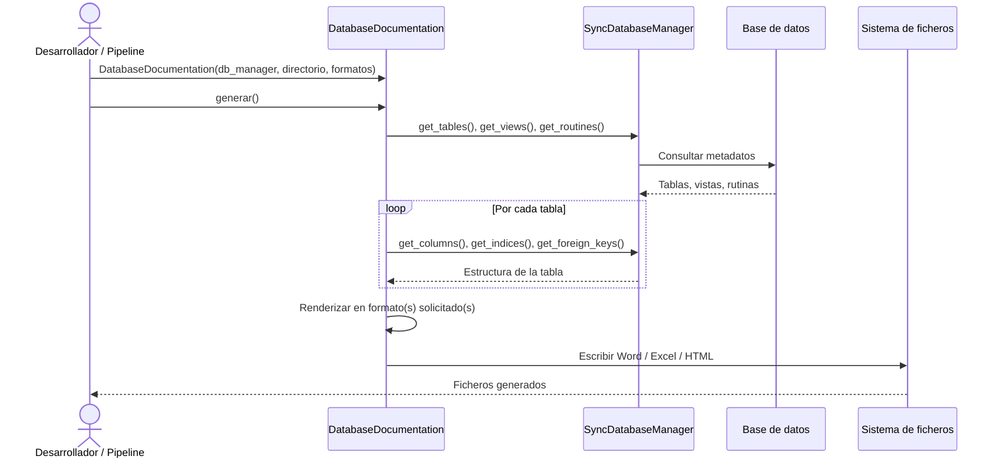

## Objetivo de negocio

Automatiza la generación de documentación técnica de bases de datos en múltiples formatos (Word, Excel, HTML) a partir de una conexión activa, sin que el usuario tenga que escribir SQL ni conocer el esquema de antemano. El resultado es un documento listo para compartir con equipos de arquitectura, auditoría o soporte.

Soporta MariaDB, Oracle, PostgreSQL y HSQLDB. Puede generar grafos de relaciones entre tablas y dividir la salida en varios ficheros Word cuando el esquema es muy grande.

## Precondiciones

- Instancia de `SyncDatabaseManager` ya inicializada y con conexión activa
- Permisos de lectura sobre los metadatos del esquema (tablas del sistema, vistas de catálogo)
- Directorio de salida accesible con permisos de escritura
- Para grafos: librería `graphviz` instalada (binario en PATH) y `cairosvg` si se quiere SVG
- Para Word: `python-docx` instalado; para Excel: `openpyxl`; para HTML: `Jinja2`

## Flujo principal del usuario

## Reglas de negocio críticas

| Regla | Descripción | Impacto si se viola |
|---|---|---|
| Delegación de metadatos | `DatabaseDocumentation` no consulta BD directamente; toda la introspección la hace el `SyncDatabaseManager` proporcionado | Si el manager no está inicializado o la conexión cae, la generación falla en la primera consulta de metadatos |
| Auto-naming de ficheros | Si `fichero_salida` es `None`, el nombre se genera automáticamente con timestamp y clave de base de datos | Ejecuciones concurrentes con el mismo directorio y base de datos pueden solapar ficheros (ventana de 90 s) |
| Tablas por documento Word | Por defecto se generan 50 tablas por documento; esquemas grandes producen varios ficheros numerados | Cambiar `tablas_por_documento` a un valor muy alto puede generar documentos Word que superen el límite de memoria de Word |
| Formatos opcionales | Solo se generan los formatos indicados en `formatos`; por defecto puede variar entre versiones | Especificar siempre la lista explícita para resultados reproducibles |
| Grafos: profundidad máxima | `grafo.max_depth` controla cuántos niveles de relaciones se muestran en el grafo | Valores > 3 en esquemas con muchas FK generan grafos ilegibles o fallos de memoria en Graphviz |

## Límites y exclusiones

- Solo lectura: no modifica el esquema ni los datos de la base de datos
- No soporta modo async: requiere `SyncDatabaseManager`, no `AsyncDatabaseManager`
- No compara esquemas entre dos bases de datos distintas: eso corresponde al módulo de comparación
- No valida el contenido del documento generado: la calidad depende de los metadatos presentes en el motor
- Los grafos requieren `graphviz` instalado como ejecutable del sistema (no solo la librería Python)
