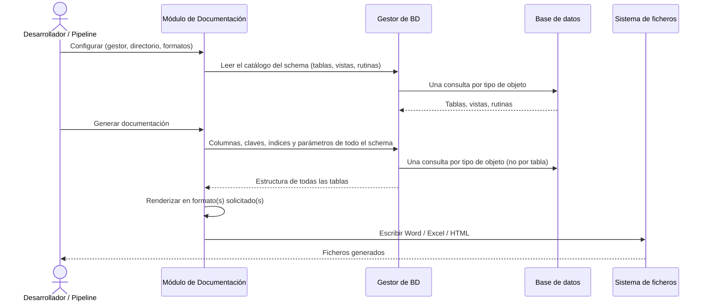

# Generación de Documentación de Base de Datos

## 1. Descripción General

Automatiza la generación de documentación técnica de bases de datos en múltiples formatos (Word, Excel, HTML y, desde 5.3.0, Markdown) a partir de una conexión activa, sin que el usuario tenga que escribir SQL ni conocer el esquema de antemano. El resultado es un documento listo para compartir con equipos de arquitectura, auditoría o soporte.

Soporta MariaDB, MySQL, Oracle, PostgreSQL, SQLite, SQL Server y HSQLDB. Puede generar diagramas de relaciones mediante Graphviz y dividir la salida Word en varios ficheros cuando el esquema es grande.

La salida **Markdown** está pensada para tres usos:

- **Publicarla** como sitio con Zensical o MkDocs, también sin Internet.
- **Versionarla** con git: la salida es idéntica para el mismo esquema y se puede comparar con la generación anterior.
- **Que una IA la interprete** y la trace con el código y con la documentación funcional y técnica: ids estables,
  `catalog.json`, `llms.txt` y mapa de trazabilidad.

Sus diagramas entidad-relación son de Mermaid y no necesitan Graphviz. Guía:
[Documentación Markdown](../guides/markdown_documentation_guide.md).

**Precondiciones:**

- Instancia del gestor síncrono de BD ya inicializada y con conexión activa
- Permisos de lectura sobre los metadatos del esquema, vistas de catálogo y DDL
- Directorio de salida accesible con permisos de escritura
- Dependencias de documentación (`openpyxl`, `python-docx`, `jinja2`): incluidas en la instalación base
- Para grafos en Word y HTML: Graphviz disponible cuando se activen diagramas de relaciones (el Markdown no lo necesita)
- Formatos válidos: `word`, `excel`, `html`, `markdown` (alias `md`)

## 2. Reglas de Negocio

| Regla | Descripción | Impacto si se viola |
|---|---|---|
| Delegación de metadatos | El módulo no consulta BD directamente; toda la introspección la hace el gestor proporcionado | Si el gestor no está inicializado o la conexión cae, la generación falla en la primera consulta |
| Inicialización sin generación | El constructor solo valida la configuración (no consulta la base de datos); el catálogo se lee y los ficheros se escriben al llamar a `generate()`, que devuelve un `DocumentationResult` con la ruta de cada formato y los recuentos | Si se omite `generate()`, no se crea ninguna salida documental |
| Formatos normalizados | Solo acepta `word`, `excel`, `html` y `markdown` (o `md`); elimina duplicados y rechaza valores no soportados | Un formato inválido detiene la ejecución con error de validación |
| Auto-naming de ficheros | Si no se especifica nombre de fichero, se genera automáticamente con identificador de BD y timestamp, uno por generación; con `batch_window_seconds` > 0 (por defecto 0 desde 5.0.0), las generaciones seguidas dentro de la ventana reutilizan la misma carpeta | Para versionar el Markdown con git, usar un `fichero_salida` fijo |
| Markdown: un fichero por objeto | Una página por tabla, vista y rutina, con las secciones de Word, índices por letra y orden alfabético | Pensado para esquemas de cientos de tablas; no hay modo «varias tablas por fichero» |
| Markdown: salida determinista | Para el mismo esquema y las mismas opciones, `docs/` es idéntico byte a byte; la fecha solo va en `manifest.json` | Permite revisar los cambios con git y compararlos con la generación anterior |
| Markdown: regeneración segura | Se escribe en una carpeta temporal y se publica al terminar; al regenerar se borran solo los ficheros generados que ya no se producen y que nadie ha modificado | Una cancelación o un error dejan la versión anterior intacta; la documentación propia del usuario en la carpeta se conserva |
| Markdown: texto del catálogo no confiable | Nombres y comentarios se escapan (HTML, Markdown y Mermaid) antes de publicarse | Un comentario con HTML no se ejecuta en el sitio publicado |
| Markdown: profundidad de diagramas | La profundidad es `grafo.max_depth` con el tope `markdown.max_diagram_depth` (2); si recorta, la página lo avisa y las relaciones completas siguen en la sección de FK y en el front matter | Diagramas legibles y rápidos de dibujar también en esquemas grandes |
| Mapa de trazabilidad estricto | Un campo o una sección desconocidos en el mapa son error, con todos los errores juntos | Una errata (`requirement`) no deja la traza vacía sin aviso |
| Cambios entre generaciones | Se comparan los catálogos de dos generaciones del mismo motor; si cambia el schema o la selección de objetos, se avisa | Un motor distinto es error: los tipos no son comparables |
| Tablas por documento Word | Por defecto se generan 50 tablas por documento (`imprimir["tablas_por_documento"]`); esquemas grandes producen varios ficheros numerados | Valores muy altos pueden generar documentos Word difíciles de abrir |
| Grafos: profundidad máxima | La profundidad máxima de relaciones en los grafos controla la complejidad visual | Valores superiores a 3 en esquemas con muchas FK generan grafos ilegibles |
| Secciones bajo demanda | Cada sección (tablas, vistas, rutinas, información de la BD, almacenamiento, condiciones del motor) se pide expresamente en `imprimir`; nada se incluye por defecto | Sin configuración, el documento solo lleva el título y el resumen de inventario |
| Condiciones del motor | La sección final «Condiciones del motor» muestra si la configuración de conexión y del servidor es adecuada para cargas masivas; se verifica una vez por generación y un fallo de la verificación no detiene la documentación | Sin conexión al servidor solo se revisa la configuración de conexión; la sección lo indica con un aviso |

## 3. Casos de Uso

### Flujo principal

### Flujos alternativos

**Esquema grande con Word:** Cuando el número de tablas supera el límite configurado, se generan automáticamente múltiples ficheros Word numerados.

**Generación con grafos:** Si Graphviz está disponible y se habilita la opción de diagramas de relaciones, el módulo genera un grafo por tabla y los embebe en la salida Word o HTML. Los diagramas se renderizan por lotes en paralelo (`grafo.workers`), y cada formato produce lo mismo pida o no los demás.

**Documentación Markdown para publicar:** con `formatos=["markdown"]` se genera la carpeta `MARKDOWN` con un
`mkdocs.yml` listo para `zensical build`. Con `markdown.mermaid_js` (un `mermaid.min.js` local), el sitio dibuja los
diagramas sin Internet; con `markdown.mermaid_js_ref` (desde 5.4.0) lo referencia sin copiarlo en cada generación.

**Trazabilidad con código y documentos:** con `markdown.trace_map`, un fichero TOML o JSON que relaciona tablas y
columnas con código, documentos funcionales y técnicos y requisitos, cada página lleva su sección «Trazabilidad», y
`traceability.md` muestra la cobertura, qué cubre cada requisito y cada fichero de código, y las entradas del mapa
que ya no corresponden a ningún objeto.

**Cambios respecto de la generación anterior:** con `markdown.previous` se añaden `changes.md` (para personas) y
`changes.json` (formato `util_bbdd.schema_diff`), comparando los catálogos sin conectarse a la base de datos.

**Mismo formato en todos los motores:** columnas (campo, tipo declarado, nulo, por defecto, generación —identidad o
columna calculada—, comentario), claves foráneas (con `ON DELETE`/`ON UPDATE`), restricciones únicas e índices se
presentan con las mismas cabeceras sea cual sea el motor; la hoja y la página «Todas las tablas y columnas» marcan en
todos ellos si cada columna es PK, FK y en qué índices está.

**Límites y exclusiones:**

- Solo lectura: no modifica el esquema ni los datos de la base de datos
- No soporta modo async: requiere el gestor síncrono de BD
- No compara esquemas entre dos bases de datos vivas (eso es `SchemaComparator`); el Markdown solo compara con una
  generación anterior de la documentación
- No valida el contenido del documento generado: la calidad depende de los metadatos presentes en el motor
- No genera documentación mediante APIs externas

## 4. Criterios de Aceptación

Derivados de los tests de la generación de documentación.

| ID | Dado | Cuando | Entonces |
|---|---|---|---|
| AC-01 | Una configuración válida | Se crea el generador | Se valida sin leer la base de datos |
| AC-02 | Un formato no soportado (`pdf`), `formatos` como texto, una plantilla o fichero de cabeceras inexistente o un `batch_window_seconds` negativo o no entero | Se crea el generador | Se rechaza con un error de configuración (que también es `ValueError`) |
| AC-03 | Una plantilla de Word inexistente y solo el formato HTML | Se crea el generador | Se acepta: la plantilla solo se exige si se pide Word |
| AC-04 | Los formatos Word, Excel y HTML | Se llama a `generate()` | Se escribe cada formato en su carpeta, el resultado indica dónde y cuántas tablas, vistas y rutinas se documentaron, y el catálogo se lee una vez para todos |
| AC-05 | Una base SQLite con dos tablas, dos vistas y una clave foránea | Se genera en los tres formatos | El Excel, el Word y el HTML contienen las tablas, columnas, índices y la regla de la clave foránea |
| AC-06 | Una base SQLite con tablas, FK, una vista y un nombre de tabla con HTML | Se genera en Markdown | Hay una página por objeto con front matter, anclas por columna, diagrama Mermaid con la opcionalidad de cada FK, `manifest.json`; el HTML del nombre aparece escapado (`test_doc_markdown_e2e.py`) |
| AC-07 | El mismo esquema | Se genera dos veces en Markdown | `docs/` es idéntico byte a byte (`test_output_is_byte_identical_between_generations`) |
| AC-08 | Una generación anterior en la misma carpeta, una tabla eliminada y un fichero del usuario | Se regenera | Desaparece la página de la tabla y el fichero del usuario se conserva; un fichero generado y modificado tampoco se borra (`test_regeneration_removes_orphans_and_keeps_foreign_files`, `test_modified_orphan_is_kept`) |
| AC-09 | Una cancelación a mitad de la generación Markdown | Se cancela | La carpeta queda como estaba y no quedan temporales (`test_cancel_keeps_previous_version`) |
| AC-10 | Sin el paquete `graphviz` | Se genera en Markdown con diagramas | Los diagramas se generan igual (`test_diagrams_without_graphviz`) |
| AC-11 | Un mapa de trazabilidad con campos desconocidos | Se crea el generador | Error de configuración con todos los errores y sin escribir nada (`test_doc_markdown_trace.py`) |
| AC-12 | Una generación anterior y cambios de columnas, índices, tablas y vistas | Se genera con `previous` | `changes.md` y `changes.json` (legible con `SchemaDiff.from_dict`) recogen los cambios; con otro motor, error (`test_doc_markdown_changes.py`) |
| AC-13 | La salida Markdown con `mkdocs.yml`, trazabilidad y cambios | Se ejecuta `zensical build --strict` | Termina sin incidencias (tests `integration`) |

## 5. Glosario y Términos

| Término | Definición |
|---|---|
| `generate()` | Método que desencadena la escritura real de los ficheros de documentación al sistema de archivos |
| Auto-naming | Generación automática del nombre de fichero usando el identificador de la BD y un timestamp cuando no se especifica nombre manualmente |
| Batching | Agrupación automática de generaciones seguidas en la misma carpeta de salida cuando se lanzan dentro de una ventana temporal (`batch_window_seconds`) |
| `batch_window_seconds` | Ventana temporal en segundos durante la cual se reutiliza el nombre generado automáticamente. Default 0 (sin agrupar) desde 5.0.0; hasta 4.x, 90 s |
| Front matter | Bloque de datos al principio de cada página Markdown (una línea JSON entre `---`): id estable, PK, FK, hash y trazas |
| `catalog.json` | Catálogo máquina-legible de los objetos documentados en Markdown; contrato versionado (ADR-006) |
| `llms.txt` | Índice para modelos de lenguaje (formato de llmstxt.org); `llms-full.txt` reúne todas las páginas |
| Mapa de trazabilidad | Fichero TOML o JSON que relaciona objetos y columnas con código, documentos y requisitos (`markdown.trace_map`) |
| Generación anterior | Carpeta Markdown de una ejecución previa con cuyo `catalog.json` se comparan los cambios (`markdown.previous`) |
| Logging DEBUG de cache | Trazas en nivel `DEBUG` que muestran cuándo se usa cache (📦 reutilizado) o se genera un nuevo nombre (✨ nuevo); útil para debugging |
| Tablas por documento | Número máximo de tablas incluidas en un solo fichero Word antes de crear un nuevo fichero numerado |
