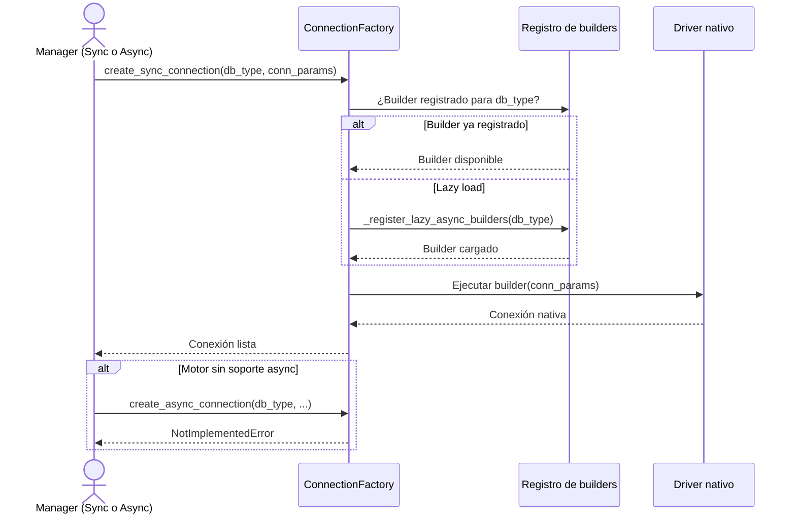

## Objetivo de negocio

Oculta la complejidad de seleccionar y cargar el driver correcto para cada motor de base de datos. El resto de la librería solicita una conexión indicando solo el tipo de motor y los parámetros; `ConnectionFactory` resuelve qué driver usar, cómo inicializarlo y si el motor soporta conexiones asíncronas.

Esto permite que los managers y otros componentes sean independientes del driver concreto: cambiar de `psycopg2` a `asyncpg` para PostgreSQL, por ejemplo, no afecta al código que usa el manager.

## Precondiciones

- Driver Python instalado para el motor objetivo (`psycopg2`, `asyncpg`, `cx_Oracle`, `pyodbc`, `aiomysql`, etc.)
- Tipo de motor reconocido por `util_bbdd`: MariaDB, MySQL, PostgreSQL, Oracle, SQL Server, SQLite, Snowflake, Redshift o HSQLDB
- Parámetros de conexión completos según el motor (host, port, database, user, password y cualquier parámetro driver-específico)

## Flujo principal del usuario

## Reglas de negocio críticas

| Regla | Descripción | Impacto si se viola |
|---|---|---|
| Lazy loading de builders | Los builders async se cargan bajo demanda la primera vez que se solicita el motor | Si el driver no está instalado, el error aparece en la primera petición, no al importar la librería |
| Registro extensible | Nuevos motores se añaden con `register_async_connection(db_type, builder)` sin modificar la factory | Sin registrar el builder, el motor no estará disponible para conexiones async |
| Normalización del tipo de motor | `db_type` se convierte a minúsculas y se elimina espacio antes de buscar el builder | Usar `"PostgreSQL"` y `"postgresql"` como clave produce el mismo resultado |
| `NotImplementedError` para async no soportado | Si el motor no tiene soporte async declarado, se lanza `NotImplementedError` | Los managers async capturan este error y caen a conexión directa sync |

## Límites y exclusiones

- No gestiona el ciclo de vida de la conexión (apertura, cierre, pool): eso lo hace `_manager_lifecycle`
- No valida las credenciales: la validación ocurre cuando el driver intenta conectar
- No cachea conexiones: cada llamada crea una conexión nueva
- No configura parámetros de pool: la configuración del pool es responsabilidad del manager que lo solicita
