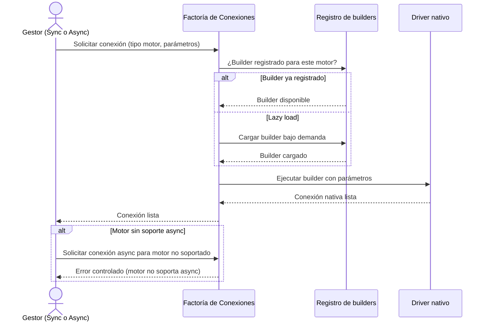

# Selección de Driver de Conexión

## 1. Descripción General

Oculta la complejidad de seleccionar y cargar el driver correcto para cada motor de base de datos. El resto de la librería solicita una conexión indicando solo el tipo de motor y los parámetros; la factoría resuelve qué driver usar, cómo inicializarlo y si el motor soporta conexiones asíncronas.

Esto permite que los gestores y otros componentes sean independientes del driver concreto: usar `psycopg` (sync) o `asyncpg` (async) para PostgreSQL, o `mariadb` para MariaDB y `pymysql` para MySQL, no afecta al código que usa el gestor.

**Precondiciones:**

- Driver Python instalado para el motor objetivo (`psycopg`, `asyncpg`, `oracledb`, `pymssql`/`pyodbc`, `mariadb` para MariaDB, `pymysql` para MySQL, `aiomysql` para ambos en async, `jaydebeapi` para HSQLDB, etc.)
- Tipo de motor reconocido: MariaDB, MySQL, PostgreSQL, Oracle, SQL Server, SQLite o HSQLDB
- Parámetros de conexión completos según el motor (host, port, database, user, password y cualquier parámetro driver-específico)

## 2. Reglas de Negocio

| Regla | Descripción | Impacto si se viola |
|---|---|---|
| Lazy loading de builders | Los builders async se cargan bajo demanda la primera vez que se solicita el motor | Si el driver no está instalado, el error aparece en la primera petición, no al importar la librería |
| Registro extensible | Nuevos motores se añaden mediante registro sin modificar la factoría | Sin registrar el builder, el motor no estará disponible para conexiones async |
| Normalización del tipo de motor | El tipo de motor se convierte a minúsculas antes de buscar el builder | Usar `"PostgreSQL"` y `"postgresql"` produce el mismo resultado |
| Error controlado para async no soportado | Si el motor no tiene soporte async (HSQLDB), se indica con `NotImplementedError` | El gestor async no se puede usar con ese motor: hay que usar el gestor síncrono |

## 3. Casos de Uso

### Flujo principal

### Flujos alternativos

**Motor async no soportado:** Cuando el gestor asíncrono solicita una conexión para un motor sin soporte async (HSQLDB), `init()` falla con `NotImplementedError`; no hay caída a una conexión síncrona.

**Límites y exclusiones:**

- No gestiona el ciclo de vida de la conexión (apertura, cierre, pool): eso lo hace el gestor
- No valida las credenciales: la validación ocurre cuando el driver intenta conectar
- No cachea conexiones: cada llamada crea una conexión nueva
- No configura parámetros de pool: la configuración del pool es responsabilidad del gestor

## 4. Glosario y Términos

| Término | Definición |
|---|---|
| Builder | Función registrada en la factoría que sabe cómo instanciar la conexión nativa de un motor específico |
| Lazy loading | Técnica de cargar el driver del motor solo cuando se solicita por primera vez, no al iniciar la librería |
| Driver nativo | Librería Python que implementa el protocolo de comunicación específico del motor de base de datos (`psycopg`, `oracledb`, `mariadb`, `pymysql`, etc.) |
