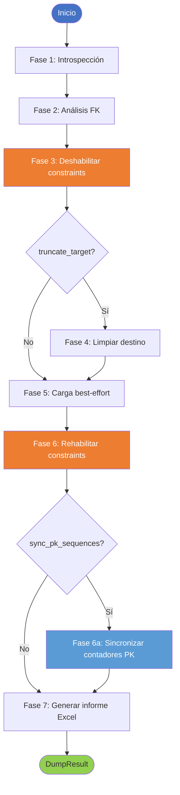

# Volcado de Datos entre Esquemas

## Objetivo de negocio

`DumpOrchestrator` copia todos los datos de un esquema/base de datos origen a un esquema/base de datos destino, respetando automáticamente el orden de carga impuesto por las claves foráneas, gestionando constraints por motor y generando un informe Excel de auditoría al finalizar.

Casos de uso típicos:

- Refrescar un entorno de pruebas con datos de producción (PostgreSQL → PostgreSQL)
- Migrar datos durante un cambio de motor (Oracle → SQL Server)
- Sincronizar un esquema de réplica o analítica (MariaDB → PostgreSQL)
- Restaurar un subconjunto de tablas desde un backup en vivo

---

## Precondiciones

| Requisito | Detalle |
|---|---|
| Engines activos | Ambos engines SQLAlchemy deben poder conectarse antes de llamar a `run()` |
| Esquemas existentes | Las tablas destino deben existir (el módulo no aplica DDL, solo datos) |
| Permisos de lectura | El usuario origen necesita SELECT sobre todas las tablas a volcar |
| Permisos de escritura | El usuario destino necesita INSERT, DELETE/TRUNCATE y permisos de constraint management |
| Python 3.12+ | Requerido por `util_bbdd` |

---

## Flujo de las 7 fases

### Fase 1 — Introspección

Introspección de origen y destino mediante SQLAlchemy `Inspector`, limitada a lo imprescindible para la carga: nombres de tablas, columnas y claves foráneas del origen.

El volcado **no** ejecuta una comparación de esquemas (`SchemaComparator`). Las columnas presentes en origen y ausentes en destino se detectan durante la carga (`TableDumpResult.skipped_columns`, ver Fase 5) y alimentan directamente la hoja «Columnas Inexistentes» del informe. De este modo se evita la cascada N+1 de introspección de índices, FKs de destino, comentarios y vistas que no intervienen en el volcado de datos y que penalizaba el tiempo total frente a una inserción directa.

### Fase 2 — Análisis topológico

Se detectan las dependencias de clave foránea entre las tablas a volcar. El orden de carga se calcula con el **algoritmo de Kahn** (topological sort):

- Las tablas sin dependencias se cargan primero.
- Las tablas con dependencias circulares (ciclos FK) se detectan y se cargan **al final**, marcadas como `in_cycle=True` en el resultado.
- Las tablas del origen que no existen en el destino se excluyen de la carga y se reportan como `missing_target`.

### Fase 3 — Desactivación de constraints

Antes de la carga, las constraints del destino se desactivan para evitar violaciones de integridad durante la inserción masiva. El método varía por motor:

| Motor | Estrategia |
|---|---|
| **SQL Server** | `ALTER TABLE t NOCHECK CONSTRAINT ALL` (catalog-level, persiste entre conexiones) |
| **MariaDB/MySQL** | `event.listen(engine, "connect", SET FOREIGN_KEY_CHECKS=0)` + `dispose()` del pool (cross-connection safe) |
| **PostgreSQL** | `ALTER TABLE t DISABLE TRIGGER ALL` (catalog-level, requiere OWNER o SUPERUSER) |
| **Oracle** | `DISABLE CONSTRAINT` por constraint individual; filtra automáticamente constraints de sistema (`SYS_C%`) |
| **Otros motores** | No-op con advertencia en el log |

### Fase 4 — Limpieza del destino

Si `truncate_target=True` (por defecto), las tablas destino se vacían antes de la carga, en **orden inverso al topológico** para respetar FKs.

| Motor | SQL usado | Motivo |
|---|---|---|
| **SQL Server** | `TRUNCATE TABLE tabla` (tablas sin FK entrantes) / `DELETE FROM tabla` (tablas referenciadas) | TRUNCATE se rechaza cuando otra tabla tiene una FK apuntando a la tabla, aunque esté en NOCHECK. El volcado detecta las FK entrantes al esquema destino y aplica `TRUNCATE` donde es posible, `DELETE` solo donde es obligatorio. |
| **Todos los demás** | `TRUNCATE TABLE tabla` | Más rápido, no genera log de transacción |

### Fase 5 — Carga best-effort

Las tablas se cargan en el orden topológico calculado. Para cada tabla:

1. Se calculan las **columnas comunes** (intersección case-insensitive entre origen y destino).
2. Se leen los datos en chunks (`chunk_size`, por defecto 5 000 filas).
3. Todos los chunks de una tabla se insertan **dentro de una única transacción** (`bulk_session(atomic=True)`): si cualquier chunk falla, la tabla completa hace rollback.
4. Si una tabla falla, se registra el error y **se continúa** con la siguiente (best-effort).

Las tablas sin columnas comunes se marcan como `skipped` sin lanzar error.

### Fase 6 — Rehabilitación de constraints

Al salir del contexto `ConstraintManager` (incluso si se lanzó una excepción durante la carga), las constraints se reactivan. Si una constraint no puede reactivarse (p.ej., datos que infringen la restricción), se registra como `failed` en el informe sin detener el proceso.

### Fase 6a — Resincronización de contadores PK *(si `sync_pk_sequences=True`)*

Tras la rehabilitación de constraints, los contadores internos de PK (sequences, IDENTITY, AUTO_INCREMENT) del destino se actualizan para que coincidan con el `MAX` real de cada columna cargada. Esto es necesario cuando los datos se insertaron con PKs explícitas (el caso habitual en volcados de datos).

| Motor | Operación ejecutada |
|---|---|
| **PostgreSQL** | `SELECT setval(pg_get_serial_sequence(tabla, col), MAX(col), true)` |
| **SQL Server** | `DBCC CHECKIDENT (tabla, RESEED, MAX(col))` |
| **MariaDB/MySQL** | `ALTER TABLE tabla AUTO_INCREMENT = MAX(col) + 1` |
| **Oracle ≥ 12c** | `ALTER SEQUENCE seq RESTART START WITH MAX(col) + 1` (sequence localizada via `ALL_TAB_IDENTITY_COLS`) |
| **Oracle < 12c** | `status="unsupported"` — patrón trigger+sequence sin metadata declarativa |

Los resultados quedan en `DumpResult.pk_sync_results`. Los errores de permisos se capturan como `status="error"` sin interrumpir el volcado. Desactivar con `DumpConfig.sync_pk_sequences=False` si se gestiona la resincronización manualmente.

---

## Reglas de negocio

- **Solo datos, nunca DDL.** Si una tabla existe en origen pero no en destino, se informa como `missing_target` y se omite.
- **Columnas faltantes se saltan.** Si una columna existe en origen pero no en destino, se omite de la SELECT y se informa como columna omitida (`skipped_columns`).
- **Columnas adicionales en destino se ignoran.** Solo se mapean columnas presentes en ambos extremos.
- **La comparación de nombres de tabla es case-insensitive.** Necesario para interoperabilidad entre motores: PostgreSQL devuelve `orders` (lowercase), MariaDB puede devolver `ORDERS` (uppercase). Ambos se reconocen como la misma tabla. Si dos tablas del destino colisionan al normalizar el case, se emite un `WARNING` y se usa el primer nombre encontrado.
- **La comparación de nombres de columna es case-insensitive.** Necesario para interoperabilidad Oracle (UPPERCASE) ↔ PostgreSQL (lowercase). El `INSERT` usa siempre el nombre canónico del motor destino.
- **Los errores de tabla no detienen el volcado.** Cada tabla es independiente; se registra el error y se continúa.
- **`enable_all()` siempre se ejecuta.** El `ConstraintManager` actúa como context manager y garantiza la rehabilitación aunque la carga falle.
- **El informe Excel se genera siempre**, incluso si hubo errores parciales.

---

## Límites y exclusiones

| Límite | Detalle |
|---|---|
| No aplica DDL | Si la tabla no existe en destino, no se crea automáticamente |
| Resincronización de secuencias/identidades | Soportada para PostgreSQL, SQL Server, MariaDB y Oracle ≥ 12c (Fase 6a). Oracle < 12c (trigger+sequence): sin soporte automático. Desactivar con `sync_pk_sequences=False` si se gestiona manualmente. |
| Sin transacción global | Cada tabla se inserta en su propia transacción (`bulk_session`); no hay rollback global entre tablas |
| Semántica table-atomic | Dentro de cada tabla, todos los chunks son atómicos: un error en cualquier chunk hace rollback de toda la tabla |
| Constraint management solo en 4 motores | SQL Server, MariaDB, PostgreSQL, Oracle. Otros: no-op con warning |
| El informe Excel usa openpyxl | Requiere la dependencia `openpyxl` instalada |
| `truncate_target=False` (modo append) | Puede generar duplicados si los datos ya existen en destino |
| MariaDB/MySQL — pool recomendado | El engine destino MariaDB debe crearse con `pool_pre_ping=True` y `pool_recycle=3600` para evitar `Server has gone away`. `SyncDatabaseManager.get_sqlalchemy_engine()` los incluye por defecto. |
| MariaDB/MySQL — `max_allowed_packet` | Tablas con columnas `TEXT`/`BLOB`/`JSON` extensas requieren `chunk_size` reducido (≤ 500) o aumentar `max_allowed_packet` en el servidor. |
| `collect_row_counts=False` | Deshabilita los `COUNT(*)` sobre origen y destino por tabla. Los campos de volumetría en el informe Excel muestran `—`. Útil en volcados de alto volumen (Snowflake, Oracle sin estadísticas actualizadas). |

---

## Auditoría en bulk.audit

Cuando `DumpConfig.bulk_audit_path` apunta a un fichero CSV de `util_bbdd.bulk.audit`, el volcado integra dos niveles de auditoría:

| Nivel | Qué registra | Dónde se consulta |
|---|---|---|
| **Por lote INSERT** | Tabla, motor, filas, tiempo por chunk | CSV en `bulk_audit_path`; también en `DumpResult.audit_summary` |
| **Por tabla** | Estado, filas origen/destino, columnas omitidas, errores | `DumpResult.table_results` + informe Excel |

Al terminar el volcado, `DumpResult.audit_summary` contiene las métricas agregadas del CSV filtradas al rango temporal del volcado (lotes INSERT realizados desde que comenzó `run()`). Si `bulk_audit_path` es `None` o el CSV no tiene entradas del volcado actual, `audit_summary` es `None`.

El CSV de `bulk.audit` puede acumular operaciones de múltiples volcados y otras operaciones bulk. El filtrado temporal garantiza que `audit_summary` solo refleja este volcado concreto.

---

## Informe Excel de auditoría

El volcado genera automáticamente un fichero `.xlsx` en `output_dir` con tres hojas:

### Hoja 1 — Auditoría Tablas

| Columna | Contenido |
|---|---|
| Tabla | Nombre de la tabla |
| Posición Carga | Orden topológico asignado |
| FK Circular | `Sí` si la tabla pertenece a un ciclo FK |
| Filas Origen | COUNT(*) en origen antes de la carga |
| Filas Destino Antes | COUNT(*) en destino antes de la carga |
| Filas Destino Después | COUNT(*) en destino tras la carga |
| Estado | `SUCCESS`, `ERROR`, `SKIPPED`, `MISSING_TARGET` |
| Columnas Omitidas | Columnas presentes en origen pero ausentes en destino |
| Error | Mensaje de error si aplica |

Al pie de la hoja se añade una sección con constraints que no pudieron rehabilitarse (`failed` o `unverified`).

### Hoja 2 — Tablas Faltantes

Lista de tablas presentes en el origen que no existen en el destino. Incluye el motivo y la acción sugerida (crear la tabla en destino con el DDL del origen).

### Hoja 3 — Columnas Inexistentes

Lista de columnas presentes en el origen pero ausentes en el destino, agrupadas por tabla.

---

## Ver también

- [API Técnica — Volcado de Datos](../api/dump.md)
- [Ejemplo ejecutable — Volcado PostgreSQL → SQL Server](../examples/dump_data_export.md)
- [Comparador de Esquemas](schema-comparison.md) — para analizar diferencias antes de volcar
