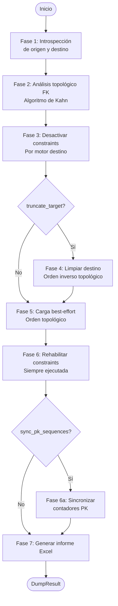

# Volcado de Datos entre Esquemas

## 1. Descripción General

Copia todos los datos de un esquema/base de datos origen a un esquema/base de datos destino, respetando automáticamente el orden de carga impuesto por las claves foráneas, gestionando constraints por motor y generando un informe Excel de auditoría al finalizar.

Casos de uso típicos: refrescar un entorno de pruebas con datos de producción; migrar datos durante un cambio de motor (Oracle → SQL Server); sincronizar un esquema de réplica o analítica; restaurar un subconjunto de tablas desde un backup en vivo.

La carga sigue 7 fases automáticas: introspección → análisis topológico FK → desactivación de constraints → limpieza del destino (opcional) → carga best-effort en orden topológico → rehabilitación de constraints → generación de informe Excel.

**Precondiciones:**

| Requisito | Detalle |
|---|---|
| Engines activos | Ambos engines SQLAlchemy deben poder conectarse antes de iniciar el volcado |
| Esquemas existentes | Las tablas destino deben existir (el módulo no aplica DDL, solo datos) |
| Permisos de lectura | El usuario origen necesita SELECT sobre todas las tablas a volcar |
| Permisos de escritura | El usuario destino necesita INSERT, DELETE/TRUNCATE y permisos de gestión de constraints |
| Python 3.12+ | Requerido por `util_bbdd` |

## 2. Reglas de Negocio

| Regla | Descripción | Impacto si se viola |
|---|---|---|
| Solo datos, nunca DDL | Si una tabla existe en origen pero no en destino, se informa como `missing_target` y se omite | La tabla no se crea automáticamente en destino |
| Columnas faltantes se saltan | Si una columna existe en origen pero no en destino, se omite de la SELECT y se informa | No hay error; la columna se registra como omitida en el informe |
| Comparación case-insensitive | Nombres de tabla y columna se comparan sin distinguir mayúsculas/minúsculas entre motores | Necesario para interoperabilidad entre motores (PostgreSQL lowercase ↔ Oracle UPPERCASE) |
| Errores de tabla no detienen el volcado | Cada tabla es independiente; se registra el error y se continúa con la siguiente | Carga best-effort; validar integridad post-volcado |
| Rehabilitación de constraints siempre se ejecuta | El gestor de constraints actúa como context manager y garantiza el intento de rehabilitación aunque la carga falle | Las constraints que no se puedan rehabilitar (p. ej. por filas huérfanas) salen en el informe; un fallo general al reactivarlas queda como ERROR en el log |
| Informe Excel siempre se genera | Se genera independientemente de si hubo errores parciales | El informe refleja el estado real de cada tabla, incluidos los errores |

## 3. Casos de Uso

### Flujo principal

### Flujos alternativos

**Tablas con ciclos FK:** Cuando dos o más tablas tienen claves foráneas circulares, el algoritmo las detecta, las carga al final sin garantía de orden (con constraints desactivadas) y las registra en el informe con indicador de ciclo FK.

**Volcado en modo append:** Con `truncate_target=False` (valor por defecto desde 5.0.0), los datos se insertan sin limpiar el destino primero. Puede generar duplicados si los registros ya existen.

**Palancas de rendimiento opcionales:** Cuatro opciones opt-in permiten acelerar el volcado en escenarios de alto volumen: cadencia de commit, gestión de índices, paralelismo por tabla y paralelismo por rangos PK. Todas están desactivadas por defecto.

| Palanca | Parámetro | Efecto | Contrapartida |
|---|---|---|---|
| Cadencia de commit | `commit_every_n_chunks=N` | Commit cada N lotes; acota el undo log | La carga de la tabla deja de ser atómica |
| Gestión de índices | `manage_indexes=True` | Deshabilita índices secundarios no únicos durante la carga | DROP+recreate en PostgreSQL y MySQL/MariaDB InnoDB (destructivo; el DDL se loguea antes de borrar) |
| Paralelismo por tabla | `max_parallel_tables=N` | Carga tablas independientes en paralelo | Solo dentro del mismo nivel topológico FK |
| Paralelismo por rangos PK | `parallel_pk_ranges=N` o `"auto"` | Particiona una tabla con PK entera en N rangos; con `"auto"` (v3.0.0) solo donde las mediciones dicen que gana (hoy, destino SQL Server desde 3,5M filas) | Requiere destino sin triggers per-fila |

**Límites y exclusiones:**

- Sin transacción global: cada tabla se inserta en su propia transacción
- Resincronización de secuencias/identidades: PostgreSQL, SQL Server, MariaDB, MySQL y Oracle ≥ 12c (en SQLite y HSQLDB queda como `unsupported`)
- Gestión de constraints en SQL Server, MariaDB, MySQL, PostgreSQL y Oracle; en SQLite y HSQLDB se carga sin desactivarlas (WARNING)
- Gestión de índices (`manage_indexes`) en SQL Server, Oracle, PostgreSQL y, desde v3.2.0, MySQL/MariaDB (InnoDB sin los índices que necesita una FK); desde v3.3.0, `manage_indexes="all"` también desactiva índices únicos y PK/UNIQUE (solo para datos ya validados, con `truncate_target=True`)
- Comprobación de filas huérfanas tras reactivar `FOREIGN_KEY_CHECKS` en MySQL/MariaDB (`validate_fks_after`, v3.3.0; activada por defecto desde v3.4.0)
- Paralelismo por rangos PK solo para tablas con PK de una única columna entera
- El informe Excel usa `openpyxl` (dependencia de la librería, incluida en la instalación base)

## 4. Criterios de Aceptación

Derivados de los tests del módulo de volcado.

| ID | Dado | Cuando | Entonces |
|---|---|---|---|
| AC-01 | Una tabla existe en origen pero no en destino | Se ejecuta el volcado | La tabla queda como `missing_target` en el resultado y en el informe; no se crea en destino |
| AC-02 | Una columna existe en origen pero no en destino | Se vuelca su tabla | La columna se omite de la carga y aparece como omitida en el informe |
| AC-03 | Origen con nombres en mayúsculas (Oracle) y destino en minúsculas (PostgreSQL) | Se emparejan las columnas | Se emparejan sin distinguir mayúsculas y se insertan con el nombre del destino |
| AC-04 | Dos tablas se referencian entre sí (ciclo FK) | Se ejecuta el volcado | Se cargan todas las tablas y las del ciclo quedan marcadas como tales en el resultado |
| AC-05 | La carga de una tabla falla (p. ej. supera `max_rejects`) | Se ejecuta el volcado | Esa tabla queda en `error` con el mensaje del fallo y el resto de tablas se cargan igualmente |
| AC-06 | `on_error="isolate"` y el destino ya tiene filas con la misma clave, sin `truncate_target` | Se vuelca la tabla | Las filas duplicadas van al CSV de rechazos, se cuentan en el resultado y la tabla termina en `success` |
| AC-07 | La reactivación de constraints falla al terminar la carga | Termina el volcado | El resultado recoge el error de reactivación y la ejecución queda como fallida en la auditoría |
| AC-08 | Falla el resumen de auditoría del volcado | Termina el volcado | El informe Excel se genera igualmente, sin el resumen de auditoría |

## 5. Glosario y Términos

| Término | Definición |
|---|---|
| Algoritmo de Kahn | Algoritmo de ordenamiento topológico que determina el orden de carga de tablas respetando las dependencias de clave foránea |
| Ciclo FK | Situación donde dos o más tablas tienen claves foráneas que se apuntan mutuamente, imposibilitando un orden de carga lineal |
| Carga best-effort | Estrategia donde un error en una tabla no detiene el volcado; las demás tablas se cargan igualmente |
| `truncate_target` | Opción que indica si las tablas destino deben vaciarse antes de la inserción de nuevos datos |
| `sync_pk_sequences` | Opción que actualiza los contadores de PK del destino (sequences, IDENTITY, AUTO_INCREMENT) tras la carga de datos con PKs explícitas |
